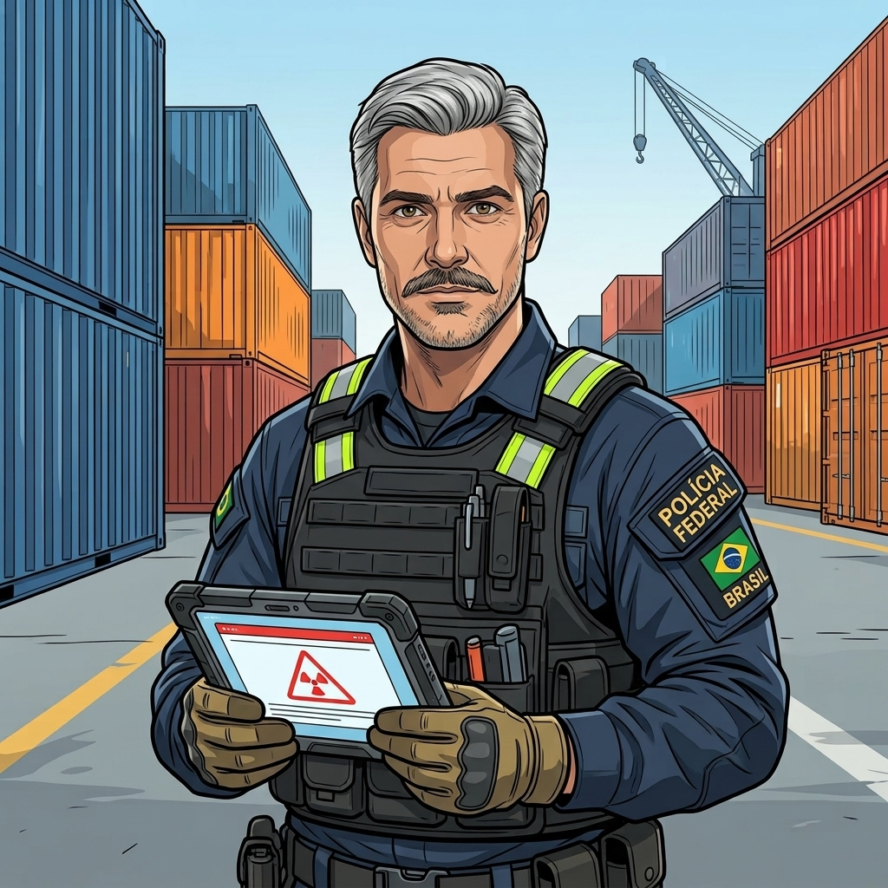
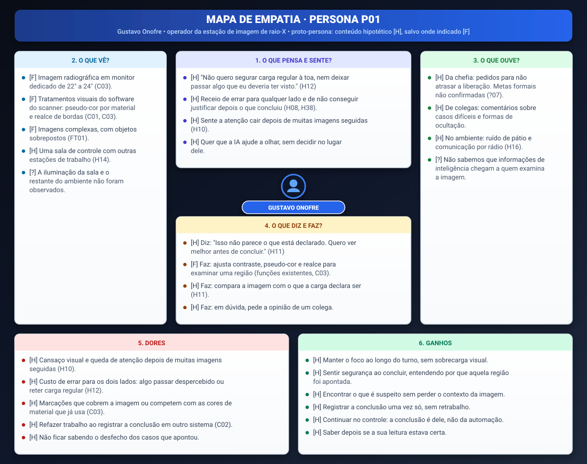

# Entrega 3 — Personas, mapa de empatia, contexto de uso e jornada

**Data:** 04/09/2026 (versão original)  
**Revisão:** 06/10/2026, aplicação do [feedback do professor](../feedbacks_professor/Feedback_Professor_Entrega03_Equipe09.md)  
**Status:** 🟦 revisada após feedback  
**Responsabilidade:** 1 persona por integrante; 1 mapa de empatia, 1 contexto de uso consolidado e 1 jornada por equipe (salvo orientação diferente do docente).

## Objetivo da atividade

Representar grupos de usuários de forma útil para decisões de design. Persona não é personagem decorativo: suas características devem alterar requisitos, prioridades, linguagem, fluxos ou critérios de avaliação.

## Atenção a projetos técnicos

Em TCCs sem interface original, a persona pode representar um **profissional que se apropria da contribuição técnica**: DBA, analista, cientista de dados, administrador, pesquisador, técnico, operador, gestor ou especialista de domínio.

Não escolha um perfil apenas porque “parece combinar” com a tecnologia. Explique **qual objetivo esse perfil teria e qual parte da contribuição do TCC produziria valor para ele**. Se ainda for hipótese, mantenha como hipótese/proto-persona a validar.

Também considere papéis diferentes quando houver tarefas distintas, por exemplo:

- operador que executa análises;
- administrador que configura e gerencia permissões;
- especialista que interpreta resultados;
- gestor que consulta relatórios e decide;
- auditor que revisa histórico.

## Entradas da Entrega 1

Antes de criar personas, retome os tipos de usuários, características relevantes, objetivos e hipóteses registradas na Entrega 1. A persona **não deve transformar uma hipótese inicial em fato por meio de uma história fictícia**.

| Item da Entrega 1 | Status inicial | Evidência disponível agora | Como será tratado nesta entrega |
|---|---|---|---|
| **Perfil: operador da estação de imagem (H01)** | [H01] Hipótese reformulada | [F] C01 e C03 mostram que os produtos de mercado têm uma estação operada por alguém que examina a imagem. Não mostram quem é essa pessoa no Brasil. [F] Em ao menos uma unidade, é um operador designado pelo recinto alfandegado, que comunica suspeitas à RFB e não decide sobre a carga (Portaria ALF/FNS nº 9/2024, arts. 3º e 8º). [F] Em Santos, matérias de A Tribuna de 2013 e 2015 dizem que as imagens são analisadas por servidores da Receita em uma central de vigilância, na sede da Alfândega. São matérias de jornal antigas, e não se sabe se segue assim (fontes na Entrega 4, CP02). | Base de P01 como proto-persona, que pode representar um operador do recinto ou um servidor da vigilância da RFB. A autoridade para liberar ou reter não é atribuída a P01: depende de H39. |
| **Divisão entre quem examina a imagem e quem decide (H39)** | [H39] Hipótese aberta | [F] C02: o despacho tem distribuição para auditor e exigência fiscal, e o Manual de Despacho atribui o desembaraço ao Auditor-Fiscal. [F] A norma nacional manda transmitir as imagens em tempo real à RFB (Portaria RFB nº 143/2022, art. 14) e prevê software de análise em estações de trabalho da RFB (ADE Coana nº 19/2014). [F] Em ao menos uma unidade, o recinto comunica a suspeita e a carga fica retida até a manifestação da RFB (Portaria ALF/FNS nº 9/2024, art. 8º). [?] Falta saber que cargo da RFB analisa as imagens. | Base de P02 como proto-persona. A fronteira entre P01 e P02 é a primeira questão da Entrega 7. |
| **Fadiga visual e plantão noturno (H10, H13)** | [H10], [H13] Hipóteses | [F] C03: o fabricante justifica monitores de 22" a 24" pela redução de fadiga ocular. É texto de fabricante, não observação de usuários. H13 é cenário exploratório da Entrega 1. | Dor hipotética de P01. Não fundamenta, por si, tema escuro nem outra solução. |
| **Sala de controle em recinto alfandegado (H14, H16)** | [H14] parcialmente sustentada, [H16] aberta | [F] C03: estação dedicada em sistema de alto tráfego. Iluminação, penumbra e ruído não têm evidência. | Entram no contexto de uso como hipótese e lacuna. |
| **Estação com monitor dedicado (H15)** | [H15] parcialmente sustentada | [F] C03: monitor dedicado de 22" a 24". Não há evidência de múltiplos monitores. | Restrição plausível para P01. Não define proporção de tela nem painéis. |
| **Comparação visual e explicação (H05, H30, H31, H37)** | Hipóteses parcialmente sustentadas | [F] C01 mostra comparação entre imagens e destaque de regiões. C03 mostra pseudo-cor por material. Nenhuma mostra a preferência dos operadores nem rejeição a métricas numéricas. | Necessidade de P01: entender onde a IA apontou discrepância. A forma (lado a lado, sobreposição, opacidade) é alternativa a testar. |
| **Registro motivado e responsabilidade (H06, H08, H17, H18, H19)** | [H18] sustentada documentalmente; as demais abertas ou parciais | [F] C02: a decisão aduaneira é um ato formal, com motivo e prazo, vinculado a um auditor responsável. | Necessidade de P02. Quem registra o quê depende de H39. |
| **Quatro canais aduaneiros (H24 revisada)** | [H24] Revisada na Entrega 2 | [F] C02: verde, amarelo, vermelho e cinza são classificação normativa do despacho, com critérios fiscais e documentais. | Entra como vocabulário que P01 e P02 conhecem. Não é usada para representar o resultado da IA (RC05, ?08). |
| **Perfil: Analista de Inteligência Aduaneira (H02)** | [H02] Hipótese aberta | Sem evidência nova. | Não vira persona nesta entrega. |
| **Perfil: agente de campo (H03, H42)** | [H03] aberta; [H42] nova | [F] C02: o canal vermelho prevê verificação física da mercadoria. Não há evidência de que quem a executa use a solução. A Entrega 1 (H03) supunha que não usaria. | P03 fica como proto-persona a validar, possível stakeholder. |

---

## 1. Personas

### Classificação do elenco

A classificação segue o papel de cada persona no design, e não a frequência de uso. Persona primária é a que precisa de uma interface própria, porque não seria bem atendida pela interface desenhada para outra.

| Persona | Classificação | Justificativa |
|---|---|---|
| P01, Gustavo Onofre | primária | [H01] Examina a imagem radiográfica, que é onde a contribuição do TCC atua. A interface de análise é desenhada para ela. [F] Em ao menos uma unidade da RFB, o escâner é operado por operadores designados pelo recinto alfandegado, e as imagens seguem em tempo real para a RFB (Portaria ALF/FNS nº 9/2024). [F] Em Santos, segundo matérias de jornal de 2013 e 2015, as imagens são analisadas por servidores da vigilância da RFB em uma central (fontes na Entrega 4, CP02). [?] Não sabemos se quem examina a imagem com atenção é o operador do recinto, um servidor da RFB ou ambos, nem se isso varia por unidade. |
| P02, Dr. Eduardo Resende | primária | [F] O Auditor-Fiscal é o responsável pelo desembaraço, e o despacho tem distribuição para auditor e exigência fiscal (C02 da Entrega 2). [H39] Se a decisão formal couber a ele, precisa de um fluxo próprio, de conferir a evidência com a declaração e formalizar o ato, que a interface de análise de P01 não atende. |
| P03, Marcos Oliveira | proto-persona a validar | [H42] Não está demonstrado que o agente de campo interage com a solução. Ele pode receber a ordem por outro sistema, verbalmente ou por documento, pertencer a outro órgão ou não precisar de interface nova. Até H42 ser investigada, P03 é tratado como possível stakeholder do fluxo, fica fora do recorte principal e não justifica uma interface móvel. |

[H39] Se a investigação mostrar que P01 e P02 são a mesma pessoa ou funções da mesma carreira, as duas personas serão fundidas ou redefinidas.

### Persona P01 — Gustavo Onofre (operador da estação de imagem de raio-X)

**Autor(a):** Kawan Mark Geronimo Da Silva — 22.222.010-5  
**Tipo:** primária (ver Classificação do elenco)  
**Base de evidências:** [F] Análise das estações de imagem de mercado na Entrega 2 (Rapiscan InSight, C01, e Smiths Detection, C03). [F] Normas da RFB sobre inspeção não invasiva, listadas em Referências. [F] Resumo do artigo base do TCC (Gaikwad et al., 2025). Nenhum operador foi entrevistado ou observado. Por isso P01 é uma **proto-persona**.  
**Hipóteses relacionadas:** H01, H04, H05, H10, H11, H16, H34, H37, H38, H39, H41 e a lacuna ?07

A ficha usa as mesmas marcas de P02: **[F]** sustentado por fonte, **[H]** hipótese de perfil ainda não investigada, **[?]** lacuna, e **ficcional** para detalhe de identidade que não embasa decisão de design.

| Campo | Descrição |
|---|---|
| **Nome** | Gustavo Onofre (ficcional) |
| **Faixa etária / contexto relevante** | Ficcional: 46 anos. [H] Escolhas da proto-persona, sem base investigada: cerca de 12 anos na área, 7 deles com inspeção por escâner, e trabalho em turnos que incluem a noite. [?] Regime de escala desconhecido. |
| **Ocupação/papel** | [H01] Opera a estação de imagem: examina a radiografia de cada contêiner e produz um apontamento sobre o que encontrou. [F] Em ao menos uma unidade, quem opera o escâner é um operador designado pelo recinto alfandegado, que comunica suspeitas à RFB (Portaria ALF/FNS nº 9/2024, arts. 3º e 8º). [F] Em Santos, matérias de 2013 e 2015 dizem que as imagens são analisadas por servidores da Receita em uma central de vigilância (fontes na Entrega 4, CP02). [?] Não sabemos qual dos dois arranjos Gustavo representa. [H39] A decisão de liberar, exigir ou reter a carga não é atribuída a ele. |
| **Conhecimento do domínio** | [H] Alto conhecimento prático de leitura de radiografias de carga: densidades, estruturas típicas do contêiner e formas conhecidas de ocultação. [F] Os softwares de estação oferecem pseudo-cor por material, realce de contornos, zoom, brilho e contraste (C03; ADE Coana nº 19/2014). [H] Conhece o vocabulário aduaneiro e os canais de parametrização (H24). |
| **Experiência tecnológica** | [H] Média a alta com softwares de estação de escâner. [F] Esses softwares existem e são operados por alguém (C01, C03). [H] Pouca familiaridade com termos de aprendizado de máquina (H37). |
| **Objetivos práticos** | 1. [H38] Chegar, a cada contêiner, a uma conclusão em que confie. 2. [H] Verificar se o que a imagem mostra é compatível com a carga declarada (H11). 3. [H] Registrar o que concluiu de forma que possa ser defendida depois (H06). |
| **Objetivos de experiência** | 1. [H] Manter a concentração ao longo do turno. 2. [H] Confiar que não deixou passar algo que deveria ter visto. 3. [H] Sentir que a conclusão é dele, e não da automação. 4. [H] Saber depois se a sua leitura estava certa. |
| **Necessidades** | 1. [H] Saber onde olhar em uma imagem densa (H10, H34). 2. [H] Entender onde e por que a IA apontou discrepância, sem perder a imagem original nem as cores de material que já usa (RC02, RC09). 3. [H] Ter à mão o que a carga declara ser (H11). 4. [H] Registrar o resultado sem refazer o trabalho em outro sistema (H06). 5. [H] Saber por onde começar, se a ordem de exame for decisão dele (H04, H41). |
| **Dores/frustrações** | 1. [H] Cansaço visual e queda de atenção depois de muitas imagens seguidas (H10). [F] O fabricante justifica monitores de 22" a 24" pela redução de fadiga ocular (C03), o que é texto de fabricante. 2. [H] Receio de errar para os dois lados: algo passar despercebido ou uma carga regular ficar retida (H12). 3. [H] Registrar a conclusão em um sistema diferente daquele onde examina a imagem. [F] A decisão com valor jurídico é registrada no Siscomex (C02). 4. [H] Não ficar sabendo o desfecho dos casos que apontou. |
| **Motivadores** | 1. [H] Concluir cada análise com segurança. 2. [H] Ver um apontamento seu se confirmar na verificação física. 3. [H] Contar com apoio para a varredura da imagem sem perder a palavra sobre a conclusão. [?07] Não sabemos se existem metas de liberação por turno. |
| **Restrições/acessibilidade** | 1. [H] Escolha da proto-persona: cansaço ocular recorrente e início de presbiopia. 2. Informação crítica com redundância além da cor, por princípio de acessibilidade (RC11). 3. [?] Iluminação da sala desconhecida (H16). |
| **Ambiente típico de uso** | [F] Sala de operação do escâner, de acesso restrito (Portaria ALF/FNS nº 9/2024, art. 3º). [F] Estação com monitor dedicado de 22" a 24" (C03). [H] Ruído de pátio e interrupções (H16). [?] Se a sala é mantida em penumbra. |
| **Comportamentos relevantes** | [F] Ajusta zoom, contraste, pseudo-cor e realce para examinar uma região, funções que os softwares oferecem (C03; ADE Coana nº 19/2014). [H] Usa atalhos de teclado para isso. [H] Em dúvida, pede a opinião de um colega antes de concluir. |

**Implicações de P01 para o design (alternativas a investigar, não requisitos):**

- [H] Tema claro ou escuro, conforme a iluminação real da sala (H16).
- [H] Prioridade visual da radiografia na tela (RC10). Proporção da imagem e posição de dados e ações são alternativas de layout.
- [H] Camada de IA distinguível dos tratamentos radiográficos e que não oculte a imagem (RC09). Lado a lado, sobreposição, opacidade ajustável e alternância são alternativas a comparar (H30).
- [H] Ordem de exame por nível de anomalia (RC06), só se Gustavo decidir o que examinar primeiro (H41). O canal aduaneiro não representa o resultado da IA (RC05).
- Informação crítica com texto ou padrão redundante à cor (RC11).
- [H] Registro do resultado com motivo e vinculado a quem o produziu (RC04). Número de passos e justificativas pré-escritas são alternativas a testar.

Nenhuma dessas alternativas avança antes de se investigar H01, H04 e H39: sem saber quem examina a imagem, se existe uma fila e o que o registro significa, não há como definir a interface de P01.

---

### Persona P02 — Dr. Eduardo Resende (Auditor-Fiscal da Receita Federal)

**Autor(a):** Gabriel Albertini Pinheiro — 22.122.094-8  
**Tipo:** primária (ver Classificação do elenco)  
**Base de evidências:** [F] Análise do Portal Único Siscomex e do Manual de Despacho de Importação na Entrega 2 (C02): etapas do despacho, distribuição para auditor, canais de parametrização, exigência fiscal e responsabilidade do Auditor-Fiscal pelo desembaraço. [F] Normas da RFB sobre inspeção não invasiva, listadas em Referências. Nenhum Auditor-Fiscal foi entrevistado ou observado. Por isso P02 é uma **proto-persona**.  
**Hipóteses relacionadas:** H06, H08, H11, H17, H18, H19, H24 (revisada), H29, H32, H39 e a lacuna ?08

**Como ler esta ficha.** Cada afirmação traz sua base:

- **[F]** sustentada por fonte: a análise C02 da Entrega 2 ou as normas listadas em Referências;
- **[H]** hipótese plausível de perfil, ainda não investigada com usuários;
- **[?]** lacuna, algo que a equipe não sabe;
- **ficcional** detalhe de identidade criado só para tornar o personagem memorável. Não embasa decisão de design.

| Campo | Descrição |
|---|---|
| **Nome** | Dr. Eduardo Resende (ficcional) |
| **Faixa etária / contexto relevante** | Ficcional: 52 anos. [H] Escolhas da proto-persona, sem base investigada: carreira longa, em torno de 20 anos, e formação em Direito. [H] Atua na conferência aduaneira de uma unidade portuária. |
| **Ocupação/papel** | [F] Auditor-Fiscal da Receita Federal. O Manual de Despacho de Importação atribui a ele a responsabilidade pelo desembaraço, e o despacho tem as etapas de distribuição para auditor e de exigência fiscal (C02). [H39] Recebe o apontamento de quem examina a imagem e decide sobre exigência, verificação física ou desembaraço. [F] Em ao menos uma unidade, quem opera o escâner é um operador do recinto, que comunica a suspeita à RFB, e a carga fica retida até a manifestação da RFB (Portaria ALF/FNS nº 9/2024, arts. 3º e 8º). [F] A norma nacional prevê software de análise de imagem em estações de trabalho da RFB (ADE Coana nº 19/2014). [?] Não sabemos que cargo da RFB examina as imagens, nem se P02 as examina pessoalmente ou recebe a análise de outro servidor (?08). |
| **Conhecimento do domínio** | [H] Alto em legislação aduaneira e no processo de despacho (DUIMP, DI, NCM, canais, exigência), por ser o conteúdo do cargo. [?] Familiaridade com leitura de imagens de raio-X desconhecida. |
| **Experiência tecnológica** | [F] Usa o Portal Único Siscomex, com acesso por certificado digital (C02). [H] Pouca familiaridade com termos de aprendizado de máquina. |
| **Objetivos práticos** | 1. [H] Decidir sobre os casos que recebe com base suficiente para sustentar a decisão. 2. [H] Verificar se o que a imagem indica é compatível com o que a declaração descreve (H11). 3. [F] Formalizar a decisão em ato com motivo e prazo, como a exigência fiscal (C02). |
| **Objetivos de experiência** | 1. [H] Sentir que controla a decisão e que a automação não substitui seu julgamento. 2. [H] Confiar que não deixou de ver informação relevante antes de decidir. 3. [H] Não se sentir inseguro quanto ao que assina. 4. [H] Entender por que um caso chegou até ele. |
| **Necessidades** | 1. [H] Ver a evidência da imagem junto dos dados da declaração (H11). 2. [H] Saber quem analisou a imagem e o que concluiu (H17, H39). 3. [F] Registrar a decisão com motivo, de forma rastreável (C02, H18). [H] O formato desse registro está aberto (H32). 4. [H] Consultar o que já aconteceu com o mesmo processo (H29). |
| **Dores/frustrações** | 1. [H] Alternar entre o sistema onde está a imagem e o Siscomex, onde a decisão tem valor jurídico. 2. [H] Receber um apontamento sem contexto documental, sem saber o que a carga declara ser. 3. [H] Decidir com base em uma evidência visual que não sabe interpretar sozinho. |
| **Motivadores** | 1. [H] Tomar decisões que se sustentem se forem questionadas. 2. [H] Concluir o despacho de cargas regulares sem retenção indevida. |
| **Restrições/acessibilidade** | 1. [F] Vocabulário normativo do despacho: DUIMP, canal, exigência, desembaraço, dossiê (C02, RC03). 2. [F] Autenticação por certificado digital no Portal Único (C02). 3. Informação crítica com redundância além da cor, por princípio de acessibilidade (RC11). 4. [?] Iluminação e demais condições do posto de trabalho desconhecidas. |
| **Ambiente típico de uso** | [H] Ambiente administrativo de unidade aduaneira. [?] Local exato, equipamento e número de monitores não foram investigados. |
| **Comportamentos relevantes** | [H] Confere a compatibilidade entre o que a imagem indica e a mercadoria declarada antes de decidir. [H] Consulta o histórico do importador. Este segundo ponto é escolha da proto-persona: [F] regularidade fiscal e habitualidade do importador são elementos da seleção do canal (C02), o que o torna plausível, mas não mostra que o auditor faz essa consulta. |

**Implicações de P02 para o design (alternativas a investigar, não requisitos):**

- [H] Reunir a evidência da imagem e os dados da declaração, ou facilitar a passagem entre eles (RC07, H11). Alternativas a comparar: visão conjunta, evidência anexada ao dossiê do Siscomex, resumo encaminhado.
- [H] Consultar o andamento do processo pelo identificador (RC08, H29).
- [H] Registrar o ato com motivo, destinatário e efeito, com correspondência aos atos que já existem no Siscomex (RC04, RC07). Modelos de texto e número de passos são alternativas a testar.
- [H] Vincular cada registro a quem o produziu (H17, H32).

Nenhuma dessas alternativas avança antes de se investigar H39 e ?08: sem saber quem decide e como o resultado da imagem chega ao processo formal, não há como definir a interface de P02.

---

### Persona P03 — Marcos Oliveira (agente que executa a verificação física)

**Autor(a):** Alexandre Domiciano Pierri — 22.125.061-6  
**Tipo:** proto-persona a validar, possível stakeholder (ver Classificação do elenco)  
**Base de evidências:** [F] O canal vermelho prevê verificação física da mercadoria (C02). [F] Em ao menos uma unidade, a carga sob suspeita fica retida e segregada até a manifestação da RFB (Portaria ALF/FNS nº 9/2024, art. 8º). [F] Em Santos, uma matéria de 2013 diz que a conferência física pode ser presencial ou remota (fonte na Entrega 4, CP02). Ninguém que executa a verificação física foi entrevistado ou observado, e não há evidência de que essa pessoa use a solução.  
**Hipóteses relacionadas:** H03, H42

A ficha usa as mesmas marcas de P02: **[F]**, **[H]**, **[?]** e **ficcional**. Ela descreve quem recebe o resultado da análise para agir no pátio. Enquanto H42 estiver aberta, Marcos é tratado como stakeholder do fluxo, e não como usuário.

| Campo | Descrição |
|---|---|
| **Nome** | Marcos Oliveira (ficcional) |
| **Faixa etária / contexto relevante** | Ficcional: 38 anos. [H] Escolha da proto-persona: cerca de 8 anos em verificação física de cargas em recinto alfandegado. |
| **Ocupação/papel** | [H] Executa a verificação física de contêineres encaminhados para conferência. [?] Não sabemos a que órgão ou cargo pertence quem faz esse trabalho, nem se é a mesma pessoa em todas as unidades. [H42] Não está demonstrado que ele interage com a solução: pode receber a ordem por outro sistema, verbalmente ou por documento. |
| **Conhecimento do domínio** | [H] Alto em procedimentos de conferência física, abertura de unidade de carga e registro de apreensão. [H] Não lê radiografias nem mapas residuais. |
| **Experiência tecnológica** | [?] Não sabemos que dispositivos ou sistemas ele usa no pátio. |
| **Objetivos práticos** | 1. [H] Saber qual contêiner verificar e por quê. 2. [H] Encontrar o contêiner antes que ele deixe o recinto. 3. [H] Ir à parte da carga que motivou a suspeita, em vez de revirar tudo. |
| **Objetivos de experiência** | 1. [H] Confiar que a ordem recebida é clara e veio de quem tem autoridade para dá-la. 2. [H] Não precisar interpretar uma imagem que não sabe ler. |
| **Necessidades** | 1. [H] Receber a indicação de qual contêiner verificar, sem ambiguidade. 2. [H] Saber em que região da carga está a suspeita, em linguagem que não exija ler a radiografia. 3. [H] Registrar o que encontrou, para que o resultado volte a quem decidiu e a quem analisou a imagem. |
| **Dores/frustrações** | 1. [H] Receber material técnico que não consegue interpretar. 2. [H] Procurar em toda a carga por falta de indicação de onde está a suspeita. 3. [H] Ordem que chega tarde ou incompleta. |
| **Motivadores** | 1. [H] Encontrar o que motivou a suspeita, quando existe. 2. [H] Concluir a verificação sem reter a carga além do necessário. |
| **Restrições/acessibilidade** | [H] Trabalho em área externa, sujeito a sol, chuva e ruído. [?] Uso de luvas e de equipamento de proteção não foi investigado. |
| **Ambiente típico de uso** | [H] Pátio de contêineres e área de conferência física do recinto alfandegado. [?] Nenhum ambiente foi observado. |
| **Comportamentos relevantes** | [H] Age a partir de uma ordem de outra pessoa. [?] Não sabemos quem dá essa ordem nem por que meio ela chega (H39, H42). |

**Implicações de P03 para o design (só se H42 for confirmada):**

Nenhuma interface para o agente de campo faz parte do recorte. Se a investigação da Entrega 7 mostrar que ele interage com a solução, estas alternativas passam a valer como hipóteses de design:

- [H] Um resumo do caso sem a radiografia: identificação do contêiner e do veículo, a existência de suspeita e quem a encaminhou. O canal aduaneiro, se aparecer, fica separado do resultado da IA (RC05).
- [H] A região da suspeita descrita em texto ou esquema simples, em vez de imagem.
- [H] Registro do que foi feito no pátio, vinculado ao histórico do caso (RC08).
- [H] Dispositivo móvel, aviso imediato e ação em um toque são alternativas de forma, a decidir só depois de conhecido o trabalho real.

Se H42 for refutada, P03 permanece como stakeholder: o que importa para o projeto é como o resultado registrado por P01 e a decisão de P02 chegam até ele.

---

### Síntese das personas

| Dimensão | Persona P01 — Gustavo Onofre | Persona P02 — Dr. Eduardo Resende | Persona P03 — Marcos Oliveira |
|---|---|---|---|
| **Autor(a)** | Kawan Mark Geronimo Da Silva | Gabriel Albertini Pinheiro | Alexandre Domiciano Pierri |
| **Papel no domínio** | [H01] Operador da estação de imagem de raio-X. [?] Operador do recinto ou servidor da RFB | [F] Auditor-Fiscal da Receita Federal, responsável pelo desembaraço (C02) | [H] Agente que executa a verificação física. [?] Órgão e cargo desconhecidos |
| **Tipo de persona** | **Primária** | **Primária** | **Proto-persona a validar** (possível stakeholder, H42) |
| **Dispositivo / Hardware** | [F] Estação com monitor dedicado de 22" a 24" (C03) | [?] Não investigado. [F] Acesso ao Portal Único com certificado digital (C02) | [?] Não investigado |
| **Ambiente de uso** | [F] Sala de operação do escâner, de acesso restrito. [?] Iluminação e ruído não observados (H16) | [H] Ambiente administrativo de unidade aduaneira | [H] Pátio e área de conferência física |
| **Frequência de interação** | [H] Contínua ao longo do turno (H04). [?] Volume real desconhecido | [H] Sob demanda, quando recebe um caso apontado (H39) | [H] Pontual, quando uma carga é encaminhada para verificação. [H42] Uso da solução não demonstrado |
| **Interação com a IA** | [H] Examina a radiografia e a região que o modelo apontou (H05) | [H] Usa o resultado da imagem como evidência, junto dos dados da declaração (H11, ?08) | [H] Receberia só a indicação de que há suspeita e onde, sem a radiografia |
| **Decisão central** | [H] Concluir se o que foi apontado é compatível com a carga declarada e registrar o resultado. Não decide sobre a carga (H39) | [F] Formalizar exigência, verificação física ou desembaraço (C02) | [H] Como conduzir a verificação física do contêiner indicado |
| **Principal impacto no design** | [H] Camada de IA que não oculte a imagem e registro do resultado com motivo. Formas a investigar | [H] Evidência da imagem reunida aos dados da declaração e registro com motivo. Formas a investigar | Nenhum no recorte enquanto H42 estiver aberta |

Cada afirmação da tabela traz `[F]`, `[H]` ou `[?]`, como nas fichas.

---

## 2. Mapa de empatia — equipe

**Persona escolhida:** Persona P01 — Gustavo Onofre  
**Justificativa:** Das duas personas primárias, P01 é a que examina a imagem, onde a contribuição do TCC atua. O mapa é o de uma proto-persona: o conteúdo é hipotético [H], salvo onde indicado [F].

| Dimensão | Conteúdo | Status/evidência |
|---|---|---|
| **O que pensa e sente?** | • [H] "Não quero segurar carga regular à toa, nem deixar passar algo que eu deveria ter visto." • [H] Receio de errar para qualquer lado e de não conseguir justificar depois o que concluiu. • [H] Sente a atenção cair depois de muitas imagens seguidas. • [H] Quer que a IA ajude a olhar, sem decidir no lugar dele. | [H08], [H10], [H12], [H38]. Nenhum usuário foi ouvido. |
| **O que vê?** | • [F] Imagem radiográfica em monitor dedicado de 22" a 24". • [F] Tratamentos visuais do software do scanner: pseudo-cor por material e realce de bordas. • [H] Imagens complexas, com objetos sobrepostos. • [H] Uma sala de controle com outras estações de trabalho. • [?] A iluminação da sala e o restante do ambiente não foram observados. | C01 e C03 da Entrega 2; [H10], [H14], [H15], [H16] |
| **O que ouve?** | • [H] Da chefia: pedidos para não atrasar a liberação. Metas formais não confirmadas. • [H] De colegas: comentários sobre casos difíceis e formas de ocultação. • [H] No ambiente: ruído de pátio e comunicação por rádio. • [?] Não sabemos que informações de inteligência chegam a quem examina a imagem. | [H16], [?07] |
| **O que diz e faz?** | • [H] Diz: "Isso não parece o que está declarado. Quero ver melhor antes de concluir." • [F] Faz: ajusta contraste, pseudo-cor e realce para examinar uma região, funções que os softwares atuais oferecem. • [H] Faz: compara a imagem com o que a carga declara ser. • [H] Faz: em dúvida, pede a opinião de um colega. | [H11]; C03 da Entrega 2 |
| **Dores** | • [H] Cansaço visual e queda de atenção depois de muitas imagens seguidas. • [H] Custo de errar para os dois lados: algo passar despercebido ou reter carga regular. • [H] Marcações que cobrem a imagem ou competem com as cores de material que já usa. • [H] Refazer trabalho ao registrar a conclusão em outro sistema. • [H] Não ficar sabendo o desfecho dos casos que apontou. | [H10], [H12]; C02 e C03 da Entrega 2 |
| **Ganhos** | • [H] Manter o foco ao longo do turno, sem sobrecarga visual. • [H] Sentir segurança ao concluir, entendendo por que aquela região foi apontada. • [H] Encontrar o que é suspeito sem perder o contexto da imagem. • [H] Registrar a conclusão uma vez só, sem retrabalho. • [H] Continuar no controle: a conclusão é dele, não da automação. • [H] Saber depois se a sua leitura estava certa. | [H34], [H38] |

O mapa descreve a pessoa, e não a solução. As soluções que poderiam atender a esses ganhos são alternativas de design e estão na Síntese, no nível 3.

---

## 3. Contexto de uso — consolidação

*(Consolidação das dimensões contextuais para toda a equipe. Cada dimensão separa o que tem fonte, o que é suposição e o que ainda não se sabe.)*

Nenhum ambiente de trabalho foi visitado e nenhum usuário foi ouvido. Os fatos vêm da documentação analisada na Entrega 2.

| Dimensão | [F] O que tem fonte | [H] O que supomos | [?] O que não sabemos | Implicação a considerar |
|---|---|---|---|---|
| **Usuários** | O Auditor-Fiscal é o responsável pelo desembaraço (C02). Os produtos de mercado têm uma estação de imagem operada por alguém (C01, C03). Em ao menos uma unidade, o escâner é operado por operadores designados pelo recinto alfandegado (Portaria ALF/FNS nº 9/2024). | Quem examina a imagem (P01) e quem decide (P02) são papéis distintos (H01, H39). O agente de campo (P03) usaria a solução (H42). | Quem examina as imagens em cada unidade: operador do recinto, como na norma de Imbituba, ou servidor da vigilância da RFB, como indicam matérias sobre Santos (Entrega 4, CP02). Se P03 tem acesso a algum sistema. | A interface de análise parte de P01. Nada é definido para P02 e P03 antes de H39 e H42. |
| **Tarefas** | O despacho tem as etapas de registro, parametrização, distribuição para auditor, exigência fiscal e desembaraço (C02). | Triagem contínua das imagens (H04), inspeção das regiões apontadas (H05), confronto com os dados declarados (H11) e registro do resultado (H06). | Tempo gasto por contêiner. Frequência de cada atividade (?02). Se existe uma fila e quem define a ordem (H41). | A Entrega 5 modela só as tarefas que a investigação sustentar. |
| **Equipamentos** | Estação de trabalho com monitor dedicado de 22" a 24" (C03). Acesso ao Portal Único por certificado digital (C02). O software do escâner deve oferecer zoom, inversão, realce de contornos, colorização por densidades, brilho, contraste e equalização, com licenças para estações de trabalho da RFB (ADE Coana nº 19/2014). | Uso de teclado e atalhos na estação de imagem. | Equipamento e número de monitores do Auditor-Fiscal. Se o agente de campo usa algum dispositivo. | A área útil de um monitor de 22" a 24" é a premissa de layout. Proporções e painéis são alternativas a testar. |
| **Ambiente físico** | Nenhum ambiente foi observado. Existe uma sala de operação do escâner, de acesso restrito (Portaria ALF/FNS nº 9/2024, art. 3º). | Sala de controle em recinto alfandegado (H14), com iluminação controlada, ruído de pátio e interrupções (H16). | Se a sala é mantida em penumbra. Nível de ruído. Como é o ambiente do Auditor-Fiscal. | Tema claro ou escuro e uso de som dependem dessa investigação. Não depender só de cor vale por princípio (RC11). |
| **Ambiente social/organizacional** | A decisão aduaneira é um ato formal, com motivo e prazo, e o processo é atribuído a um auditor responsável (C02). | Hierarquia rígida e responsabilidade legal sobre a decisão (H17). Pressão de tempo (H16). | Regime de turnos. Existência de metas de liberação (?07). Que consequências pessoais um erro traz. | O registro precisa identificar quem o produziu. O tom e os avisos da interface dependem do que for apurado sobre pressão e responsabilização. |
| **Papéis/permissões/governança** | O Auditor-Fiscal responde pelo desembaraço, e o canal pode ser redirecionado durante a análise fiscal (C02). Em ao menos uma unidade, o recinto comunica a suspeita à RFB, e a carga fica retida até a manifestação da RFB ou por 3 dias úteis (Portaria ALF/FNS nº 9/2024, art. 8º). | Quem examina a imagem produz um apontamento técnico, sem decidir (H39). | Quem pode liberar, reter ou homologar. Se o agente de campo recebe ordens pelo sistema (H42). Como o resultado da imagem entra no processo formal (?08). | Permissões só são definidas depois de H39. Canal aduaneiro e resultado da IA ficam separados (RC05). |
| **Volume de dados/histórico** | Sistemas pass-through são projetados para até 80 caminhões por hora, o que é capacidade do equipamento, não volume medido (C03). O despacho é acompanhado como linha do tempo até o comprovante de importação (C02). Em ao menos uma unidade, as imagens ficam disponíveis por 180 dias e arquivadas por mais 1 ano, com busca por unidade de carga, data, hora ou placa (Portaria ALF/FNS nº 9/2024, art. 5º). | É preciso manter histórico e rastreabilidade de cada análise (H18). | Volume real por unidade. Tamanho dos arquivos de imagem. Se o prazo de guarda é o mesmo em outras unidades. Formato da trilha de registro (H32). | Consulta ao histórico depende de tarefa demonstrada (?02). Desempenho de carregamento depende de ?05. |

---

## 4. Jornada do usuário — equipe

**Persona:** Persona P01 — Gustavo Onofre  
**Objetivo da jornada:** Chegar a uma conclusão confiável sobre um contêiner escaneado, com apoio do modelo de detecção de anomalias, e deixá-la registrada para quem decide.  
**Início e fim da jornada:** Começa quando a imagem de um contêiner passa a exigir análise, antes de qualquer contato com a interface, e termina quando Gustavo fica sabendo, ou não, o que aconteceu com a carga.

A jornada é a de uma proto-persona: tudo é hipótese [H], salvo onde indicado [F]. Ela descreve a experiência com apoio do modelo sem fixar telas nem componentes, e não usa os canais aduaneiros para descrever o resultado da IA (RC05, ?08). A coluna de oportunidade aponta o que precisa ser apoiado. Como apoiar fica para a prototipação.

| Fase | Etapa | Situação/ação | Objetivo | Pensamento/emoção | Dor | Oportunidade (o que apoiar) | Evidência |
|---|---|---|---|---|---|---|---|
| **Antes** | **1. O que dispara a necessidade** | [H] Um contêiner passa pelo scanner e sua imagem fica disponível para análise. Gustavo assume o posto e já há imagens aguardando. | Saber o que precisa ser examinado. | "Quantos tem hoje, e quais são os complicados?" *(Expectativa)* | [H] Não sabe de antemão quais casos merecem mais atenção. | Ajudar a decidir por onde começar, se essa decisão for dele. | H04, H41 |
| **Antes** | **2. Antes de abrir a imagem** | [H] Toma conhecimento do que a carga declara ser e das pendências deixadas por quem estava antes dele. | Chegar à imagem sabendo o que esperar. | "Se eu sei o que deveria estar lá dentro, vejo mais rápido o que não deveria." *(Preparação)* | [H] A informação sobre a carga e sobre casos pendentes está em lugares diferentes ou é passada de boca. | Ter o contexto do caso disponível antes da imagem. | H11 |
| **Durante** | **3. Chegada ao sistema** | [H] Abre o caso na estação de trabalho. [?] Não sabemos como se identifica nem como a imagem chega até ali. | Começar a análise sem perder tempo. | "Já terminou de processar ou ainda está analisando?" *(Impaciência)* | [H] Esperar sem saber se a análise automática terminou. | Deixar claro em que estado está a análise de cada imagem. | H26, H27, ?05 |
| **Durante** | **4. Exame da imagem** | [H] Examina a radiografia e a região que o modelo apontou, e compara com o que a carga declara ser. [F] Usa os tratamentos visuais que já conhece, como pseudo-cor por material e realce de bordas (C03). | Entender se o que foi apontado é mesmo incompatível com a carga. | "Isso é parte da carga ou tem algo escondido?" *(Tensão, dúvida)* | [H] Sobreposição de objetos e cansaço visual. [F] A estação já usa pseudo-cor por material (C03). [H] A marcação da IA pode competir com essas cores. | Mostrar onde e por que a IA apontou, sem esconder a imagem original. | H05, H10, H30, RC02, RC09 |
| **Durante** | **5. Conclusão e registro** | [H] Conclui e registra o resultado com a justificativa. [H39] O registro pode ser um apontamento para o Auditor-Fiscal ou a própria decisão. | Deixar a conclusão clara e defensável e encerrar o caso na estação. | "Se alguém me perguntar depois, consigo explicar por que concluí isso?" *(Receio de errar para qualquer lado)* | [H] Ter de registrar de novo em outro sistema. [F] A decisão com valor jurídico é registrada no Siscomex (C02). | Registro com motivo, aproveitável por quem decide, sem duplicar trabalho. | H06, H08, H12, RC04, RC07 |
| **Depois** | **6. O que acontece com a carga** | [F] O despacho segue no Siscomex, conduzido pelo Auditor-Fiscal: exigência fiscal, verificação física ou desembaraço (C02). [F] Em ao menos uma unidade, a suspeita é comunicada à RFB e a carga fica retida até a sua manifestação (Portaria ALF/FNS nº 9/2024, art. 8º). [?08] Não sabemos como isso se liga ao despacho da declaração. Gustavo já está no contêiner seguinte. | Confiar que o que registrou chegou a quem decide. | "Será que tinha mesmo alguma coisa ali?" *(Incerteza)* | [H] Não acompanha o que foi feito com o caso depois que saiu da sua estação. | Manter disponível o que foi registrado e para quem seguiu. | H18, H39, H42, ?08 |
| **Depois** | **7. Como percebe o resultado** | [H] Dias depois, a verificação física confirma ou não o que foi apontado. | Saber se sua leitura estava certa e quanto pode confiar na IA. | Satisfação quando o apontamento se confirma. Frustração quando era alarme falso. | [H] Sem retorno, o trabalho de hoje não melhora o de amanhã, e a confiança na IA não tem base. | Devolver o desfecho a quem analisou e permitir consultar casos anteriores. | H18, H34, H36 |

**Benefício esperado, ainda a validar:** localizar regiões suspeitas com menos esforço (H34) e reter menos cargas regulares (H36). Nenhum dos dois foi medido.

---

## Síntese

Quais necessidades e objetivos devem obrigatoriamente aparecer nos cenários e nas tarefas seguintes?

Esta entrega não fixa a interface. O que ela entrega às próximas está separado em três níveis.

**Nível 1. Necessidades e objetivos com sustentação.** Entram nos cenários de problema (Entrega 4) e na análise de tarefas (Entrega 5).

1. Entender onde e por que a IA apontou discrepância, sem perder a imagem original. Comparação e destaque de regiões são padrões observados (C01), e a imagem tem prioridade visual nas estações analisadas (C01, C03; RC01, RC02, RC10).
2. Usar o vocabulário do domínio aduaneiro e de inspeção (C01, C02, C03; RC03).
3. Registrar o resultado da análise com motivo e de forma rastreável a quem o produziu. A decisão aduaneira é um ato formal vinculado a um auditor responsável (C02; RC04, RC07; H18).
4. Manter o canal aduaneiro, que é classificação normativa, separado do resultado da IA (C02; RC05).
5. Não transmitir informação crítica só por cor (RC11).

**Nível 2. Hipóteses que as próximas entregas precisam investigar.** Não entram como requisito antes disso.

1. Quem opera a estação de imagem e quem decide e formaliza (H01, H39). Define se P01 e P02 continuam separadas. As normas consultadas indicam operador do recinto e decisão da RFB em ao menos uma unidade, mas não dizem quem examina as imagens na RFB. Em Santos, matérias de 2013 e 2015 indicam análise por servidores da vigilância da RFB (Entrega 4, CP02).
2. Se existe uma fila de imagens e se quem examina decide a ordem (H04, H41).
3. Quais informações da carga declarada são usadas junto da imagem e em que momento (H11).
4. Como o resultado da imagem entra no processo formal no Siscomex (?08).
5. Se o agente de campo interage com a solução (H42). Define se P03 é persona ou stakeholder.
6. Condições reais do ambiente: iluminação, ruído, turnos, número de monitores (H14, H15, H16).
7. O que o usuário considera uma análise bem feita e se há metas de liberação (H38, ?07).

**Nível 3. Alternativas de solução a prototipar e comparar.** Nenhuma está decidida.

| Alternativa | Necessidade que tentaria atender | Hipótese ligada |
|---|---|---|
| Lado a lado, sobreposição, opacidade ajustável ou alternância da camada de IA | Entender onde a IA apontou sem perder a imagem | H30, RC09 |
| Tema escuro ou claro | Conforto visual no ambiente real | H10, H16 |
| Proporção da tela dedicada à imagem e posição de dados e ações (painéis fixos, retráteis, faixa inferior) | Prioridade visual da imagem | H15, RC10 |
| Ordem de exame por nível de anomalia | Decidir por onde começar | H25, H33, H41, RC06 |
| Número de passos do registro e justificativas pré-escritas | Registrar sem retrabalho | H06, H07, RC04 |
| Dados da declaração junto da imagem, em painel, anexo ou resumo | Conferir a imagem com o que foi declarado | H11, RC07 |
| Aviso em dispositivo móvel para o agente de campo | Encaminhar a verificação física | H42. Só se P03 for confirmado como usuário |

Para a Entrega 4, os cenários de problema partem da situação atual, sem a solução. Para a Entrega 5, as tarefas são derivadas do trabalho que a investigação sustentar, e não de botões ou componentes.

---

## Referências

- BRASIL. Receita Federal. **Portaria RFB nº 143, de 11 de fevereiro de 2022**. Alfandegamento de locais e recintos. Art. 14, sobre equipamentos de inspeção não invasiva e transmissão das imagens à RFB.
- BRASIL. Receita Federal. Alfândega em Florianópolis. **Portaria ALF/FNS nº 9, de 22 de agosto de 2024**. Disciplina o uso dos equipamentos de inspeção não invasiva de cargas nos recintos jurisdicionados pela Inspetoria em Imbituba. É norma de uma unidade, não regra nacional.
- BRASIL. Receita Federal. Coordenação-Geral de Administração Aduaneira. **Ato Declaratório Executivo Coana nº 19, de 6 de outubro de 2014**. Requisitos técnicos e operacionais de equipamentos de inspeção não invasiva.
- BRASIL. Receita Federal. **Despacho de Importação: Parametrização (gerenciamento de riscos)**. Manual de Despacho de Importação. Referência completa na Entrega 2.
- GAIKWAD, B.; PATRA, A.; CRAWFORD, C. R.; MILLER, E. L. **Self-supervised anomaly detection and localization for X-ray cargo images: generalization to novel anomalies**. Engineering Applications of Artificial Intelligence, 2025. DOI 10.1016/j.engappai.2024.109675.

As fontes sobre a Alfândega do Porto de Santos (matérias de A Tribuna e Portaria ALF/STS nº 197/2025) estão nas Referências da Entrega 4.

As três normas foram lidas em 06/10/2026 na reprodução do site normasbrasil.com.br, e não no Diário Oficial da União. O Manual de Despacho foi lido na página oficial da Receita Federal.

---

## Checklist

- [x] Existe pelo menos uma persona por integrante (P01: Gustavo Onofre, P02: Dr. Eduardo Resende, P03: Marcos Oliveira).
- [x] As personas não são apenas diferenças demográficas superficiais (diferenciadas pelo papel: exame da imagem, decisão formal no despacho e verificação física).
- [x] Está claro o que é dado real e o que é hipótese/proto-persona.
- [x] A persona não “validou por ficção” uma hipótese da Entrega 1; afirmações continuam marcadas como hipótese quando não há evidência.
- [x] Objetivos e dores têm consequência para o design.
- [x] Contexto de uso está coerente com a Entrega 1 e com a análise de concorrência da Entrega 2.
- [x] Em TCC sem interface original, a persona possui relação explícita com a contribuição técnica (modelo de anomalia residual em raio-X).
- [x] Papéis administrativos, técnicos e decisórios só foram criados quando possuem objetivos/tarefas diferentes.
- [x] Jornada possui etapas, dores e oportunidades e não é apenas wireflow (sete etapas, cobrindo antes, durante e depois da interação).
- [x] IDs das personas foram mapeados para a rastreabilidade (seção 2.1 da matriz).

## Histórico de revisões

| Data | O que mudou | Motivo |
|---|---|---|
| 06/10/2026 | Classificação do elenco, ficha de P02, tabela de entradas, mapa de empatia, contexto de uso, jornada e síntese. | [Parecer do professor](../feedbacks_professor/Feedback_Professor_Entrega03_Equipe09.md), com o tratamento de cada item anotado no próprio parecer. |
| 12/10/2026 | Fichas de P01 e P03 reescritas com a marcação [F], [H], [?] e ficcional, e com as decisões de design convertidas em alternativas a investigar. Tabela de síntese das personas refeita. Indício sobre Santos acrescentado às entradas, à classificação e ao contexto. Marca da etapa 4 da jornada corrigida. As fichas de P01 e P03 foram reescritas por Gabriel e ficam sujeitas à conferência de Kawan e Alexandre. | Auditoria de coerência de 12/10/2026 (AC-001, AC-002, AC-003, AC-011, AC-014) e parecer do professor, correções 2, 3 e 4. |
