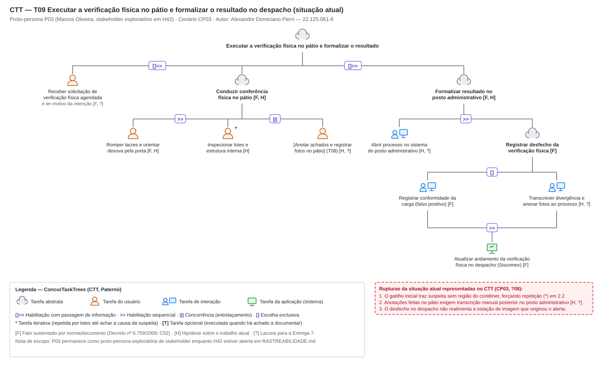

# Entrega 5 — Análise de tarefas: HTA, GOMS e CTT

**Data:** 22/10/2026  
**Status:** 🟩 concluída  
**Responsabilidade:** cada integrante modela pelo menos 1 HTA, 1 GOMS e 1 CTT. As três técnicas podem abordar a mesma funcionalidade ou funcionalidades distintas, conforme a orientação da disciplina.

## Objetivo da atividade

Modelar tarefas importantes sob perspectivas complementares: decomposição hierárquica (HTA), estrutura de metas/métodos/operações (GOMS) e relações temporais entre tarefas (CTT). O diagrama deve ser acompanhado de interpretação textual.

## Para projetos cujo TCC não previa interface

Modele **tarefas humanas relacionadas ao uso da contribuição técnica**, e não a implementação interna do algoritmo. Exemplos de boas tarefas para análise:

- investigar uma consulta de baixo desempenho;
- configurar uma análise e selecionar parâmetros;
- submeter um dataset e verificar sua validade;
- acompanhar uma execução demorada;
- comparar dois resultados/modelos;
- interpretar uma recomendação e decidir se a aceita;
- localizar uma execução anterior usando busca/filtros;
- gerar e compartilhar um relatório;
- administrar papéis/permissões quando isso for parte do trabalho real;
- revisar um alerta e registrar uma decisão.

Um CRUD pode gerar tarefas relevantes, mas “cadastrar usuário” só merece modelagem se tiver significado no domínio (papéis, validações, riscos, permissões, dependências).

## Seleção das tarefas

Cada integrante modela três tarefas, uma por técnica. A numeração segue a ordem dos autores na equipe, como nos cenários da Entrega 4: T01 a T03 para Kawan, T04 a T06 para Gabriel e T07 a T09 para Alexandre.

| ID | Tarefa | Persona/cenário de origem | Frequência/criticidade | Autor responsável |
|---|---|---|---|---|
| T01 | Inspecionar a imagem do contêiner e manifestar conclusão sobre a carga (HTA) | P01 / CP01 | [F] Contínua (fluxo de escaneamento na entrada do terminal, Portaria RFB nº 143/2022). [H] Alta criticidade: o erro pode liberar ilícito ou causar retenção injustificada (H12). | Kawan Mark Geronimo Da Silva |
| T02 | Examinar a imagem de um contêiner e concluir se há motivo para apontar suspeita (GOMS) | P01 / CP01, subobjetivo 2 de T01 | [H] Alta / Crítica: repete a cada contêiner (H05) e o erro tem custo nos dois sentidos (H12) | Kawan Mark Geronimo Da Silva |
| T03 | Comunicar e registrar a conclusão do exame da imagem (CTT) | P01 / CP01, subobjetivo 4 de T01 | [F] Ocorre a cada contêiner examinado. [F] O apontamento retém e segrega a carga por até 3 dias úteis perante a RFB (Portaria ALF/FNS nº 9/2024, art. 8º). | Kawan Mark Geronimo Da Silva |
| T04 | Decidir sobre uma carga bloqueada por suspeita na imagem do escâner (HTA) | P02 / CP02 | `[?]` Frequência desconhecida (CP02, Q9). `[H08]` Criticidade alta: o erro libera carga ilícita ou retém carga regular | Gabriel Albertini Pinheiro |
| T05 | Entender por que a carga foi bloqueada (GOMS) | P02 / CP02, subobjetivo 2 de T04 | Ocorre em todo caso de T04. `[H]` É onde o cenário mostra a maior perda de informação | Gabriel Albertini Pinheiro |
| T06 | Formalizar o ato sobre a carga bloqueada (CTT) | P02 / CP02, subobjetivo 5 de T04 | Ocorre em todo caso de T04. `[F]` O ato tem valor jurídico e é registrado no Siscomex (C02) | Gabriel Albertini Pinheiro |
| T07 | Localizar o contêiner, inspecionar fisicamente o conteúdo e registrar divergências no pátio (HTA) | P03 / CP03 | Média / Alta: crítica para o fechamento da fiscalização e cadeia de custódia da prova física | Alexandre Domiciano Pierri |
| T08 | Registrar ocorrência de divergência física em campo (GOMS) | P03 / CP03 | Média / Alta: registro de inconformidades e cadeia de custódia | Alexandre Domiciano Pierri |
| T09 | Execução e formalização da vistoria física no pátio (CTT) | P03 / CP03 | Média / Alta: sincronização entre campo e fiscalização | Alexandre Domiciano Pierri |

> Priorize tarefas necessárias para que o usuário alcance objetivos centrais. Não desperdice a modelagem em ações triviais isoladas, como “clicar em login”, se o objetivo relevante é maior. Da mesma forma, não modele o funcionamento interno do algoritmo como se fosse uma tarefa humana.

---

## Kawan — T01 a T03

As três tarefas partem do cenário de problema CP01 (Entrega 4) e da persona primária P01 (Gustavo Onofre), abordando a atividade de inspeção não intrusiva de contêineres na estação de análise do terminal portuário. O HTA (T01) cobre a tarefa macro do operador: receber os dados, examinar a radiografia, confrontar com a carga declarada e manifestar a conclusão. O GOMS (T02) e o CTT (T03) aprofundam os dois subobjetivos críticos em que o cenário evidencia as maiores dificuldades cognitivas e operacionais: o exame visual minucioso na estação do fabricante (T02) e a formalização/comunicação da conclusão à autoridade aduaneira (T03).

**Situação atual, não a solução.** Os modelos descrevem estritamente o trabalho como é realizado hoje, utilizando os recursos dos softwares dos fabricantes do escâner (C01, C03) e os procedimentos normativos vigentes (Portaria ALF/FNS nº 9/2024, Portaria RFB nº 143/2022, ADE Coana nº 19/2014), sem antecipar telas da disciplina nem bounding boxes da IA.

**Base de evidência.** P01 é persona primária do projeto. Como nenhum operador de escâner foi entrevistado diretamente até o momento, a estrutura das tarefas fundamenta-se nas especificações técnicas de estações de inspeção (C01, C03), em normas da Receita Federal e na literatura técnica de triagem radiográfica. As etapas e operações estão identificadas com fatos `[F]`, hipóteses de trabalho `[H]` ou lacunas `[?]` a averiguar na Entrega 7.

### HTA — T01 Inspecionar a imagem do contêiner e manifestar conclusão sobre a carga

**Autor(a):** Kawan Mark Geronimo Da Silva — 22.222.010-5

#### Descrição da tarefa

- **Objetivo:** Inspecionar a imagem radiográfica de um contêiner gerada pelo escâner e manifestar formalmente uma conclusão sobre a regularidade da carga (não apontar suspeita e liberar o fluxo do veículo, ou apontar suspeita fundamentada e segregar a unidade para a Receita Federal).
- **Ponto de início:** Disponibilização da radiografia na estação após a passagem do caminhão pelo portal de escaneamento. `[F]` As imagens são transmitidas em tempo real pelo recinto (Portaria RFB nº 143/2022, art. 14).
- **Conclusão esperada:** Conclusão formalizada e registrada no sistema da estação/terminal, permitindo o prosseguimento da viagem do veículo ou a retenção física e segregação da carga com notificação à Receita Federal (Portaria ALF/FNS nº 9/2024, art. 8º).
- **Contexto:** Estação de análise de imagens do terminal alfandegado (recinto), em monitor dedicado de 22" a 24" (C03). Gustavo opera sob fluxo contínuo de veículos, em plantão com pressão de tempo para evitar formação de filas no gate (CP01, H10, H13).

#### Diagrama

*Figura 1 — HTA da tarefa T01, situação atual. Fonte: elaboração do autor a partir do cenário CP01, das análises de mercado C01/C03 e das normas aduaneiras.*

#### Decomposição e planos

| ID | Objetivo/operação | Plano/ordem | Problema ou decisão de design observada |
|---|---|---|---|
| 0 | Inspecionar a imagem do contêiner e manifestar conclusão sobre a carga | 1 > 2 > 3 > 4. Se 2 não apresentar dúvida visual: 3 pode ser dispensado e segue direto para 4.1. Se 3 mantiver dúvida após esgotar comparações, concluir sob incerteza em 4 (pesar custos de H12) | O operador trabalha sob incerteza (H38). Se liberar com dúvida, há risco de evasão ilícita; se reter sem fundamento, gera atrito e bloqueia o pátio por até 3 dias úteis (H12, Portaria ALF/FNS nº 9/2024) |
| 1 | Receber dados da carga e confirmar imagem | 1.1 > 1.2. Se a imagem apresentar falha de captura ou corte, solicitar novo escaneamento | `[F]` O fluxo de entrada exige passagem pelo portal (Portaria RFB nº 143/2022). Os dados de manifesto nem sempre estão integrados na mesma tela da estação (H11) |
| 1.1 | Identificar unidade, placa e manifesto | — | `[F]` Número do contêiner e placa são indexadores legais de busca e conferência (Portaria ALF/FNS nº 9/2024, art. 5º) |
| 1.2 | Verificar integridade e nitidez da radiografia | — | Falhas na varredura mecânica do escâner podem exigir reescaneamento imediato antes da liberação do caminhão do portal |
| 2 | Examinar a radiografia em busca de dúvida → T02 | 2.1 > 2.2. Para cada região em dúvida, repetir 2.3 até esclarecer ou esgotar recursos. Se restar dúvida, fazer 2.4 e ir a 3 | Detalhado no GOMS T02. O software do fabricante não indica onde olhar; a varredura depende integralmente de atenção visual sustentada, sujeita a fadiga (H10, H13) |
| 2.1 | Perceber imagem e cores de material (Zeff) | — | `[F]` Classificação de materiais orgânicos, inorgânicos e metais por diferenciação de número atômico efetivo (C01, C03, ADE Coana nº 19/2014) |
| 2.2 | Varrer a imagem em busca de descontinuidades | — | Inspeção visual sem direcionamento automático de foco, consumindo tempo em áreas homogêneas da carga |
| 2.3 | Ajustar contraste, zoom, realce de bordas ou cores | — | `[F]` Recursos manuais previstos no software (ADE Coana nº 19/2014, item 1.2.8). O laço não possui critério objetivo de parada (H16) |
| 2.4 | Reter regiões que seguem em dúvida | — | `[H]` Esforço de memória do operador para manter as coordenadas visuais das áreas anômalas antes de checar a declaração |
| 3 | Confrontar anomalias com a declaração da carga | 3.1 > 3.2. Se compatível, ir para 4.1. Se incompatível ou dúvida persistir, ir para 4.2 (pesar custos de erro em H12) | O operador confronta a densidade observada com o conteúdo esperado. Dúvidas sutis exigem conhecimento empírico do tipo de embalagem e arranjo da carga (H11) |
| 3.1 | Consultar descrição e natureza declarada | — | `[F]` Campo de produtos no software (C03) ou consulta manual em outro sistema `[H]` (M2 vs M3 de T02) |
| 3.2 | Julgar se padrão visual é compatível com a carga declarada | — | Operação cognitiva complexa. Dificuldade em distinguir alterações legítimas de densidade (como madeira tratada) de objetos ocultos |
| 4 | Formalizar manifestação sobre a carga → T03 | Escolha exclusiva: 4.1 se carga regular; 4.2 se houver suspeita fundamentada (Portaria ALF/FNS nº 9/2024, art. 8º) | Detalhado no CTT T03. A retenção interrompe a logística e inicia procedimento formal perante a Receita Federal |
| 4.1 | Concluir "não apontar" e autorizar liberação do fluxo | — | `[F]` Permite o desengate ou a saída imediata do veículo do recinto aduaneiro |
| 4.2 | Registrar suspeita, segregar contêiner e notificar a RFB | — | `[F]` Procedimento de contenção obrigatório. A carga vai para área segregada no pátio e aguarda manifestação da RFB por até 3 dias úteis |

**Critério de parada.** A decomposição foi interrompida em operações que representam ações de trabalho completas e reconhecíveis pelo operador de raio-X (perceber cores Zeff, aplicar tratamentos de imagem, confrontar com declaração, registrar conclusão). Não desceu a eventos de nível motor elementar (como cliques em botões específicos da interface do fabricante), porque esses aspectos variam entre fornecedores e não foram observados in loco (lacuna reservada à Entrega 7). Pelo critério de probabilidade versus custo do HTA, as falhas com maior impacto ocorrem no exame visual (subobjetivo 2, detalhado em T02) e na comunicação/formalização da suspeita (subobjetivo 4, detalhado em T03).

**Verificação do HTA:**

- *O objetivo 0 representa uma meta do usuário?* Sim. Inspecionar a imagem e manifestar uma conclusão técnica é a meta de trabalho central de Gustavo (P01) e da atividade A02/A03.
- *As subtarefas são necessárias e suficientes?* Sim. Cobrem todo o ciclo operacional narrado em CP01 e fundamentado nas normas portuárias: entrada da imagem (1), análise da radiografia (2), confronto documental (3) e despacho operacional (4).
- *Os planos indicam ordem, alternativa, repetição ou condição?* Sim. O Plano 0 combina sequência, desvio condicional e critério sob incerteza; o Plano 1 é sequencial com tratamento de exceção; o Plano 2 possui laço de repetição com condição de parada; o Plano 3 prevê ramificação conforme compatibilidade; e o Plano 4 expressa escolha mutuamente exclusiva.
- *A decomposição parou em nível útil para projeto de interação?* Sim. A análise evidencia os gargalos de atenção visual não assistida (subobjetivo 2) e a fricção no registro formal de suspeitas (subobjetivo 4), fornecendo os requisitos exatos para o projeto da interface de IHC.

### GOMS — T02 Examinar a imagem de um contêiner e concluir se há motivo para apontar suspeita

**Autor(a):** Kawan Mark Geronimo Da Silva — 22.222.010-5

**Situação atual, não a solução.** O modelo descreve como P01 examina a imagem hoje, com os tratamentos do software do fabricante e sem a interface da disciplina. Isso segue a regra da Entrega 4 e a cobrança dos pareceres de não antecipar a solução. O exame com apoio da IA será modelado quando houver protótipo (Entregas 6 e 10).

**Nível de análise.** Os operadores são de ação do usuário: perceber, ajustar, comparar e decidir. Não chegam ao nível de teclas do KLM, porque o fluxo real das estações não foi observado (Entrega 7). Por isso o modelo não estima tempo e não desenha tela.

**Base de evidência.** P01 é persona primária, mas nenhum operador de estação de imagem foi entrevistado. Os passos de M1 vêm dos tratamentos oferecidos pelos softwares dos fabricantes (C01, C03; ADE Coana nº 19/2014, item 1.2.8) e do cenário CP01. Os demais passos trazem `[F]`, `[H]` ou `[?]`.

#### Descrição da tarefa

- **Persona e cenário:** P01 Gustavo Onofre, operador da estação de imagem; CP01. Atividade A02 (inspecionar).
- **Início:** a imagem do contêiner está disponível na estação e Gustavo vai examiná-la.
- **Fim:** Gustavo chega a uma conclusão, "apontar suspeita" ou "não apontar". A conclusão segue para o registro e para quem decide, o que corresponde a A03 e não é modelado aqui.
- **Papel de Gustavo:** ele examina e conclui se há motivo para apontar. Quem decide formalmente sobre a carga pode ser outra pessoa (H39), então a meta não é "decidir sobre a carga".

#### Goal

`G0: Concluir se há motivo para apontar suspeita na imagem de um contêiner`

**Submetas e ordem (M0):** `G1 >> G2 >> G3`. Se G1 não deixar nenhuma região em dúvida, G2 pode ser dispensada e G3 conclui "não apontar" `[H]`.

- `G1: Examinar a imagem e identificar regiões de dúvida`
- `G2: Confrontar a região em dúvida com a carga declarada`
- `G3: Decidir se aponta suspeita`

#### Diagrama

*Linha contínua: método baseado em fato `[F]`. Linha tracejada: hipótese sobre o trabalho atual `[H]`, a confirmar na Entrega 7. O SVG é a fonte editável.*

#### Métodos, operadores e regras de seleção

**Para G1 (examinar a imagem e identificar regiões de dúvida)**

- **Method M1: exame direto, com os tratamentos do software do fabricante** `[F]`
  1. Perceber a imagem inteira e as cores atribuídas a cada material (O1).
  2. Varrer a imagem em busca de regiões que diferem do esperado (O2).
  3. Para cada região em dúvida, repetir até conseguir dizer se faz parte da carga ou esgotar os tratamentos: ampliar e deslocar a imagem (O4); ajustar contraste e brilho (O3); ligar o realce de bordas (O5); alternar pseudo-cor ou inversão e comparar com a imagem original (O6).
  4. Reter quais regiões seguem em dúvida (O7).
- G1 tem um único método, porque não há outro sustentado pelas fontes. Por isso não há regra de seleção para G1.

**Para G2 (confrontar a região com a carga declarada)**

- **Method M2: dados da declaração mostrados na própria estação** `[F]` para o campo de produtos no software do fabricante (C03), `[?]` para o que a unidade de Gustavo realmente mostra
  1. Ler a descrição e a natureza da carga declarada (O8).
  2. Recordar o que essa carga deveria mostrar na imagem (O9).
  3. Comparar a região em dúvida com isso (O10).
- **Method M3: consulta à declaração fora da estação** `[H]`
  1. Abrir a declaração em outro sistema (O11).
  2. Ler e reter a descrição da carga (O8, O9).
  3. Voltar à imagem e comparar (O10).
- **Selection Rule SR1:** usar M2 quando a estação mostrar os dados da declaração; usar M3 quando não mostrar.

**Para G3 (decidir se aponta suspeita)**

- **Method M4: avaliar a compatibilidade e concluir** `[H]` (a estrutura vem do CP01, que é cenário; a segunda opinião não tem fonte)
  1. Avaliar se a região é compatível com a carga declarada (O10).
  2. Se compatível, concluir "não apontar" (O12).
  3. Se incompatível, concluir "apontar" (O12).
  4. Se a dúvida persistir, pedir segunda opinião `[?]` ou concluir sob incerteza, pesando o custo de errar (H12).
- **Selection Rule SR2:** critérios de decisão. Compatível, concluir "não apontar". Incompatível, concluir "apontar". Dúvida persistente, aplicar o passo 4 de M4. Não há fonte que diga se Gustavo pode pedir segunda opinião `[?]`.

> M2 e M3 são alternativas para G2. G1 e G3 têm um único método cada, então só G2 tem escolha entre métodos. SR2 não escolhe entre métodos: ela organiza os critérios de decisão.

#### Operadores

| ID | Operador (ação do usuário) | Tipo | Base |
|---|---|---|---|
| O1 | Perceber a imagem inteira e as cores atribuídas a cada material | perceptivo | `[F]` C01, C03 |
| O2 | Varrer a imagem em busca de região que difere do esperado | perceptivo | `[F]` C01, C03 |
| O3 | Ajustar contraste, brilho e equalização | motor e cognitivo | `[F]` C01, C03 |
| O4 | Ampliar e deslocar a imagem até uma região | motor | `[F]` C01, C03 |
| O5 | Ligar o realce de bordas | motor | `[F]` C01, C03 |
| O6 | Alternar pseudo-cor ou inversão e comparar com a imagem original | motor e perceptivo | `[F]` C01, C03 |
| O7 | Reter quais regiões seguem em dúvida | cognitivo | `[H]` |
| O8 | Ler os dados da declaração (na estação em M2, em outro sistema em M3) | perceptivo | `[F]` C03 na estação, `[?]` na unidade |
| O9 | Recordar o que a carga declarada deveria mostrar | cognitivo | `[H]` H11 |
| O10 | Comparar a região com o que a carga deveria mostrar | cognitivo | `[H]` H11 |
| O11 | Abrir a declaração em outro sistema | motor | `[H]` |
| O12 | Concluir "apontar" ou "não apontar" | cognitivo | `[H]` CP01 |

#### Interpretação

O modelo mostra que o exame depende de três coisas ao mesmo tempo: do que Gustavo percebe na imagem (G1), do que ele sabe sobre a carga (G2) e de uma conclusão que ele precisa sustentar (G3). Nada na situação atual diz a Gustavo onde olhar: M1 depende de varrer a imagem inteira e de tratar cada região em dúvida até esgotar os tratamentos.

G2 é onde há escolha entre métodos. Se a estação mostra a declaração (M2), Gustavo confronta a região sem sair da imagem. Se não mostra (M3), ele troca de sistema e depende da memória.

#### Problemas e decisões de design observadas

Estas são observações do modelo, não soluções.

| # | Observação | Onde aparece | Base |
|---|---|---|---|
| 1 | A varredura depende de atenção sustentada e perde qualidade com cansaço. Nada indica a Gustavo onde olhar. | M1 passo 2 | `[H]` H10, H13 |
| 2 | O laço do passo 3 de M1 não tem critério de parada. Sem ele, Gustavo pode gastar tempo em uma região enquanto há contêineres esperando. | M1 passo 3 | `[H]` H16 |
| 3 | M3 obriga a trocar de sistema e a lembrar a descrição da carga ao voltar à imagem. | M3 | `[H]` H11 |
| 4 | O erro tem custo nos dois sentidos: apontar sem motivo atrasa a carga, e não apontar pode deixar passar um ilícito. | G3 | `[H]` H12 |
| 5 | Depois da conclusão, não está claro se Gustavo recebe retorno sobre o que aconteceu com a carga. | fim de G3 | `[?]` ?08, CP01 |

#### Verificação do GOMS

- **Goals:** G0 é uma meta de Gustavo (concluir se há motivo para apontar), não uma ação de tela. G1, G2 e G3 são metas, não passos.
- **Operators:** os operadores O1 a O12 são ações no nível definido (perceber, ajustar, comparar, decidir) e não dependem de componente de interface.
- **Methods:** M2 e M3 atingem a mesma meta (G2) por caminhos diferentes. G1 e G3 têm um método cada, e isso está dito no modelo.
- **Selection Rules:** SR1 traz condição observável (a estação mostra a declaração?). SR2 traz critérios de decisão.
- **Origem:** M1 e M2 têm base em fato (C01, C03, ADE Coana nº 19/2014), M2 com a lacuna sobre a unidade. M3 e M4 são hipóteses sobre o trabalho atual e estão marcadas como tal.
- **Limites:** a tarefa não modela triagem (A01), registro (A03), nem o que o auditor faz depois. Também não assume que Gustavo decida sobre a carga (H39).

#### Rastreabilidade

| Elemento | Origem |
|---|---|
| Persona | P01 |
| Cenário | CP01 |
| Atividade | A02 |
| Hipóteses e lacunas | H05, H10, H11, H12, H13, H16, H38, H39, ?08 |
| Concorrentes | C01, C03 |

### CTT — T03 Comunicar e registrar a conclusão do exame da imagem

**Autor(a):** Kawan Mark Geronimo Da Silva — 22.222.010-5

#### Descrição

Modela o subobjetivo 4 de T01: após concluir o exame da radiografia e o confronto com os dados da carga, Gustavo formaliza a conclusão no sistema e direciona o contêiner. A tarefa inicia na avaliação cognitiva de convicção pelo operador e termina quando o sistema autoriza a saída do veículo ou emite a ordem de segregação física no pátio com notificação eletrônica à Receita Federal.

A modelagem reflete a **situação atual**, fundamentada na Portaria ALF/FNS nº 9/2024 (art. 8º, que estabelece o procedimento de interrupção do fluxo, segregação física e comunicação à RFB) e na análise de estações de inspeção (C01, C03; ADE Coana nº 19/2014). Adota a notação ConcurTaskTrees (CTT) de Paternò, especificando categorias de tarefas (usuário, interação, aplicação e abstrata) e operadores temporais.

#### Diagrama

*Figura 2 — CTT da tarefa T03, situação atual. O detalhe inferior decompõe a elaboração do apontamento de suspeita e a efetivação da retenção. Fonte: elaboração do autor a partir do cenário CP01 e da Portaria ALF/FNS nº 9/2024.*

#### Legenda e relações temporais usadas

| Operador/relação | Significado no diagrama | Exemplo no modelo |
|---|---|---|
| `>>` habilitação sequencial | A tarefa da direita só pode iniciar após o término bem-sucedido da tarefa da esquerda | *Confirmar liberação no software do escâner* `>>` *Registrar liberação e autorizar saída*. *Elaborar apontamento de suspeita* `>>` *Efetivar retenção e comunicar RFB* |
| `[]>>` habilitação com passagem de informação | Similar à habilitação, porém a tarefa da esquerda repassa um dado ou decisão essencial para a tarefa da direita | *Avaliar convicção e definir manifestação* `[]>>` *Efetivar manifestação no sistema*: a decisão (regular vs. suspeito) determina qual ramo de execução será ativado no sistema |
| `[]` escolha exclusiva | Uma única tarefa entre as alternativas é executada; assim que uma inicia, as demais são desabilitadas | *Liberar trânsito regular* `[]` *Registrar suspeita fundamentada*: o operador libera a carga ou inicia a retenção |
| `\|\|\|` entrelaçamento (concorrência) | As tarefas podem ser executadas em qualquer ordem ou alternadas entre si | *Indicar região suspeita (marcar ROI)* `\|\|\|` *Descrever inconformidade observada*: o operador pode marcar a anomalia visual na imagem, digitar a justificativa e retornar para ajustar a marcação. No sistema: *Emitir ordem de segregação física no pátio* `\|\|\|` *Transmitir notificação eletrônica à RFB* |
| `[>` desativação (interrupção) | A inicialização da tarefa da direita interrompe e encerra em definitivo a tarefa da esquerda | *Elaborar apontamento* (marcação de ROI e texto descritivo) `[>` *Confirmar envio da ocorrência*: o ato de confirmar encerra a edição e consolida o formulário |

Tipos de tarefa empregados no modelo:

- **Abstratas:** a raiz *Comunicar e registrar a conclusão do exame da imagem*, o nó intermediário *Efetivar manifestação no sistema*, os ramos principais *Liberar trânsito regular* e *Registrar suspeita fundamentada*, e os subprocessos *Elaborar apontamento de suspeita* e *Efetivar retenção e comunicar RFB*.
- **Do usuário (cognitiva):** *Avaliar convicção e definir manifestação*. Trata-se de uma deliberação humana puramente mental, correspondente aos subobjetivos 3 e 4 do HTA T01 e à meta G3 do GOMS T02.
- **De interação:** *Confirmar liberação no software do escâner*, *Indicar região suspeita (marcar ROI na imagem)*, *Descrever inconformidade observada (texto livre)* e *Confirmar envio da ocorrência de suspeita*.
- **Da aplicação (sistema):** *Registrar liberação e autorizar saída*, *Emitir ordem de segregação física no pátio* e *Transmitir notificação eletrônica à RFB*.

#### Interpretação

- **Assimetria de custo e esforço operacional.** O ramo de liberação (*Liberar trânsito regular*) é direto e veloz: uma interação rápida de confirmação habilita a liberação física e do sistema. Em contrapartida, o ramo de suspeita (*Registrar suspeita fundamentada*) exige esforço substancial de interação concorrente (`|||`), com anotação geométrica manual da ROI e redação de justificativa em texto livre, gerando atrito para o operador que lida com fila de veículos no gate (CP01).
- **Ruptura de retroalimentação (fluxo unilateral terminal).** O modelo formaliza uma grave lacuna da situação atual: a tarefa encerra-se nas tarefas de aplicação de transmissão da ocorrência (*Transmitir notificação eletrônica à RFB*). Nenhuma tarefa do sistema recebe ou exibe ao operador o resultado posterior da conferência física ou a decisão final do Auditor-Fiscal (CP01, ?08, H38). Gustavo não sabe se sua desconfiança procedia, impedindo o aprendizado empírico para inspeções futuras.
- **Ato de desativação irreversível.** A relação `[>` evidencia que, uma vez acionada a confirmação do envio da ocorrência, o operador perde a possibilidade de retificação rápida, disparando imediatamente a retenção física no pátio e a comunicação externa com a autoridade aduaneira (Portaria ALF/FNS nº 9/2024, art. 8º).

---

## Gabriel — T04 a T06

As três tarefas vêm do cenário CP02 (Entrega 4), que já indicava na seção 5 as tarefas a analisar: entender por que a carga foi bloqueada, confrontar a imagem com a declaração e decidir e formalizar o ato. O HTA cobre a tarefa inteira. O GOMS e o CTT detalham os dois subobjetivos em que o CP02 mostra as rupturas: a chegada da suspeita ao auditor e o registro do ato.

**Situação atual, não a solução.** As três modelagens descrevem como a tarefa é feita hoje, com o Siscomex e sem a interface da disciplina. Isso segue a regra da Entrega 4 e a cobrança dos pareceres de não antecipar a solução. A tarefa com a interface proposta será modelada quando houver protótipo (Entregas 6 e 10).

**Base de evidência.** P02 é proto-persona e nenhum Auditor-Fiscal foi entrevistado. A estrutura das tarefas vem de documentos: Manual de Despacho e Portal Único (C02), normas da RFB e as matérias de A Tribuna citadas no CP02. Cada passo traz `[F]`, `[H]` ou `[?]` quando não for óbvio pela fonte. As telas de trabalho do auditor não são públicas (C02, ressalva). Por isso nenhum modelo desce ao nível de campos, botões ou teclas.

**Dependência de H39 e ?08.** Se a investigação da Entrega 7 mostrar que quem examina a imagem e quem decide são a mesma pessoa, T05 deixa de existir como tarefa separada e T04 precisa ser refeita.

### HTA — T04 Decidir sobre uma carga bloqueada por suspeita na imagem do escâner

**Autor(a):** Gabriel Albertini Pinheiro — 22.122.094-8

#### Descrição da tarefa

- **Objetivo:** decidir o que fazer com uma carga de importação bloqueada porque a imagem do escâner levantou suspeita, com base suficiente para sustentar a decisão (P02, objetivo prático 1).
- **Ponto de início:** a declaração com a carga bloqueada chega ao Auditor-Fiscal da equipe de despacho. `[F]` O despacho tem a etapa de distribuição para auditor (C02). `[?]` Como a suspeita acompanha essa distribuição não foi apurado (CP02, Q4, ?08).
- **Conclusão esperada:** ato registrado no Siscomex e despacho concluído com desembaraço, ou carga mantida depois da verificação.
- **Contexto:** Alfândega do Porto de Santos. A vigilância, que viu a imagem, e o despacho, que decide, ficam em divisões diferentes (CP02, Q1 e Q3). A carga fica parada enquanto a decisão não sai.

#### Diagrama

*Figura 1 — HTA da tarefa T04, situação atual. Fonte: elaboração do autor a partir do cenário CP02.*

#### Decomposição e planos

| ID | Objetivo/operação | Plano/ordem | Problema ou decisão de design observada |
|---|---|---|---|
| 0 | Decidir sobre uma carga bloqueada por suspeita na imagem do escâner | 1 > 2 > 3 > 4 > 5. Se 3 não chega a conclusão, repetir 2 e 3 ou seguir para 4 com a dúvida. Fazer 6 só quando 5 foi exigência ou verificação física | A repetição de 2 e 3 é o ponto de atraso: cada volta depende de outra pessoa (ver T05). Seguir com a dúvida leva à verificação física por precaução (CP02) |
| 1 | Tomar conhecimento do caso | 1.1 > 1.2. Depois 1.3 e 1.4 em qualquer ordem, se houver necessidade | `[F]` Tudo o que está em 1 fica no Siscomex (C02). A suspeita não está entre essas informações |
| 1.1 | Localizar a declaração pelo número | — | `[F]` O número da declaração é a chave de consulta no Siscomex (C02, H29) |
| 1.2 | Ler a mercadoria declarada | — | É a referência que 3.1 usa para confrontar a suspeita (H11) |
| 1.3 | Consultar o dossiê de documentos | — | `[F]` O despacho se apoia no dossiê (C02, CP02 Q6) |
| 1.4 | Consultar o histórico do importador | — | `[H]` Escolha da proto-persona. `[F]` A habitualidade do importador entra na seleção do canal (C02), mas não sabemos se o auditor a consulta diante de uma suspeita de imagem |
| 2 | Entender por que a carga foi bloqueada | 2.1, depois um dos métodos de T05: 2.2 sozinho; 2.3 > 2.4; ou 2.2 > 2.3 > 2.4 | Detalhado no GOMS T05. Hoje todo método sai do Siscomex. O bloqueio chega sem explicação (CP02) |
| 2.1 | Identificar quem fez o bloqueio | — | `[?]` Não sabemos se o registro do bloqueio identifica o servidor (CP02, Q2) |
| 2.2 | Obter o relato da vigilância | — | `[H]` O relato é curto e depende da disponibilidade de quem o fez (CP02) |
| 2.3 | Obter a imagem do escâner | — | `[?]` Onde e como o auditor acessa a imagem (CP02, Q5). `[F]` A norma prevê estações de análise da RFB (ADE Coana nº 19/2014) |
| 2.4 | Localizar na imagem a região suspeita | — | `[?]` Exige prática de leitura de radiografia, que P02 talvez não tenha (P02, conhecimento do domínio) |
| 3 | Confrontar a suspeita com a declaração | 3.1 > 3.2. Se 3.2 fica sem conclusão, voltar a 2 (Plano 0) | O confronto junta duas fontes que hoje estão separadas: a declaração no Siscomex e o relato ou a imagem fora dele (H11) |
| 3.1 | Relacionar o que foi visto com a mercadoria declarada | — | É feito de memória ou com anotações, alternando entre fontes (P02, dor 1) |
| 3.2 | Julgar se a suspeita se sustenta | — | Operação cognitiva. É onde a falta de prática com a imagem pesa mais (CP02) |
| 4 | Definir o ato | Só um: 4.1 se a suspeita não se sustenta; 4.2 se a divergência se resolve com documento; 4.3 se a suspeita se sustenta ou resta dúvida | `[F]` Os três atos e o uso da exigência para documento ou correção vêm de C02. `[?]` Qual ato é usado quando a origem é a imagem (CP02, Q7). A regra "resta dúvida → 4.3" é a do cenário, não uma norma |
| 4.1 | Optar por desembaraçar | — | — |
| 4.2 | Optar por exigência fiscal | — | `[F]` Ato com motivo e prazo (C02) |
| 4.3 | Optar por verificação física | — | `[F]` Pode ser presencial ou remota (CP02, Q7). `[?]` Quem escolhe a modalidade |
| 5 | Formalizar o ato com motivo | 5.1 > 5.2. Desembaraço pode dispensar 5.1 `[?]` | Detalhado no CTT T06. O motivo é reescrito com as palavras do auditor, sem vínculo com a análise da imagem (CP02, Q10) |
| 5.1 | Redigir o motivo | — | Ver T06 |
| 5.2 | Registrar o ato no Siscomex | — | Ver T06 |
| 6 | Concluir o despacho | 6.1 > 6.2. Se for novo ato, voltar a 4 | Nenhuma subtarefa devolve o desfecho a quem analisou a imagem (ruptura do CP02, quadro tracejado no diagrama) |
| 6.1 | Receber o resultado da verificação ou a resposta à exigência | — | `[?]` Prazo e canal do resultado (CP02, Q8) |
| 6.2 | Desembaraçar ou definir novo ato | — | — |

**Critério de parada.** A decomposição para em operações que o auditor reconhece como passos do próprio trabalho (ler a mercadoria, obter o relato, registrar o ato). Descer mais exigiria descrever telas do Siscomex que não foram observadas. Também não valeria o custo: pelo critério de probabilidade × custo do HTA, os erros relevantes estão em 2, 3 e 5, e esses subobjetivos foram detalhados em T05 e T06.

**Verificação do HTA:**

- *O objetivo 0 representa uma meta do usuário?* Sim. É o objetivo prático 1 de P02 e o objetivo do CP02. Não é uma função de sistema.
- *As subtarefas são necessárias e suficientes?* As subtarefas 1 a 5 correspondem às ações extraídas do CP02 (seção 4). A subtarefa 6 cobre o desfecho narrado no cenário. Falta uma etapa, a de devolver o desfecho a quem analisou a imagem. Ela foi registrada como ausente porque o cenário mostra que hoje não acontece.
- *Os planos indicam ordem, alternativa, repetição ou condição?* Sim: sequência (Plano 1, 3, 5), alternativa exclusiva com condição (Plano 4), escolha de método (Plano 2), repetição (Planos 0 e 6) e condição de execução (Plano 0, para 6).
- *A decomposição parou em nível útil?* Parou no nível em que aparecem os problemas de interação do cenário. Os pontos que dependem de tela ficam para o protótipo.

### GOMS — T05 Entender por que a carga foi bloqueada

**Autor(a):** Gabriel Albertini Pinheiro — 22.122.094-8

**Nível de análise.** Os operadores são de atividade: ler, contatar, perguntar, aguardar, procurar, comparar e decidir. Não chegam ao nível de teclas do KLM, porque as telas onde a imagem e o bloqueio aparecem não foram observadas (C02, CP02 Q5). Por isso o modelo não estima tempo. Ele compara métodos pelo número e pelo tipo de operadores, e pelo que cada um exige do auditor e de outras pessoas.

#### Goal

`G0: Entender por que a carga foi bloqueada (o que a vigilância viu na imagem, em que parte do contêiner e com que fundamento)`

Subobjetivo usado pelos métodos:

`G1: Identificar quem fez o bloqueio`

- Operators: ler na declaração os dados do bloqueio `[?]`; se não identificarem o servidor, perguntar à equipe de vigilância em plantão `[F]` (Eqvig, Portaria ALF/STS nº 197/2025, art. 34; CP02, Q1).

#### Métodos, operadores e regras de seleção

- **Method M1: obter o relato de quem bloqueou**
  - Operators:
    1. cumprir G1;
    2. contatar o servidor `[?]` (telefone, mensagem ou sistema; o canal não foi apurado);
    3. perguntar o que foi visto e onde;
    4. aguardar a resposta;
    5. ler ou ouvir o relato;
    6. reter o relato, de memória ou em anotação, para usar em T04-3 e T06;
    7. verificar se o relato diz o quê e onde. Se não disser, voltar ao operador 3.
  - Resultado: `[H]` descrição curta, de segunda mão (CP02).
- **Method M2: examinar a imagem pessoalmente**
  - Operators:
    1. localizar a imagem do contêiner no sistema onde está guardada `[H]` (fora do Siscomex, CP02 Q5);
    2. acessar o sistema e abrir a imagem `[?]`;
    3. percorrer a imagem;
    4. ajustar os tratamentos visuais, se disponíveis `[F]` (pseudo-cor por material e realce de bordas existem nas estações analisadas em C03);
    5. procurar uma região incompatível com a mercadoria declarada;
    6. decidir qual região provavelmente motivou o bloqueio.
  - Resultado: leitura do próprio auditor, sem saber se é a mesma região que a vigilância viu.
- **Method M3: examinar a imagem guiado pelo relato**
  - Operators:
    1. executar M1, operadores 1 a 6;
    2. localizar e abrir a imagem (M2, operadores 1 e 2);
    3. ir à região indicada no relato;
    4. comparar o que vê com a descrição recebida;
    5. decidir se a região e a descrição batem. Se não baterem, voltar ao M1, operador 3.
  - Resultado: a suspeita entendida com a evidência à vista.
- **Selection Rule SR1:** usar M1 quando o auditor não tem acesso à imagem.
- **Selection Rule SR2:** usar M2 quando tem acesso à imagem e prática de leitura de radiografia, ou quando quem fez o bloqueio não está disponível.
- **Selection Rule SR3:** usar M3 quando tem acesso à imagem, mas não tem prática suficiente para achar a região sozinho.

> As três condições das regras de seleção são lacunas `[?]`: acesso à imagem (CP02, Q5), prática de leitura (P02, conhecimento do domínio) e disponibilidade de quem bloqueou (CP02, Q1). O auditor do CP02 não tem prática de leitura, o que o leva a M1 ou M3. Se nenhum método der resultado, G0 falha e o Plano 0 de T04 segue para a decisão com a dúvida, e daí para a verificação física.

#### Interpretação

| Método | Operadores | Depende de outra pessoa | Sai do Siscomex | O que o auditor obtém |
|---|---:|---|---|---|
| M1 | 7, com espera e possível repetição | sim, de quem bloqueou | sim, para contatar | relato de segunda mão |
| M2 | 6 | não | sim, para abrir a imagem | leitura própria, que exige prática |
| M3 | 11, com espera e possível repetição | sim | sim, duas vezes | relato e evidência juntos |

O que o modelo mostra:

- **Nenhum método começa pela suspeita.** Todos começam por buscar a suspeita, porque ela não chega com a declaração (CP02). G1 é necessário só porque a origem do bloqueio não vem identificada.
- **O método mais confiável é o mais longo.** M3 junta relato e evidência, mas soma os operadores de M1 e M2 e herda a espera de M1. É o método indicado para quem não lê radiografia, que é o caso de P02.
- **A espera domina.** M1 e M3 dependem de alguém de outra divisão (CP02, Q3). O operador "aguardar a resposta" não tem duração conhecida (CP02, Q8).
- **O resultado se perde no caminho.** O operador M1-6, reter o relato, existe porque nada registra o que foi explicado. É a origem do motivo reescrito à mão em T06.

### CTT — T06 Formalizar o ato sobre a carga bloqueada

**Autor(a):** Gabriel Albertini Pinheiro — 22.122.094-8

#### Descrição

Modela o subobjetivo 5 de T04: depois de escolher o ato, o auditor o registra no Siscomex com o motivo. Começa na localização da declaração e termina quando o sistema atualiza a linha do tempo do despacho. Os atos e as tarefas da aplicação vêm da documentação do Siscomex `[F]` (C02): exigência comunicada ao importador com motivo e prazo, desembaraço e linha do tempo de marcos. A forma e o número das tarefas de interação são `[H]`, porque as telas do auditor não foram observadas. A notação é a do CTT de Paternò, com os tipos de tarefa e os operadores temporais da legenda do diagrama.

#### Diagrama

*Figura 2 — CTT da tarefa T06, situação atual. O quadro inferior detalha a subtarefa "Motivar o ato", que aparece em dois ramos. Fonte: elaboração do autor a partir do cenário CP02 e da análise C02.*

#### Legenda e relações temporais usadas

| Operador/relação | Significado no diagrama | Exemplo no modelo |
|---|---|---|
| `>>` habilitação | A tarefa da direita só começa quando a da esquerda termina | *Localizar a declaração* `>>` *Escolher o ato*. *Motivar o ato* `>>` *Comunicar a exigência e o prazo ao importador* |
| `[]>>` habilitação com passagem de informação | Como `>>`, e a tarefa da esquerda entrega uma informação à da direita | *Escolher o ato* `[]>>` *Registrar o ato escolhido*: o ato escolhido decide qual ramo de *Executar o ato* acontece |
| `[]` escolha | Só uma das tarefas é realizada. Quando uma começa, as outras ficam indisponíveis | *Registrar exigência fiscal* `[]` *Determinar verificação física* `[]` *Desembaraçar* (Plano 4 de T04) |
| `\|\|\|` entrelaçamento | As tarefas acontecem em qualquer ordem e podem se alternar | *Editar o texto do motivo* `\|\|\|` *Consultar o relato e a imagem*: o auditor escreve, volta à fonte e escreve de novo |
| `[>` desativação | Quando a tarefa da direita começa, a da esquerda é encerrada | *Elaborar o motivo* `[>` *Confirmar o motivo*: confirmar encerra a edição |
| `*` iteração | A tarefa se repete até ser desativada | *Editar o texto do motivo* `*`. *Consultar o relato e a imagem* `*` |
| `[ ]` tarefa opcional | A tarefa pode não acontecer | *[Consultar o relato e a imagem]*: o auditor pode escrever o motivo só de memória |

Tipos de tarefa usados:

- **Abstratas:** a raiz, *Registrar o ato escolhido*, *Executar o ato*, os três atos, *Motivar o ato* e *Elaborar o motivo*.
- **Do usuário:** *Escolher o ato*. É cognitiva e corresponde aos subobjetivos 3 e 4 de T04.
- **De interação:** *Localizar a declaração*, *Editar o texto do motivo*, *Confirmar o motivo*, *Confirmar o desembaraço* e *Consultar o relato e a imagem*. Esta última acontece fora do Siscomex `[H]`.
- **Da aplicação:** *Comunicar a exigência e o prazo ao importador*, *Registrar a determinação*, *Registrar o desembaraço e liberar a carga* e *Atualizar a linha do tempo do despacho*.

Pontos em aberto no modelo:

- **Destino da determinação de verificação física** `[?]`: não sabemos para onde vai nem quem escolhe entre verificação presencial e remota (CP02, Q7). Por isso *Registrar a determinação* é uma única tarefa da aplicação.
- **Motivo no desembaraço** `[?]`: o modelo supõe que o desembaraço não exige motivo escrito. Se exigir, *Motivar o ato* entra também nesse ramo.
- **Prazo da exigência** `[?]`: C02 mostra que o importador recebe um prazo, mas não se é o auditor quem o define. Por isso o prazo aparece só na tarefa da aplicação.

#### Interpretação

- **A alternância entre sistemas aparece como entrelaçamento.** A única tarefa que traz a evidência para o ato, *Consultar o relato e a imagem*, é opcional, repetida e fica fora do Siscomex. É a dor 1 de P02 escrita em notação: o auditor escreve em um sistema e consulta em outro.
- **Nenhuma tarefa da aplicação liga o ato à análise da imagem.** O sistema registra o motivo como texto e atualiza a linha do tempo. Não há tarefa que anexe ou referencie o que a vigilância viu (CP02, Q10, H17 e H32).
- **A escolha do ato é a última tarefa do usuário.** Depois de *Escolher o ato*, só há interação e aplicação. Se a escolha foi feita com dúvida (T04, Plano 0), nada no restante da tarefa a registra.
- **Nada volta para a vigilância.** A tarefa termina na linha do tempo do despacho, que é do processo e não de quem analisou a imagem. É a mesma ruptura do subobjetivo 6 de T04.

---

## Alexandre — T07 a T09

### HTA — T07 Localizar o contêiner, inspecionar fisicamente o conteúdo e registrar divergências no pátio

**Autor(a):** Alexandre Domiciano Pierri — 22.125.061-6

#### Descrição da tarefa

**Objetivo:** Localizar o contêiner direcionado no pátio, realizar a abertura física, inspecionar o conteúdo confrontando com os documentos declarados e registrar formalmente eventuais divergências.  
**Ponto de início:** Recebimento da ordem de verificação física para carga em canal vermelho ou cinza.  
**Conclusão esperada:** Contêiner vistoriado, termo de ocorrência preenchido, evidências fotográficas anexadas e comunicação enviada ao Auditor-Fiscal (P02).  
**Contexto:** Pátio aberto de terminal portuário, sujeito a intempéries, ruído intenso de maquinário pesado e pressões operacionais por liberação de carga.

#### Diagrama

#### Decomposição e planos

| ID | Objetivo/operação | Plano/ordem | Problema ou decisão de design observada |
|---|---|---|---|
| 0 | Vistoriar fisicamente a carga no pátio e registrar divergências | 1 > 2 > 3 > 4 | O processo analógico atual depende de deslocamentos cegos e registros em papel/celular particular. |
| 1 | Localizar e acessar o contêiner no pátio | 1.1 > 1.2 | Ausência de mapa residual ou coordenadas espaciais precisas para orientar a equipe diretamente ao ponto de anomalia. |
| 1.1 | Conferir a identificação visual (número do contêiner e placa) | - | Inspeção visual direta sujeita a falhas sob baixa visibilidade. |
| 1.2 | Coordenar com a equipe de apoio o posicionamento | - | Dependência de comunicação verbal via rádio sujeita a ruídos e atritos operacionais. |
| 2 | Abrir o contêiner e inspecionar o conteúdo | 2.1 > 2.2 | Risco de descarregamento cego e exaustivo de toneladas de carga por falta de indicação de profundidade da ROI. |
| 2.1 | Romper o lacre de segurança sob supervisão | - | Registro manual do número do lacre em prancheta de papel. |
| 2.2 | Realizar a descaltagem e conferência visual | - | Esforço físico extremo e risco de quebra da cadeia de frio em cargas refrigeradas (reefer). |
| 3 | Constatar e documentar divergências físicas | 3.1 / 3.2 (Seleção) | *Plano de seleção:* se houver conformidade, encerra; se houver divergência, executa o registro detalhado. |
| 3.1 | Registrar divergências de volumetria ou mercadoria oculta | - | Uso de bloco de notas físico sujeito a perdas e rasuras. |
| 3.2 | Capturar evidências fotográficas das irregularidades | - | Fotos avulsas em aparelhos particulares sem vínculo automático com o dossiê oficial. |
| 4 | Formalizar e transmitir a ocorrência | 4.1 > 4.2 | Ruptura de comunicação entre o campo (P03) e o gabinete de despacho (P02). |
| 4.1 | Comunicar resultado da vistoria à fiscalização | - | Comunicação fragmentada e geradora de atrasos na liberação. |
| 4.2 | Consolidar e protocolar o relatório no sistema | - | Retrabalho de redigitação posterior das informações coletadas em campo. |

**Verificação do HTA:**

- O objetivo 0 representa uma meta do usuário? Sim, reflete a execução completa da vistoria tática de campo.
- As subtarefas são necessárias e suficientes? Sim, cobrem desde a chegada ao pátio até a formalização.
- Os **planos** indicam ordem, alternativa, repetição ou condição? Sim, o plano 3 emprega condição de seleção.
- A decomposição parou em nível útil para projeto de interação? Sim, evidencia as lacunas analógicas que justificam a ferramenta de campo.

---

### GOMS — T08 Registrar ocorrência de divergência física em campo

**Autor(a):** Alexandre Domiciano Pierri — 22.125.061-6

#### Descrição da tarefa

Persona: P03 Marcos Oliveira, agente de campo. Cenário de origem: CP03. Atividade: A04 / A05 (conferência física e registro de divergências).  
Linha da cadeia de contribuição: R01 / suporte espacial para verificação no pátio.

- **Início:** Marcos depara-se com uma divergência física ou falso positivo durante a abertura do contêiner no pátio.
- **Fim:** O termo de ocorrência e as evidências são registrados e transmitidos para a retaguarda.
- **Nível de detalhe:** Operadores no nível da ação do usuário (perceber, apontar, fotografar, registrar), sem estimativas de tempo via KLM.

#### Goal

`G0: Registrar formalmente a divergência encontrada na vistoria física do contêiner`

**Submetas e ordem (M0):** `G1 >> G2 >> G3`.

- `G1: Identificar a ocorrência e os dados da carga no terminal móvel`
- `G2: Registrar a natureza da divergência e capturar evidências visuais`
- `G3: Transmitir o termo de vistoria validado para a fiscalização`

#### Métodos, operadores e regras de seleção

- **Method M1: Registro Digital Integrado via Aplicativo Móvel (Proposição de Design)**
  - 1. Perceber os dados e o mapa residual de orientação na tela do dispositivo móvel.
  - 2. Selecionar o tipo de divergência em campos estruturados (volumetria, mercadoria oculta, falso positivo estrutural).
  - 3. Acionar a câmera integrada para capturar a evidência fotográfica vinculada ao caso.
  - 4. Revisar e tocar em "Confirmar e Enviar Termo".
  - Operators: O1, O2, O3, O4, O5.
- **Method M2: Registro Manual Tradicional em Papel e Rádio (Situação Atual / Concorrente)**
  - 1. Anotar manualmente as divergências em bloco de notas físico.
  - 2. Fotografar a irregularidade usando um celular particular.
  - 3. Acionar o rádio comunicador para informar a fiscalização.
  - 4. Retornar à sala administrativa para redigitar os dados no sistema fixo.
  - Operators: O6, O7, O8, O9.
- **Selection Rule SR1:** Usar o **Method M1** quando o aplicativo móvel de campo estiver disponível e operando com conectividade; usar o **Method M2** em situações de contingência de rede ou ausência de equipamento digital oficial.

#### Operadores

| ID | Operador (ação do usuário) | Tipo | Base |
|---|---|---|---|
| O1 | Perceber dados e orientações na tela do coletor móvel | perceptivo | [H] Proposta |
| O2 | Selecionar campos de inconformidade por toque rápido | motor | [H] Proposta |
| O3 | Acionar câmera integrada para registro fotográfico com metadados | motor | [H] Proposta |
| O4 | Revisar informações compiladas do termo | cognitivo | [H] Proposta |
| O5 | Tocar no botão de envio para transmissão síncrona | motor | [H] Proposta |
| O6 | Escrever anotações manuais em bloco de papel | motor | [F] CP03 |
| O7 | Fotografar com aparelho particular | motor | [F] CP03 |
| O8 | Acionar rádio portátil PTT para comunicação verbal | motor e verbal | [F] CP03 |
| O9 | Redigitar laudo posteriormente no computador de mesa | motor e cognitivo | [F] CP03 |

---

### CTT — T09 Execução e formalização da vistoria física no pátio

**Autor(a):** Alexandre Domiciano Pierri — 22.125.061-6

#### Descrição

Modelagem das relações temporais e de comunicação entre o agente de campo (P03), o terminal móvel de vistoria e o sistema de retaguarda da fiscalização durante a inspeção física de um contêiner.

#### Diagrama

#### Legenda e relações temporais usadas

| Operador/relação | Significado no diagrama | Exemplo no modelo |
|---|---|---|
| `>>` | Ativação sequencial (a segunda tarefa inicia após o término da primeira) | `Deslocar-se ao contêiner >> Abrir o contêiner` |
| `[]>>` | Ativação com passagem de informação | `Capturar fotos e dados no app móvel []>> Anexar ao processo eletrônico` |
| `|||` | Tarefas concorrentes (podem ocorrer em qualquer ordem ou simultaneamente) | `Verificar volumetria e lacre ||| Conferir dados no terminal móvel` |

---

## Síntese da equipe

Quais problemas de interação, oportunidades e requisitos apareceram a partir das modelagens? Quais tarefas irão para o protótipo e para o teste de usabilidade?

### Contribuição de T01 a T03 (Kawan)

**Problemas de interação na situação atual.** A modelagem integrada de T01 (HTA), T02 (GOMS) e T03 (CTT) para P01 revelou quatro gargalos estruturais no posto de trabalho do operador:

1. **Atenção visual não direcionada:** O operador recebe uma imagem densa e precisa examiná-la integralmente sem qualquer indicação algorítmica de relevância ou anomalia, demandando atenção sustentada exaustiva que se degrada ao longo do plantão (T01-2, T02 M1, H10, H13).
2. **Laço de exploração sem critério de parada:** As ferramentas de tratamento do fabricante (zoom, contraste, Zeff, realce de bordas) são acionadas em ciclo repetitivo sem estimativa de certeza, fazendo o operador gastar tempo excessivo em regiões ambíguas sob fila de caminhões (T01-2.3, T02 M1 passo 3, H16).
3. **Fragmentação cognitiva no confronto documental:** Para comparar a anomalia percebida com os dados declarados da carga, o operador muitas vezes precisa alternar para sistemas externos ou depender de memória de trabalho (T01-3.1, T02 M3, H11).
4. **Assimetria de fricção e ausência de retorno:** Apontar uma suspeita exige redação descritiva manual e gera retenção por até 3 dias úteis (Portaria ALF/FNS nº 9/2024, art. 8º), enquanto liberar o contêiner exige apenas um clique. Além disso, o operador nunca recebe retorno sobre o que a fiscalização física de fato encontrou, impedindo o calibramento de suas futuras decisões (T01-4, T03 ruptura terminal, H12, H38, ?08).

**Oportunidades, como hipóteses de design:**

| Oportunidade | Problema acima | Hipóteses e recomendações ligadas |
|---|---|---|
| Destacar automaticamente regiões anômalas via mapa residual (XAI) | 1, 2 | R01, H10, H34, RC01 |
| Apresentar a mercadoria declarada e referências visuais integradas na tela | 2, 3 | H11, H30, RC02, RC07 |
| Registro semiautomático de suspeita vinculando a ROI e métricas residuais | 4 | R03, H06, H32, RC04 |
| Painel com histórico e retorno de desfechos das cargas inspecionadas | 4 | H18, H38, ?08 |

**Tarefas candidatas ao protótipo e ao teste de usabilidade:**
- T01-2 / T02: Examinar a radiografia assistido pelo mapa residual e contraste de anomalias (foco no tempo de localização de anomalias e redução de carga cognitiva).
- T01-4 / T03: Formalizar e registrar a conclusão técnica com exportação da ROI residual para o dossiê fiscal (foco na facilidade de registro e redução da assimetria operacional).

**Informações a coletar na Entrega 7:**
- Como é organizada a escala e o rodízio na estação para mitigar a fadiga visual (H13, H16, ?07).
- Se a estação de trabalho utilizada na unidade possui os dados do manifesto em tela ou se exige terminal auxiliar (H11).
- Se existe canal informal ou formal de retorno aos operadores sobre o que foi apreendido nas cargas apontadas (H38, ?08).

### Contribuição de T04 a T06 (Gabriel)

**Problemas de interação na situação atual.** Os três modelos chegam ao mesmo ponto: a suspeita e a decisão ficam em lugares diferentes.

1. A suspeita não chega com a declaração. O auditor precisa buscá-la, e todo método de T05 começa por isso (T04-2, T05 G1).
2. Entender a suspeita depende de outra pessoa ou de prática com a imagem. O método mais confiável para quem não lê radiografia é o mais longo e o que mais espera (T05, M3).
3. Confrontar a suspeita com a declaração exige alternar entre fontes e guardar o relato de memória (T04-3.1, T05 M1-6, T06 `|||`).
4. O ato é registrado sem vínculo com a evidência que o motivou (T06).
5. Nada devolve o desfecho a quem analisou a imagem (T04-6, T06).

**Oportunidades, como hipóteses de design.** Nenhuma é requisito antes da Entrega 7. Todas dependem de H39 e ?08.

| Oportunidade | Problema acima | Hipóteses e recomendações ligadas |
|---|---|---|
| A suspeita chegar ao auditor com o que foi visto, onde e por quem | 1, 2 | H11, H17, RC07, ?08 |
| Ver a região apontada junto da mercadoria declarada, sem depender de prática de leitura | 2, 3 | H11, H30, RC02, RC07 |
| O motivo do ato poder referenciar a análise da imagem, em vez de reescrevê-la | 3, 4 | H06, H32, RC04 |
| O desfecho voltar a quem analisou a imagem | 5 | H18, H34, H36 |

**Tarefas candidatas ao protótipo e ao teste.** T04-3, confrontar a suspeita com a declaração, e T06, formalizar o ato com motivo. São as que concentram os problemas 2 a 4 e as que a interface da disciplina pode apoiar com o mapa residual (R03). Entram no protótipo só se a Entrega 7 confirmar que o Auditor-Fiscal decide a partir da imagem (H39).

**Informações a coletar na Entrega 7,** além das listadas no CP02:

- se o registro do bloqueio identifica quem o fez e por quê (T05, G1);
- por que canal o auditor contata a vigilância e quanto espera (T05, M1);
- se o auditor abre a imagem, em que sistema, e se tem treino para lê-la (T05, SR1 a SR3);
- que campos o Siscomex pede ao registrar exigência, verificação e desembaraço, e se aceita anexo (T06);
- quem define o prazo da exigência e a modalidade da verificação (T06).

### Contribuição de T07 a T09 (Alexandre)

A modelagem de tarefas evidenciou que o principal gargalo operacional de campo reside na dependência de meios analógicos e fragmentados (papel, rádio e celular pessoal). A introdução de um fluxo móvel integrado reduz o esforço motor de redigitação, garante a segurança da cadeia de custódia por meio de transmissão direta de evidências (`[]>>`) e orienta a equipe de pátio com precisão espacial, mitigando falsos positivos e o desgaste físico severo em cargas refrigeradas.

## Referências

Fontes de T01 a T03:

- Cenário CP01 e fontes associadas (Portaria ALF/FNS nº 9/2024, arts. 3º, 5º e 8º; Portaria RFB nº 143/2022, art. 14; ADE Coana nº 19/2014, itens 1.2.8 e 1.2.9): referências completas nas Entregas 3 e 4.
- Análises de concorrentes de sistemas de escaneamento de contêineres e estações de análise de imagem C01 (Rapiscan InSight) e C03 (Smiths Detection HCVM e RIW): referências completas na Entrega 2.

Fontes de T04 a T06:

- Cenário CP02 e suas fontes (A Tribuna, 2013 e 2015; Portaria ALF/STS nº 197/2025): referências completas na Entrega 4.
- Manual de Despacho de Importação e Portal Único Siscomex (análise C02): referências completas na Entrega 2.
- ADE Coana nº 19/2014 e Portaria ALF/FNS nº 9/2024: referências completas na Entrega 3.

Métodos:

- ANNETT, John; DUNCAN, Keith D. Task analysis and training design. **Occupational Psychology**, v. 41, p. 211–221, 1967. (HTA e critério de parada por probabilidade × custo)
- CARD, Stuart K.; MORAN, Thomas P.; NEWELL, Allen. **The Psychology of Human-Computer Interaction**. Lawrence Erlbaum, 1983. (GOMS)
- PATERNÒ, Fabio. **Model-Based Design and Evaluation of Interactive Applications**. Springer, 1999. (CTT)

## Checklist

- [x] Cada integrante produziu ao menos 1 HTA, 1 GOMS e 1 CTT.
- [x] Cada artefato identifica autor e tarefa.
- [x] Diagramas são legíveis e possuem fonte editável quando possível.
- [x] HTA contém planos, não apenas árvore de tópicos.
- [x] GOMS distingue Goals, Operators, Methods e Selection Rules.
- [x] CTT usa operadores temporais e tipos de tarefa coerentes.
- [x] Há texto explicando cada diagrama.
- [x] Tarefas estão ligadas a cenários/personas na rastreabilidade.
- [x] Em TCC técnico, as tarefas descrevem o que a pessoa faz com a contribuição/resultados, não passos internos do código.
- [x] CRUDs, relatórios, filtros e atividades administrativas foram escolhidos por relevância ao objetivo do usuário.

> Todas as tarefas (T01 a T09) foram modeladas pelos respectivos autores (Kawan, Gabriel e Alexandre). Os diagramas são disponibilizados em SVG vetorial editável em `assets/05_tarefas/` (abrem no draw.io, Inkscape e navegadores).
