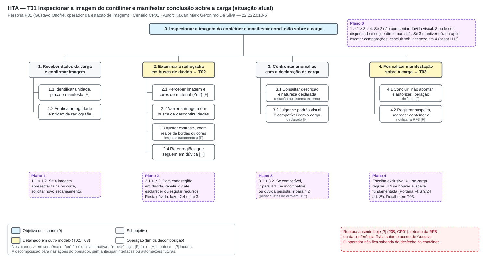
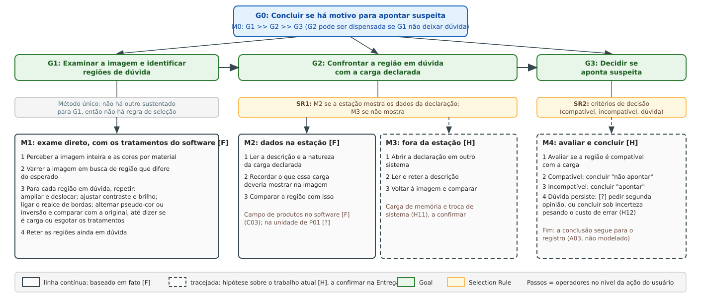
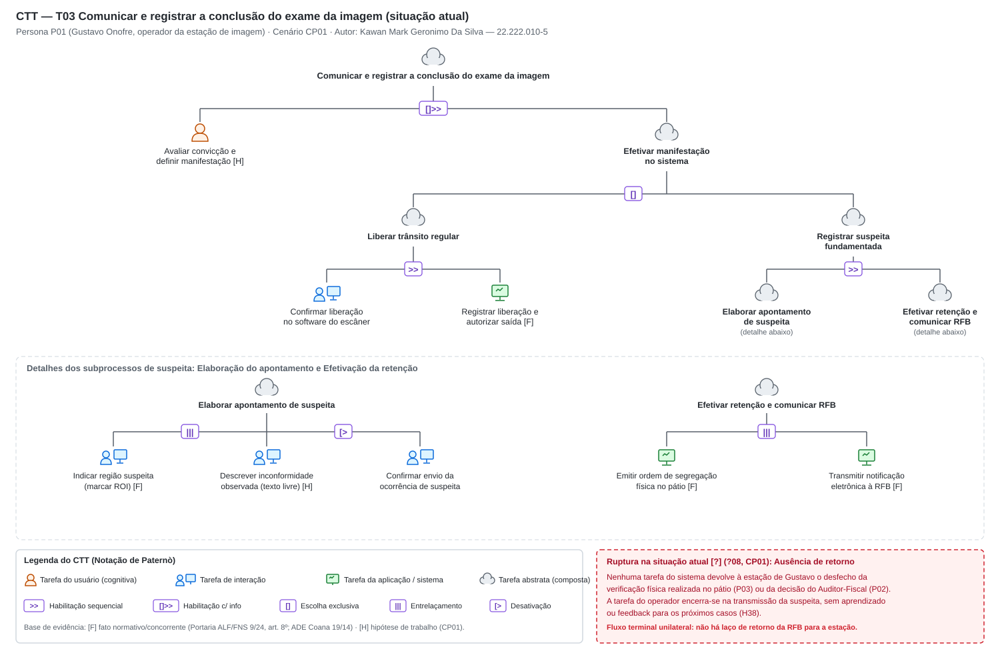
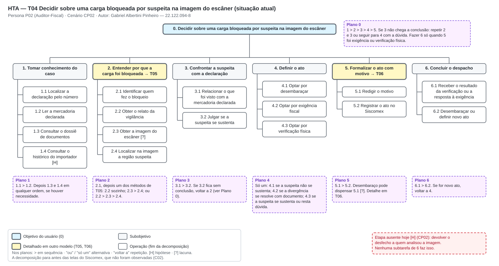
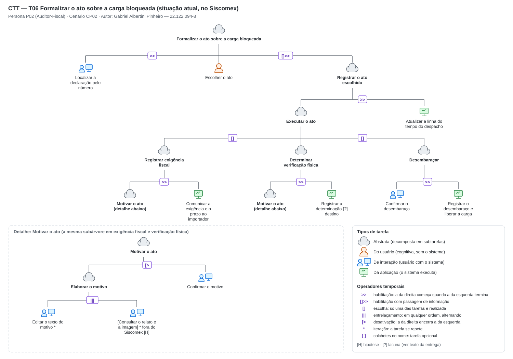

# Entrega 5 — Análise de tarefas: HTA, GOMS e CTT

**Data:** 22/10/2026  
**Status:** 🟨 em andamento  
**Responsabilidade:** cada integrante modela pelo menos 1 HTA, 1 GOMS e 1 CTT. As três técnicas podem abordar a mesma funcionalidade ou funcionalidades distintas, conforme a orientação da disciplina.

## Objetivo da atividade

Modelar tarefas importantes sob perspectivas complementares: decomposição hierárquica (HTA), estrutura de metas/métodos/operações (GOMS) e relações temporais entre tarefas (CTT). O diagrama deve ser acompanhado de interpretação textual.

## Para projetos cujo TCC não previa interface

Modele **tarefas humanas relacionadas ao uso da contribuição técnica**, e não a implementação interna do algoritmo. Exemplos de boas tarefas para análise:

- investigar uma consulta de baixo desempenho;
- configurar uma análise e selecionar parâmetros;
- submeter um dataset e verificar sua validade;
- acompanhar uma execução demorada;
- comparar dois resultados/modelos;
- interpretar uma recomendação e decidir se a aceita;
- localizar uma execução anterior usando busca/filtros;
- gerar e compartilhar um relatório;
- administrar papéis/permissões quando isso for parte do trabalho real;
- revisar um alerta e registrar uma decisão.

Um CRUD pode gerar tarefas relevantes, mas “cadastrar usuário” só merece modelagem se tiver significado no domínio (papéis, validações, riscos, permissões, dependências).

## Seleção das tarefas

Cada integrante modela três tarefas, uma por técnica. A numeração segue a ordem dos autores na equipe, como nos cenários da Entrega 4: T01 a T03 para Kawan, T04 a T06 para Gabriel e T07 a T09 para Alexandre.

| ID | Tarefa | Persona/cenário de origem | Frequência/criticidade | Autor responsável |
|---|---|---|---|---|
| T01 | {{...}} | {{P01/C01}} | {{...}} | {{...}} |
| T02 | Examinar a imagem de um contêiner e concluir se há motivo para apontar suspeita | P01 / CP01 | [H] Alta / Crítica: repete a cada contêiner (H05) e o erro tem custo nos dois sentidos (H12) | Kawan Mark Geronimo Da Silva — 22.222.010-5 |
| T01 | {{...}} | {{P01/CP01}} | {{...}} | Kawan Mark Geronimo Da Silva |
| T02 | {{...}} | {{P01/CP01}} | {{...}} | Kawan Mark Geronimo Da Silva |
| T03 | {{...}} | {{P01/CP01}} | {{...}} | Kawan Mark Geronimo Da Silva |
| T04 | Decidir sobre uma carga bloqueada por suspeita na imagem do escâner (HTA) | P02 / CP02 | `[?]` Frequência desconhecida (CP02, Q9). `[H08]` Criticidade alta: o erro libera carga ilícita ou retém carga regular | Gabriel Albertini Pinheiro |
| T05 | Entender por que a carga foi bloqueada (GOMS) | P02 / CP02, subobjetivo 2 de T04 | Ocorre em todo caso de T04. `[H]` É onde o cenário mostra a maior perda de informação | Gabriel Albertini Pinheiro |
| T06 | Formalizar o ato sobre a carga bloqueada (CTT) | P02 / CP02, subobjetivo 5 de T04 | Ocorre em todo caso de T04. `[F]` O ato tem valor jurídico e é registrado no Siscomex (C02) | Gabriel Albertini Pinheiro |
| T07 | {{...}} | {{...}} | {{...}} | Alexandre Domiciano Pierri |
| T08 | {{...}} | {{...}} | {{...}} | Alexandre Domiciano Pierri |
| T09 | {{...}} | {{...}} | {{...}} | Alexandre Domiciano Pierri |

> Priorize tarefas necessárias para que o usuário alcance objetivos centrais. Não desperdice a modelagem em ações triviais isoladas, como “clicar em login”, se o objetivo relevante é maior. Da mesma forma, não modele o funcionamento interno do algoritmo como se fosse uma tarefa humana.

---

## Kawan — T01 a T03

### HTA — T01 {{nome da tarefa}}

**Autor(a):** Kawan Mark Geronimo Da Silva — 22.222.010-5

#### Descrição da tarefa

{{objetivo, ponto de início, conclusão esperada, contexto}}

#### Diagrama

#### Decomposição e planos

| ID | Objetivo/operação | Plano/ordem | Problema ou decisão de design observada |
|---|---|---|---|
| 0 | {{objetivo principal}} | {{1 > 2 > 3 / 1 ou 2 etc.}} | {{...}} |

**Verificação do HTA:**

- O objetivo 0 representa uma meta do usuário?
- As subtarefas são necessárias e suficientes?
- Os **planos** indicam ordem, alternativa, repetição ou condição?
- A decomposição parou em nível útil para projeto de interação?

### GOMS — T02 {{nome da tarefa}}

## GOMS — T02 Examinar a imagem de um contêiner e concluir se há motivo para apontar suspeita

**Autor(a):** Kawan Mark Geronimo Da Silva — 22.222.010-5

### Descrição da tarefa

Persona: P01 Gustavo Onofre, operador da estação de imagem. Cenário de origem: CP01. Atividade: A02 (inspecionar). Linha da cadeia de contribuição: R01 (mapa residual, que localiza onde a imagem se afasta da reconstrução de uma carga normal).

- **Início:** a imagem do contêiner está disponível na estação e Gustavo vai examiná-la.
- **Fim:** Gustavo chega a uma conclusão, "apontar suspeita" ou "não apontar". A conclusão segue para o registro e para quem decide, o que corresponde a A03 e não é modelado aqui.
- **Papel de Gustavo:** ele examina e conclui se há motivo para apontar. Quem decide formalmente sobre a carga pode ser outra pessoa (H39), então a meta não é "decidir sobre a carga".
- **Nível de detalhe:** operadores no nível da ação do usuário (perceber, ajustar, comparar, decidir). Não há estimativa de tempo (não é KLM) nem desenho de tela. O que depende de interface ainda não projetada aparece como forma em aberto.

**Base dos métodos:**

- **M1 [F]** é a prática atual de examinar a imagem com os tratamentos visuais do software do fabricante (C01, C03; ADE Coana nº 19/2014, item 1.2.8).
- **M2 [H]** é hipótese de uso da contribuição do TCC: examinar a imagem a partir da região que a IA aponta. Não há evidência de que seja mais rápido ou mais seguro (H34).
- O resto é marcado em cada operador como `[F]`, `[H]` ou `[?]`.

### Goal

`G0: Concluir se há motivo para apontar suspeita na imagem de um contêiner`

**Submetas e ordem (M0):** `G1 >> G2 >> G3`. Se G1 não deixar nenhuma região em dúvida, G2 pode ser dispensada e G3 conclui "não apontar" `[H]`.

- `G1: Examinar a imagem e identificar regiões de dúvida`
- `G2: Confrontar a região em dúvida com a carga declarada`
- `G3: Decidir se aponta suspeita`

### Diagrama

*Linha contínua: método baseado em fato `[F]`. Linha tracejada: hipótese de design `[H]`. O SVG é a fonte editável.*

#### Métodos, operadores e regras de seleção

**Para G1 (examinar a imagem e identificar regiões de dúvida)**

- **Method M1:** exame direto, com os tratamentos visuais do software do fabricante `[F]`.
  1. Perceber a imagem inteira e as cores atribuídas a cada material.
  2. Varrer a imagem em busca de regiões que diferem do esperado.
  3. Para cada região em dúvida, repetir até conseguir dizer se faz parte da carga ou esgotar os tratamentos: ampliar e deslocar a imagem; ajustar contraste e brilho; ligar o realce de bordas; alternar pseudo-cor ou inversão e comparar com a imagem original.
  4. Reter quais regiões seguem em dúvida.
  - Operators: O1, O2, O3, O4, O5, O6, O7.
- **Method M2:** exame orientado pela região que a IA aponta `[H]`.
  1. Perceber a imagem e a região apontada pela IA.
  2. Perceber onde e por que a região foi apontada (forma de explicação em aberto, H31).
  3. Ampliar e deslocar a imagem até a região.
  4. Mostrar ou ocultar a camada da IA para comparar com a imagem sem ela (forma em aberto, H30, RC09).
  5. Ajustar contraste ou realce, se necessário.
  6. Varrer o restante da imagem por dúvida própria.
  7. Decidir se a região faz parte da carga.
  - Operators: O1, O8, O9, O4, O10, O3, O5, O2, O7.
- **Selection Rule SR1:** usar M2 quando a análise da IA estiver concluída e apontar região; usar M1 quando não houver análise (em curso, indisponível, ?05 e H27) ou quando a IA não apontar região.
- **Selection Rule SR1.1 (dentro de M2):** se Gustavo discordar da região apontada ou tiver dúvida em outra parte da imagem, aplicar o passo 3 de M1 nessa parte.

**Para G2 (confrontar a região com a carga declarada)**

- **Method M3:** dados da declaração mostrados na própria estação `[F]` para o campo de produtos no software do fabricante (C03), `[?]` para o que a unidade de Gustavo realmente mostra.
  1. Ler a descrição e a natureza da carga declarada.
  2. Recordar o que essa carga deveria mostrar na imagem.
  3. Comparar a região em dúvida com isso.
  - Operators: O11, O12, O13.
- **Method M4:** consulta à declaração fora da estação `[H]`.
  1. Abrir a declaração em outro sistema.
  2. Ler e reter a descrição da carga.
  3. Voltar à imagem e comparar.
  - Operators: O14, O11, O12, O13.
- **Selection Rule SR2:** usar M3 quando a estação mostrar os dados da declaração; usar M4 quando não mostrar.

**Para G3 (decidir se aponta suspeita)**

- **Method M5:** avaliar a compatibilidade e concluir `[H]`: a estrutura vem do CP01, que é cenário, e a segunda opinião não tem fonte.
  1. Avaliar se a região é compatível com a carga declarada.
  2. Se compatível, concluir "não apontar".
  3. Se incompatível, concluir "apontar".
  4. Se a dúvida persistir, pedir segunda opinião `[H]` ou concluir sob incerteza, pesando o custo de errar (H12).
  - Operators: O13, O15.
- **Selection Rule SR3:** critérios de decisão. Compatível, concluir "não apontar". Incompatível, concluir "apontar". Dúvida persistente, aplicar o passo 4 de M5. Não há fonte que diga se Gustavo pode pedir segunda opinião `[?]`.

> M1 e M2 são alternativas para G1, e M3 e M4 para G2. G3 tem um único método (M5), então SR3 não escolhe entre métodos: ela organiza os critérios de decisão.

### Operadores

| ID | Operador (ação do usuário) | Tipo | Base |
|---|---|---|---|
| O1 | Perceber a imagem inteira e as cores atribuídas a cada material | perceptivo | [F] C01, C03 |
| O2 | Varrer a imagem em busca de região que difere do esperado | perceptivo | [F] C01, C03 |
| O3 | Ajustar contraste, brilho e equalização | motor e cognitivo | [F] C01, C03 |
| O4 | Ampliar e deslocar a imagem até uma região | motor | [F] C01, C03 |
| O5 | Ligar o realce de bordas | motor | [F] C01, C03 |
| O6 | Alternar pseudo-cor ou inversão e comparar com a imagem original | motor e perceptivo | [F] C01, C03 |
| O7 | Reter quais regiões seguem em dúvida | cognitivo | [H] |
| O8 | Perceber a região apontada pela IA | perceptivo | [H] |
| O9 | Perceber a explicação de onde e por que a região foi apontada | perceptivo | [H] H31 |
| O10 | Mostrar ou ocultar a camada da IA | motor | [H] H30, RC09 |
| O11 | Ler os dados da declaração (na estação em M3, em outro sistema em M4) | perceptivo | [F] C03 na estação, [?] na unidade |
| O12 | Recordar o que a carga declarada deveria mostrar | cognitivo | [H] H11 |
| O13 | Comparar a região com o que a carga deveria mostrar | cognitivo | [H] H11 |
| O14 | Abrir a declaração em outro sistema | motor | [H] |
| O15 | Concluir "apontar" ou "não apontar" | cognitivo | [H] CP01 |

### Interpretação

O modelo mostra que o exame depende de três coisas ao mesmo tempo: do que Gustavo percebe na imagem (G1), do que ele sabe sobre a carga (G2) e de uma conclusão que ele precisa sustentar (G3). A IA entra apenas em G1, como alternativa de método (M2), e não substitui G2 nem G3: o mapa residual diz onde a imagem se afasta de uma carga normal, mas não diz se a região é compatível com a carga declarada.

M1 reproduz o que o CP01 descreve: Gustavo percorre a imagem, recorre a tratamentos visuais e fica na dúvida. M2 troca a varredura inicial por uma região de partida, mas mantém a varredura do restante (passo 6) e a possibilidade de discordar (SR1.1), para que o julgamento continue sendo dele.

### Problemas e decisões de design observadas

Estas são observações do modelo, não soluções.

| # | Observação | Onde aparece | Base |
|---|---|---|---|
| 1 | A varredura de M1 depende de atenção sustentada e perde qualidade com cansaço. | M1 passo 2 | [H] H10, H13 |
| 2 | O laço do passo 3 de M1 não tem critério de parada. Sem ele, Gustavo pode gastar tempo em uma região enquanto há contêineres esperando. | M1 passo 3 | [H] H16 |
| 3 | A camada da IA pode competir com a pseudo-cor do software do fabricante. Não se sabe como as duas conviveriam na mesma imagem. | M2 passo 4 | [H] H30, RC09 |
| 4 | Com a região já apontada, há risco de Gustavo deixar de olhar o resto da imagem. O passo 6 e SR1.1 existem para preservar o julgamento dele. | M2 passos 6 e 7 | [H] RC02 |
| 5 | M4 obriga a trocar de sistema e a lembrar a descrição da carga ao voltar à imagem. | M4 | [H] H11 |
| 6 | O erro tem custo nos dois sentidos: apontar sem motivo atrasa a carga, e não apontar pode deixar passar um ilícito. | G3 | [H] H12 |
| 7 | Depois da conclusão, não está claro se Gustavo recebe retorno sobre o que aconteceu com a carga. | fim de G3 | [?] ?08, CP01 |
| 8 | O benefício de M2 sobre M1 (menos fadiga, foco mais rápido) não foi medido. | SR1 | [H] H34 |

### Verificação do GOMS

- **Goals:** G0 é uma meta de Gustavo (concluir se há motivo para apontar), não uma ação de tela. G1, G2 e G3 são metas, não passos.
- **Operators:** os operadores O1 a O15 são ações no nível definido (perceber, ajustar, comparar, decidir) e não dependem de componente de interface.
- **Methods:** M1 e M2 atingem a mesma meta (G1) por caminhos diferentes. M3 e M4 atingem G2. M5 é o único caminho de G3.
- **Selection Rules:** SR1 e SR2 trazem condição observável (a IA concluiu e apontou? a estação mostra a declaração?). SR3 traz critérios de decisão.
- **Origem:** M1 e M3 têm base em fato (C01, C03, ADE Coana nº 19/2014), M3 com a lacuna sobre a unidade. M2, M4 e M5 são hipóteses e estão marcadas como tal.
- **Limites:** a tarefa não modela triagem (A01), registro (A03), nem o que o auditor faz depois. Também não assume que Gustavo decida sobre a carga (H39).

### Rastreabilidade

| Elemento | Origem |
|---|---|
| Persona | P01 |
| Cenário | CP01 |
| Atividade | A02 |
| Linha da cadeia de contribuição | R01 |
| Hipóteses e lacunas | H05, H10, H11, H12, H13, H16, H30, H31, H34, H38, H39, H41, ?05, ?08 |
| Recomendações da concorrência | RC02, RC09 |
| Concorrentes | C01, C03 |

### CTT — T03 {{nome da tarefa}}

**Autor(a):** Kawan Mark Geronimo Da Silva — 22.222.010-5

#### Descrição

{{...}}

#### Diagrama

#### Legenda e relações temporais usadas

| Operador/relação | Significado no diagrama | Exemplo no modelo |
|---|---|---|
| {{...}} | {{...}} | {{...}} |

Identifique, quando aplicável, tarefas de usuário, sistema, interação e tarefas abstratas. Verifique se concorrência, escolha, habilitação, desabilitação e repetição estão representadas corretamente segundo a notação adotada em aula.

---

## Gabriel — T04 a T06

As três tarefas vêm do cenário CP02 (Entrega 4), que já indicava na seção 5 as tarefas a analisar: entender por que a carga foi bloqueada, confrontar a imagem com a declaração e decidir e formalizar o ato. O HTA cobre a tarefa inteira. O GOMS e o CTT detalham os dois subobjetivos em que o CP02 mostra as rupturas: a chegada da suspeita ao auditor e o registro do ato.

**Situação atual, não a solução.** As três modelagens descrevem como a tarefa é feita hoje, com o Siscomex e sem a interface da disciplina. Isso segue a regra da Entrega 4 e a cobrança dos pareceres de não antecipar a solução. A tarefa com a interface proposta será modelada quando houver protótipo (Entregas 6 e 10).

**Base de evidência.** P02 é proto-persona e nenhum Auditor-Fiscal foi entrevistado. A estrutura das tarefas vem de documentos: Manual de Despacho e Portal Único (C02), normas da RFB e as matérias de A Tribuna citadas no CP02. Cada passo traz `[F]`, `[H]` ou `[?]` quando não for óbvio pela fonte. As telas de trabalho do auditor não são públicas (C02, ressalva). Por isso nenhum modelo desce ao nível de campos, botões ou teclas.

**Dependência de H39 e ?08.** Se a investigação da Entrega 7 mostrar que quem examina a imagem e quem decide são a mesma pessoa, T05 deixa de existir como tarefa separada e T04 precisa ser refeita.

### HTA — T04 Decidir sobre uma carga bloqueada por suspeita na imagem do escâner

**Autor(a):** Gabriel Albertini Pinheiro — 22.122.094-8

#### Descrição da tarefa

- **Objetivo:** decidir o que fazer com uma carga de importação bloqueada porque a imagem do escâner levantou suspeita, com base suficiente para sustentar a decisão (P02, objetivo prático 1).
- **Ponto de início:** a declaração com a carga bloqueada chega ao Auditor-Fiscal da equipe de despacho. `[F]` O despacho tem a etapa de distribuição para auditor (C02). `[?]` Como a suspeita acompanha essa distribuição não foi apurado (CP02, Q4, ?08).
- **Conclusão esperada:** ato registrado no Siscomex e despacho concluído com desembaraço, ou carga mantida depois da verificação.
- **Contexto:** Alfândega do Porto de Santos. A vigilância, que viu a imagem, e o despacho, que decide, ficam em divisões diferentes (CP02, Q1 e Q3). A carga fica parada enquanto a decisão não sai.

#### Diagrama

*Figura 1 — HTA da tarefa T04, situação atual. Fonte: elaboração do autor a partir do cenário CP02.*

#### Decomposição e planos

| ID | Objetivo/operação | Plano/ordem | Problema ou decisão de design observada |
|---|---|---|---|
| 0 | Decidir sobre uma carga bloqueada por suspeita na imagem do escâner | 1 > 2 > 3 > 4 > 5. Se 3 não chega a conclusão, repetir 2 e 3 ou seguir para 4 com a dúvida. Fazer 6 só quando 5 foi exigência ou verificação física | A repetição de 2 e 3 é o ponto de atraso: cada volta depende de outra pessoa (ver T05). Seguir com a dúvida leva à verificação física por precaução (CP02) |
| 1 | Tomar conhecimento do caso | 1.1 > 1.2. Depois 1.3 e 1.4 em qualquer ordem, se houver necessidade | `[F]` Tudo o que está em 1 fica no Siscomex (C02). A suspeita não está entre essas informações |
| 1.1 | Localizar a declaração pelo número | — | `[F]` O número da declaração é a chave de consulta no Siscomex (C02, H29) |
| 1.2 | Ler a mercadoria declarada | — | É a referência que 3.1 usa para confrontar a suspeita (H11) |
| 1.3 | Consultar o dossiê de documentos | — | `[F]` O despacho se apoia no dossiê (C02, CP02 Q6) |
| 1.4 | Consultar o histórico do importador | — | `[H]` Escolha da proto-persona. `[F]` A habitualidade do importador entra na seleção do canal (C02), mas não sabemos se o auditor a consulta diante de uma suspeita de imagem |
| 2 | Entender por que a carga foi bloqueada | 2.1, depois um dos métodos de T05: 2.2 sozinho; 2.3 > 2.4; ou 2.2 > 2.3 > 2.4 | Detalhado no GOMS T05. Hoje todo método sai do Siscomex. O bloqueio chega sem explicação (CP02) |
| 2.1 | Identificar quem fez o bloqueio | — | `[?]` Não sabemos se o registro do bloqueio identifica o servidor (CP02, Q2) |
| 2.2 | Obter o relato da vigilância | — | `[H]` O relato é curto e depende da disponibilidade de quem o fez (CP02) |
| 2.3 | Obter a imagem do escâner | — | `[?]` Onde e como o auditor acessa a imagem (CP02, Q5). `[F]` A norma prevê estações de análise da RFB (ADE Coana nº 19/2014) |
| 2.4 | Localizar na imagem a região suspeita | — | `[?]` Exige prática de leitura de radiografia, que P02 talvez não tenha (P02, conhecimento do domínio) |
| 3 | Confrontar a suspeita com a declaração | 3.1 > 3.2. Se 3.2 fica sem conclusão, voltar a 2 (Plano 0) | O confronto junta duas fontes que hoje estão separadas: a declaração no Siscomex e o relato ou a imagem fora dele (H11) |
| 3.1 | Relacionar o que foi visto com a mercadoria declarada | — | É feito de memória ou com anotações, alternando entre fontes (P02, dor 1) |
| 3.2 | Julgar se a suspeita se sustenta | — | Operação cognitiva. É onde a falta de prática com a imagem pesa mais (CP02) |
| 4 | Definir o ato | Só um: 4.1 se a suspeita não se sustenta; 4.2 se a divergência se resolve com documento; 4.3 se a suspeita se sustenta ou resta dúvida | `[F]` Os três atos e o uso da exigência para documento ou correção vêm de C02. `[?]` Qual ato é usado quando a origem é a imagem (CP02, Q7). A regra "resta dúvida → 4.3" é a do cenário, não uma norma |
| 4.1 | Optar por desembaraçar | — | — |
| 4.2 | Optar por exigência fiscal | — | `[F]` Ato com motivo e prazo (C02) |
| 4.3 | Optar por verificação física | — | `[F]` Pode ser presencial ou remota (CP02, Q7). `[?]` Quem escolhe a modalidade |
| 5 | Formalizar o ato com motivo | 5.1 > 5.2. Desembaraço pode dispensar 5.1 `[?]` | Detalhado no CTT T06. O motivo é reescrito com as palavras do auditor, sem vínculo com a análise da imagem (CP02, Q10) |
| 5.1 | Redigir o motivo | — | Ver T06 |
| 5.2 | Registrar o ato no Siscomex | — | Ver T06 |
| 6 | Concluir o despacho | 6.1 > 6.2. Se for novo ato, voltar a 4 | Nenhuma subtarefa devolve o desfecho a quem analisou a imagem (ruptura do CP02, quadro tracejado no diagrama) |
| 6.1 | Receber o resultado da verificação ou a resposta à exigência | — | `[?]` Prazo e canal do resultado (CP02, Q8) |
| 6.2 | Desembaraçar ou definir novo ato | — | — |

**Critério de parada.** A decomposição para em operações que o auditor reconhece como passos do próprio trabalho (ler a mercadoria, obter o relato, registrar o ato). Descer mais exigiria descrever telas do Siscomex que não foram observadas. Também não valeria o custo: pelo critério de probabilidade × custo do HTA, os erros relevantes estão em 2, 3 e 5, e esses subobjetivos foram detalhados em T05 e T06.

**Verificação do HTA:**

- *O objetivo 0 representa uma meta do usuário?* Sim. É o objetivo prático 1 de P02 e o objetivo do CP02. Não é uma função de sistema.
- *As subtarefas são necessárias e suficientes?* As subtarefas 1 a 5 correspondem às ações extraídas do CP02 (seção 4). A subtarefa 6 cobre o desfecho narrado no cenário. Falta uma etapa, a de devolver o desfecho a quem analisou a imagem. Ela foi registrada como ausente porque o cenário mostra que hoje não acontece.
- *Os planos indicam ordem, alternativa, repetição ou condição?* Sim: sequência (Plano 1, 3, 5), alternativa exclusiva com condição (Plano 4), escolha de método (Plano 2), repetição (Planos 0 e 6) e condição de execução (Plano 0, para 6).
- *A decomposição parou em nível útil?* Parou no nível em que aparecem os problemas de interação do cenário. Os pontos que dependem de tela ficam para o protótipo.

### GOMS — T05 Entender por que a carga foi bloqueada

**Autor(a):** Gabriel Albertini Pinheiro — 22.122.094-8

**Nível de análise.** Os operadores são de atividade: ler, contatar, perguntar, aguardar, procurar, comparar e decidir. Não chegam ao nível de teclas do KLM, porque as telas onde a imagem e o bloqueio aparecem não foram observadas (C02, CP02 Q5). Por isso o modelo não estima tempo. Ele compara métodos pelo número e pelo tipo de operadores, e pelo que cada um exige do auditor e de outras pessoas.

#### Goal

`G0: Entender por que a carga foi bloqueada (o que a vigilância viu na imagem, em que parte do contêiner e com que fundamento)`

Subobjetivo usado pelos métodos:

`G1: Identificar quem fez o bloqueio`

- Operators: ler na declaração os dados do bloqueio `[?]`; se não identificarem o servidor, perguntar à equipe de vigilância em plantão `[F]` (Eqvig, Portaria ALF/STS nº 197/2025, art. 34; CP02, Q1).

#### Métodos, operadores e regras de seleção

- **Method M1: obter o relato de quem bloqueou**
  - Operators:
    1. cumprir G1;
    2. contatar o servidor `[?]` (telefone, mensagem ou sistema; o canal não foi apurado);
    3. perguntar o que foi visto e onde;
    4. aguardar a resposta;
    5. ler ou ouvir o relato;
    6. reter o relato, de memória ou em anotação, para usar em T04-3 e T06;
    7. verificar se o relato diz o quê e onde. Se não disser, voltar ao operador 3.
  - Resultado: `[H]` descrição curta, de segunda mão (CP02).
- **Method M2: examinar a imagem pessoalmente**
  - Operators:
    1. localizar a imagem do contêiner no sistema onde está guardada `[H]` (fora do Siscomex, CP02 Q5);
    2. acessar o sistema e abrir a imagem `[?]`;
    3. percorrer a imagem;
    4. ajustar os tratamentos visuais, se disponíveis `[F]` (pseudo-cor por material e realce de bordas existem nas estações analisadas em C03);
    5. procurar uma região incompatível com a mercadoria declarada;
    6. decidir qual região provavelmente motivou o bloqueio.
  - Resultado: leitura do próprio auditor, sem saber se é a mesma região que a vigilância viu.
- **Method M3: examinar a imagem guiado pelo relato**
  - Operators:
    1. executar M1, operadores 1 a 6;
    2. localizar e abrir a imagem (M2, operadores 1 e 2);
    3. ir à região indicada no relato;
    4. comparar o que vê com a descrição recebida;
    5. decidir se a região e a descrição batem. Se não baterem, voltar ao M1, operador 3.
  - Resultado: a suspeita entendida com a evidência à vista.
- **Selection Rule SR1:** usar M1 quando o auditor não tem acesso à imagem.
- **Selection Rule SR2:** usar M2 quando tem acesso à imagem e prática de leitura de radiografia, ou quando quem fez o bloqueio não está disponível.
- **Selection Rule SR3:** usar M3 quando tem acesso à imagem, mas não tem prática suficiente para achar a região sozinho.

> As três condições das regras de seleção são lacunas `[?]`: acesso à imagem (CP02, Q5), prática de leitura (P02, conhecimento do domínio) e disponibilidade de quem bloqueou (CP02, Q1). O auditor do CP02 não tem prática de leitura, o que o leva a M1 ou M3. Se nenhum método der resultado, G0 falha e o Plano 0 de T04 segue para a decisão com a dúvida, e daí para a verificação física.

#### Interpretação

| Método | Operadores | Depende de outra pessoa | Sai do Siscomex | O que o auditor obtém |
|---|---:|---|---|---|
| M1 | 7, com espera e possível repetição | sim, de quem bloqueou | sim, para contatar | relato de segunda mão |
| M2 | 6 | não | sim, para abrir a imagem | leitura própria, que exige prática |
| M3 | 11, com espera e possível repetição | sim | sim, duas vezes | relato e evidência juntos |

O que o modelo mostra:

- **Nenhum método começa pela suspeita.** Todos começam por buscar a suspeita, porque ela não chega com a declaração (CP02). G1 é necessário só porque a origem do bloqueio não vem identificada.
- **O método mais confiável é o mais longo.** M3 junta relato e evidência, mas soma os operadores de M1 e M2 e herda a espera de M1. É o método indicado para quem não lê radiografia, que é o caso de P02.
- **A espera domina.** M1 e M3 dependem de alguém de outra divisão (CP02, Q3). O operador "aguardar a resposta" não tem duração conhecida (CP02, Q8).
- **O resultado se perde no caminho.** O operador M1-6, reter o relato, existe porque nada registra o que foi explicado. É a origem do motivo reescrito à mão em T06.

### CTT — T06 Formalizar o ato sobre a carga bloqueada

**Autor(a):** Gabriel Albertini Pinheiro — 22.122.094-8

#### Descrição

Modela o subobjetivo 5 de T04: depois de escolher o ato, o auditor o registra no Siscomex com o motivo. Começa na localização da declaração e termina quando o sistema atualiza a linha do tempo do despacho. Os atos e as tarefas da aplicação vêm da documentação do Siscomex `[F]` (C02): exigência comunicada ao importador com motivo e prazo, desembaraço e linha do tempo de marcos. A forma e o número das tarefas de interação são `[H]`, porque as telas do auditor não foram observadas. A notação é a do CTT de Paternò, com os tipos de tarefa e os operadores temporais da legenda do diagrama.

#### Diagrama

*Figura 2 — CTT da tarefa T06, situação atual. O quadro inferior detalha a subtarefa "Motivar o ato", que aparece em dois ramos. Fonte: elaboração do autor a partir do cenário CP02 e da análise C02.*

#### Legenda e relações temporais usadas

| Operador/relação | Significado no diagrama | Exemplo no modelo |
|---|---|---|
| `>>` habilitação | A tarefa da direita só começa quando a da esquerda termina | *Localizar a declaração* `>>` *Escolher o ato*. *Motivar o ato* `>>` *Comunicar a exigência e o prazo ao importador* |
| `[]>>` habilitação com passagem de informação | Como `>>`, e a tarefa da esquerda entrega uma informação à da direita | *Escolher o ato* `[]>>` *Registrar o ato escolhido*: o ato escolhido decide qual ramo de *Executar o ato* acontece |
| `[]` escolha | Só uma das tarefas é realizada. Quando uma começa, as outras ficam indisponíveis | *Registrar exigência fiscal* `[]` *Determinar verificação física* `[]` *Desembaraçar* (Plano 4 de T04) |
| `\|\|\|` entrelaçamento | As tarefas acontecem em qualquer ordem e podem se alternar | *Editar o texto do motivo* `\|\|\|` *Consultar o relato e a imagem*: o auditor escreve, volta à fonte e escreve de novo |
| `[>` desativação | Quando a tarefa da direita começa, a da esquerda é encerrada | *Elaborar o motivo* `[>` *Confirmar o motivo*: confirmar encerra a edição |
| `*` iteração | A tarefa se repete até ser desativada | *Editar o texto do motivo* `*`. *Consultar o relato e a imagem* `*` |
| `[ ]` tarefa opcional | A tarefa pode não acontecer | *[Consultar o relato e a imagem]*: o auditor pode escrever o motivo só de memória |

Tipos de tarefa usados:

- **Abstratas:** a raiz, *Registrar o ato escolhido*, *Executar o ato*, os três atos, *Motivar o ato* e *Elaborar o motivo*.
- **Do usuário:** *Escolher o ato*. É cognitiva e corresponde aos subobjetivos 3 e 4 de T04.
- **De interação:** *Localizar a declaração*, *Editar o texto do motivo*, *Confirmar o motivo*, *Confirmar o desembaraço* e *Consultar o relato e a imagem*. Esta última acontece fora do Siscomex `[H]`.
- **Da aplicação:** *Comunicar a exigência e o prazo ao importador*, *Registrar a determinação*, *Registrar o desembaraço e liberar a carga* e *Atualizar a linha do tempo do despacho*.

Pontos em aberto no modelo:

- **Destino da determinação de verificação física** `[?]`: não sabemos para onde vai nem quem escolhe entre verificação presencial e remota (CP02, Q7). Por isso *Registrar a determinação* é uma única tarefa da aplicação.
- **Motivo no desembaraço** `[?]`: o modelo supõe que o desembaraço não exige motivo escrito. Se exigir, *Motivar o ato* entra também nesse ramo.
- **Prazo da exigência** `[?]`: C02 mostra que o importador recebe um prazo, mas não se é o auditor quem o define. Por isso o prazo aparece só na tarefa da aplicação.

#### Interpretação

- **A alternância entre sistemas aparece como entrelaçamento.** A única tarefa que traz a evidência para o ato, *Consultar o relato e a imagem*, é opcional, repetida e fica fora do Siscomex. É a dor 1 de P02 escrita em notação: o auditor escreve em um sistema e consulta em outro.
- **Nenhuma tarefa da aplicação liga o ato à análise da imagem.** O sistema registra o motivo como texto e atualiza a linha do tempo. Não há tarefa que anexe ou referencie o que a vigilância viu (CP02, Q10, H17 e H32).
- **A escolha do ato é a última tarefa do usuário.** Depois de *Escolher o ato*, só há interação e aplicação. Se a escolha foi feita com dúvida (T04, Plano 0), nada no restante da tarefa a registra.
- **Nada volta para a vigilância.** A tarefa termina na linha do tempo do despacho, que é do processo e não de quem analisou a imagem. É a mesma ruptura do subobjetivo 6 de T04.

---

## Alexandre — T07 a T09

{{HTA, GOMS e CTT de Alexandre Domiciano Pierri — 22.125.061-6, na mesma estrutura das seções acima. Os modelos usam a persona e o cenário escolhidos em CP03. P03 está fora do recorte enquanto H42 estiver aberta (Entrega 3, Classificação do elenco).}}

---

## Síntese da equipe

Quais problemas de interação, oportunidades e requisitos apareceram a partir das modelagens? Quais tarefas irão para o protótipo e para o teste de usabilidade?

> A síntese da equipe é consolidada depois de T01 a T03 e T07 a T09. Abaixo está a contribuição de T04 a T06.

### Contribuição de T04 a T06 (Gabriel)

**Problemas de interação na situação atual.** Os três modelos chegam ao mesmo ponto: a suspeita e a decisão ficam em lugares diferentes.

1. A suspeita não chega com a declaração. O auditor precisa buscá-la, e todo método de T05 começa por isso (T04-2, T05 G1).
2. Entender a suspeita depende de outra pessoa ou de prática com a imagem. O método mais confiável para quem não lê radiografia é o mais longo e o que mais espera (T05, M3).
3. Confrontar a suspeita com a declaração exige alternar entre fontes e guardar o relato de memória (T04-3.1, T05 M1-6, T06 `|||`).
4. O ato é registrado sem vínculo com a evidência que o motivou (T06).
5. Nada devolve o desfecho a quem analisou a imagem (T04-6, T06).

**Oportunidades, como hipóteses de design.** Nenhuma é requisito antes da Entrega 7. Todas dependem de H39 e ?08.

| Oportunidade | Problema acima | Hipóteses e recomendações ligadas |
|---|---|---|
| A suspeita chegar ao auditor com o que foi visto, onde e por quem | 1, 2 | H11, H17, RC07, ?08 |
| Ver a região apontada junto da mercadoria declarada, sem depender de prática de leitura | 2, 3 | H11, H30, RC02, RC07 |
| O motivo do ato poder referenciar a análise da imagem, em vez de reescrevê-la | 3, 4 | H06, H32, RC04 |
| O desfecho voltar a quem analisou a imagem | 5 | H18, H34, H36 |

**Tarefas candidatas ao protótipo e ao teste.** T04-3, confrontar a suspeita com a declaração, e T06, formalizar o ato com motivo. São as que concentram os problemas 2 a 4 e as que a interface da disciplina pode apoiar com o mapa residual (R03). Entram no protótipo só se a Entrega 7 confirmar que o Auditor-Fiscal decide a partir da imagem (H39).

**Informações a coletar na Entrega 7,** além das listadas no CP02:

- se o registro do bloqueio identifica quem o fez e por quê (T05, G1);
- por que canal o auditor contata a vigilância e quanto espera (T05, M1);
- se o auditor abre a imagem, em que sistema, e se tem treino para lê-la (T05, SR1 a SR3);
- que campos o Siscomex pede ao registrar exigência, verificação e desembaraço, e se aceita anexo (T06);
- quem define o prazo da exigência e a modalidade da verificação (T06).

## Referências

Fontes de T04 a T06:

- Cenário CP02 e suas fontes (A Tribuna, 2013 e 2015; Portaria ALF/STS nº 197/2025): referências completas na Entrega 4.
- Manual de Despacho de Importação e Portal Único Siscomex (análise C02): referências completas na Entrega 2.
- ADE Coana nº 19/2014 e Portaria ALF/FNS nº 9/2024: referências completas na Entrega 3.

Métodos:

- ANNETT, John; DUNCAN, Keith D. Task analysis and training design. **Occupational Psychology**, v. 41, p. 211–221, 1967. (HTA e critério de parada por probabilidade × custo)
- CARD, Stuart K.; MORAN, Thomas P.; NEWELL, Allen. **The Psychology of Human-Computer Interaction**. Lawrence Erlbaum, 1983. (GOMS)
- PATERNÒ, Fabio. **Model-Based Design and Evaluation of Interactive Applications**. Springer, 1999. (CTT)

## Checklist

- [ ] Cada integrante produziu ao menos 1 HTA, 1 GOMS e 1 CTT.
- [ ] Cada artefato identifica autor e tarefa.
- [ ] Diagramas são legíveis e possuem fonte editável quando possível.
- [ ] HTA contém planos, não apenas árvore de tópicos.
- [ ] GOMS distingue Goals, Operators, Methods e Selection Rules.
- [ ] CTT usa operadores temporais e tipos de tarefa coerentes.
- [ ] Há texto explicando cada diagrama.
- [ ] Tarefas estão ligadas a cenários/personas na rastreabilidade.
- [ ] Em TCC técnico, as tarefas descrevem o que a pessoa faz com a contribuição/resultados, não passos internos do código.
- [ ] CRUDs, relatórios, filtros e atividades administrativas foram escolhidos por relevância ao objetivo do usuário.

> O checklist fica em aberto enquanto T01 a T03 e T07 a T09 não forem preenchidos. T04 a T06 atendem aos itens que dependem de um único integrante. Os diagramas de T04 e T06 são SVG em texto, que servem como fonte editável (abrem no draw.io e no Inkscape).
