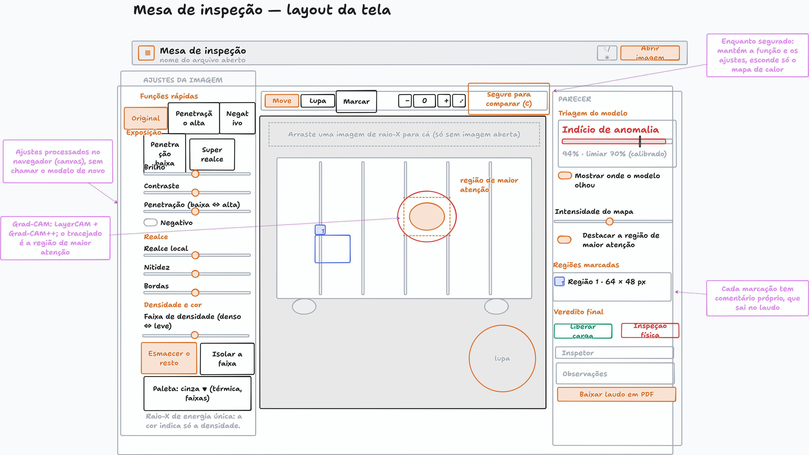

# Entrega 6 — Prototipação em papel

**Data:** 25/10/2026 · **Revisão:** 05/11/2026 
**Status:** 🟩 concluída 
**Responsabilidade:** 1 solução integrada por equipe 
**Autores:** Kawan Mark Geronimo Da Silva (22.222.010-5), Gabriel Albertini Pinheiro (22.122.094-8) e Alexandre Domiciano Pierri (22.125.061-6)

## Objetivo da atividade

Explorar em baixa fidelidade a estrutura da **Mesa de inspeção de raio-X de contêineres**, seguindo o ciclo **construir → simular → observar → revisar** antes de detalhar o visual da interface.

## 1. Escopo do protótipo

- **Personas:** P01, Gustavo, examina a imagem; P02, Eduardo, recebe o parecer para apoiar a decisão no despacho. P03 permanece stakeholder, sem tela própria.
- **Cenários/tarefas:** CP01/CP02 e T01–T06 da [Entrega 5](05_analise_tarefas.md).
- **Objetivos principais:** comparar radiografia e destaque do modelo (AC02/R01) e registrar o achado com justificativa (AC03/R03).

A interface é um protótipo demonstrativo ligado ao TCC. Os valores e rótulos do desenho são exemplos: o resultado do modelo não comprova ilícito nem autoriza desembaraço.

### 1.1 Famílias de interface escolhidas

| Família | Aplicação no esboço |
|---|---|
| Entrada de dados | Abrir uma radiografia para análise. |
| Comparação e explicação de resultados | Examinar a imagem original e o destaque do modelo, com ajustes visuais. |
| Registro e relatório | Marcar regiões, comentar o achado e preparar o parecer para exportação. |

Dashboard, fila priorizada, login, CRUD e administração não entram no esboço: não são necessários para experimentar as tarefas escolhidas.

## 2. Fluxos escolhidos

| Fluxo | Tarefa/objetivo | Por que foi priorizado |
|---|---|---|
| PF01 — examinar | Abrir a imagem, consultar a indicação do modelo e comparar com a radiografia (T01/T02, AC02). | É a interação central com a contribuição do TCC. |
| PF02 — registrar | Marcar região, descrever o achado, revisar a conclusão e exportar o parecer (T03–T06, AC03). | Permite comunicar o que foi observado e sua justificativa. |

## 3. Telas e estados

*Figura 1 — Prancha da equipe em baixa fidelidade: ajustes à esquerda, radiografia no centro e análise/parecer à direita.*

[Arquivo editável do tldraw](../assets/06_prototipos/mesa_inspecao.tldr). A imagem corresponde à página “Layout da tela”; o arquivo original mantém as páginas auxiliares. Uma mesma tela reúne os momentos de uso, identificados abaixo pelo prefixo **PP**, para não confundir com as personas P01/P02.

| Estado | O que representa / tarefa | Controle e próximo estado |
|---|---|---|
| PP01 — sem imagem | Início do exame (T01). | “Abrir imagem” leva à análise; arquivo inválido leva a PP06a. |
| PP02 — resultado disponível | Radiografia e indicação do modelo para exame (T01/T02). | Ajustes ou comparação levam a PP03; “Marcar” leva a PP04. |
| PP03 — comparação | Exame do original com e sem a camada do modelo (T02). | “Segure para comparar (C)” alterna a camada; soltar retorna a PP02. “Marcar” leva a PP04. |
| PP04 — região marcada | Registro de área de interesse e comentário (T03). | Criar, editar ou excluir marcação; preencher o parecer leva a PP05. |
| PP05 — parecer | Conclusão, responsável e observações (T03/T06). | “Baixar laudo em PDF” conclui a exportação; campos incompletos levam a PP06b. |
| PP06a/PP06b — erro e retorno | Entrada inválida ou registro incompleto. | Selecionar outro arquivo retorna a PP01; revisar região ou campos retorna a PP04/PP05, preservando os dados. |

**Caminho principal:** PP01 → PP02 → PP03 → PP04 → PP05. Uma análise sem região a registrar pode seguir de PP02/PP03 para PP05. Os caminhos de erro permitem corrigir a entrada ou voltar ao parecer. São comportamentos propostos no protótipo, não uma implementação concluída.

## 4. Simulação / walkthrough

Esta seção resume a simulação já registrada na versão anterior da entrega. Participou um **colega de curso que não elaborou as telas**, em uma iteração formativa; isso não substitui os participantes finais da Entrega 14.

**Tarefa apresentada:** examinar a imagem de um contêiner declarado como bobinas plásticas e peças automotivas, verificar a região indicada, usar os recursos necessários e concluir o registro para encaminhamento.

O participante indicou onde clicaria, explicou o que entendia e o que esperava acontecer, percorrendo abertura, comparação, marcação e parecer. As observações abaixo mantêm os identificadores do registro original.

| Observação | Tela/ação | Evidência registrada | Consequência para o design |
|---|---|---|---|
| OBS-01 — falta de contexto da carga | PP02/PP03, interpretar região densa. | Perguntou onde consultar o que o contêiner declarou transportar. | Incluir dados da carga junto da imagem. |
| OBS-02 — dificuldade de comparar ao marcar | PP03/PP04, alternar comparação e marcação. | Ao soltar C para marcar, o mapa voltava a cobrir o contorno do objeto. | Acrescentar comparação sem depender de tecla pressionada. |
| OBS-03 — dúvida sobre o indicador | PP02, ler a porcentagem do modelo. | Perguntou se o número significava chance de ser droga ou arma. | Explicar o significado e os limites do resultado. |
| OBS-04 — ambiguidade da conclusão | PP05, escolher a ação final. | Interpretou “Liberar carga” e “Inspeção física” como decisões da autoridade aduaneira. | Distinguir parecer técnico de decisão formal. |
| OBS-05 — comentário pouco evidente | PP04, registrar uma região. | Não identificou onde escrever o comentário da marcação. | Mostrar o campo junto da região registrada. |
| OBS-06 — parecer incompleto | PP05, tentar exportar. | Foi à exportação antes de preencher responsável e observações. | Indicar campos obrigatórios e permitir revisão. |

As evidências dizem respeito à compreensão do esboço por um colega, sem validar a rotina ou as preferências do profissional de inspeção.

## 5. Alterações após a simulação

São decisões para a próxima versão; a figura mantém o esboço original para permitir a comparação.

| Antes | Problema | Depois | Justificativa |
|---|---|---|---|
| Apenas nome do arquivo no cabeçalho. | Faltava referência sobre a mercadoria. | Apresentar identificação do caso e descrição da carga. | OBS-01; H11, T01/T02. |
| Comparação dependia de manter C pressionado. | Marcar a região interrompia a comparação. | Manter o atalho e oferecer alternância persistente ou vista lado a lado. | OBS-02; H30, RC09. |
| Porcentagem sem explicação de seu alcance. | Parecia indicar certeza de um tipo de ilícito. | Explicar que se trata de resultado do modelo, sujeito a revisão humana. | OBS-03; H31/H37, RC03. |
| Ações chamadas “Liberar carga” e “Inspeção física”. | Confundiam parecer e autoridade de decisão. | Usar “Sem ressalvas na imagem” e “Suspeita apontada” para a conclusão da análise. | OBS-04; H39, RC07. |
| Comentário da região apenas implícito. | Não estava claro onde escrever. | Exibir comentário junto de cada região e permitir edição. | OBS-05; R03, T03. |
| Exportação sem validação visível. | Podia gerar parecer incompleto. | Informar omissões, manter os dados e solicitar correção antes da emissão. | OBS-06; H08, RC04. |

Os diagramas e estados completos continuam guardados como [referência para as entregas 10 e 11](../assets/11_figma/referencia_mesa_inspecao.md), sem ampliar esta entrega de baixa fidelidade.

## Checklist

- [x] O protótipo cobre tarefas relevantes da Entrega 5.
- [x] Cada estado tem relação com uma tarefa, decisão ou informação necessária.
- [x] Dashboard, CRUD e login não foram criados apenas para completar o sistema.
- [x] Estados estão numerados, com controles, caminhos principais e retornos descritos.
- [x] Simulação/walkthrough documentado, com perfil, tarefa e evidências.
- [x] Observações geraram decisões de revisão justificadas.
- [x] O protótipo permanece em baixa fidelidade, com apenas a prancha principal.
- [x] Material detalhado preservado e rastreabilidade atualizada.
