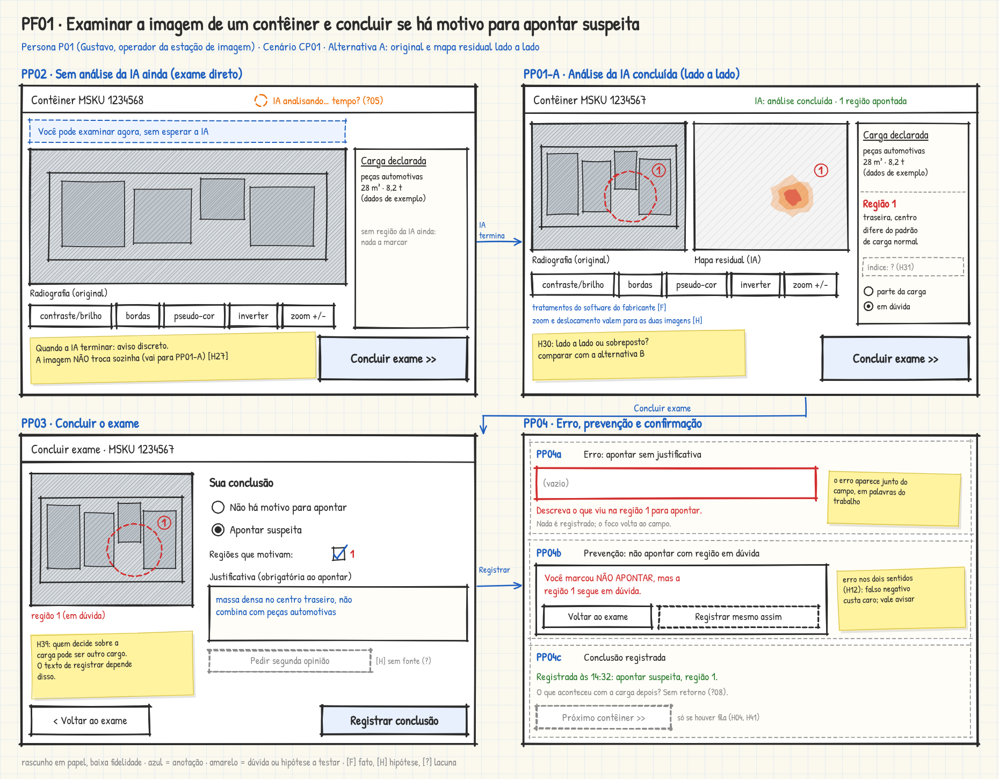
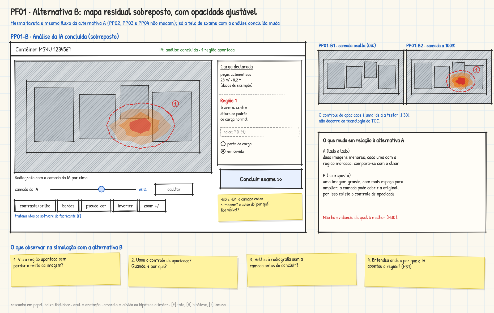

# Entrega 6 — Prototipação em papel

**Data:** 22/10/2026  
**Status:** 🟨 em andamento  
**Responsabilidade:** 1 solução integrada por equipe

## Objetivo da atividade

Externalizar rapidamente ideias de interação em baixa fidelidade para explorar alternativas antes de investir em detalhes visuais. O valor da atividade está no **ciclo construir → simular → observar → revisar**, não na beleza do desenho.

## 1. Escopo do protótipo

**Personas:** P01 Gustavo Onofre, operador da estação de imagem (primária).  
**Cenários/tarefas cobertos:** CP01; tarefa "Examinar a imagem de um contêiner e concluir se há motivo para apontar suspeita" (A02), modelada em GOMS na Entrega 5.  
**Objetivos principais:** AC02 (entender onde e por que a IA apontou a discrepância) e AC03 (registrar o resultado com sua justificativa), a serviço de H38 (chegar a uma conclusão em que confie e registrá-la de forma defensável).

**Fora deste esboço:** a triagem em fila (A01, AC01), porque H04 e H41 ainda não têm sustentação; a consulta ao histórico (AC04); e o que quem decide faz com o registro depois (P02, CP02). A imagem tende a chegar do scanner sem ação do usuário (H26), então não há tela de entrada de dados.

## 1.1 Famílias de interface

| Família | No protótipo? | Por que |
|---|---|---|
| Relatório/resultados com explicação e comparação | Sim, é o núcleo | AC02. Mostra a radiografia, o mapa residual e a região apontada. A forma está em aberto (H30, H31) e por isso há duas alternativas (PP01-A e PP01-B). |
| Acompanhamento de execução | Sim, só como estado | A análise da IA pode demorar (H27, ?05). O estado PP02 permite examinar sem esperar. |
| Registro do resultado | Sim | AC03, H38 (PP03 e PP04c). |
| Prevenção de erro | Sim, só dois avisos | O erro tem custo nos dois sentidos (H12). PP04a e PP04b. |
| Dashboard, fila e alertas | Não | Dependem de H04, H25, H33 e H41, que ainda são hipóteses secundárias. |
| Histórico com busca e filtros | Não | AC04 tem prioridade média e não é parte do fluxo de examinar. |
| Entrada/seleção de dados | Não | H26: a imagem tende a vir do scanner. |
| Configuração, administração, perfis, login e CRUD | Não | Fora do recorte de IHC (Entrega 1). |

> Não foram desenhadas telas por obrigação. Cada tela e estado abaixo se liga a uma tarefa, a um objetivo ou a uma hipótese.

## 2. Fluxos escolhidos

| Fluxo | Tarefa/objetivo | Por que foi priorizado |
|---|---|---|
| PF01 | Examinar a imagem de um contêiner e concluir se há motivo para apontar suspeita (A02, CP01, AC02, AC03) | É onde a contribuição do TCC (o mapa residual, R01) chega a P01. Repete a cada contêiner (H05) e o erro tem custo nos dois sentidos (H12). A numeração permite acrescentar outros fluxos à solução integrada. |

**Como o fluxo nasce do GOMS da Entrega 5:**

| Elemento do GOMS | Onde aparece no protótipo |
|---|---|
| Regra SR1, caminho sem análise da IA (método M1, exame direto) | PP02 |
| Regra SR1, caminho com análise da IA (método M2, exame guiado pela região) | PP01-A e PP01-B |
| Tratamentos visuais do software do fabricante `[F]` | Barra de tratamentos em PP02, PP01-A e PP01-B |
| Método M3 (dados da declaração na própria estação) | Painel "Carga declarada". O método M4 (consulta fora da estação) não foi desenhado. |
| Meta G3 e método M5 (decidir se aponta suspeita) | PP03 |
| Critérios de decisão (SR3) e custo de errar (H12) | PP04a e PP04b |
| Fim da tarefa, com a conclusão seguindo para o registro (A03) | PP04c |

## 3. Telas e estados

**Autor(a) dos esboços:** Kawan Mark Geronimo Da Silva — 22.222.010-5

As telas e estados usam o prefixo `PP` (protótipo em papel) para não confundir com `P` (persona) nem com `F` (tela no Figma, Entrega 11). Os esboços foram feitos à mão livre, no estilo de papel, e os dados nas telas são exemplos. O SVG de cada imagem é a fonte editável.

### Alternativa A: original e mapa residual lado a lado

### Alternativa B: mapa residual sobreposto, com opacidade ajustável

Fontes editáveis: [`prototipo_pf01_alt_a.svg`](../assets/06_prototipos/prototipo_pf01_alt_a.svg) e [`prototipo_pf01_alt_b.svg`](../assets/06_prototipos/prototipo_pf01_alt_b.svg).

### Telas e estados

| ID | Tela/estado | Quando aparece | Controles que mudam o estado | Por que existe |
|---|---|---|---|---|
| PP02 | Exame sem análise da IA | A imagem chegou e a análise ainda não terminou ou não está disponível | Tratamentos da imagem (contraste/brilho, bordas, pseudo-cor, inverter, zoom); Concluir exame | `[H]` Não deixar P01 parado esperando (H27, ?05). Tratamentos: `[F]` C01 e C03. |
| PP01-A | Exame com a IA concluída, lado a lado | A análise terminou e apontou ao menos uma região | Os mesmos tratamentos; marcar a região como "parte da carga" ou "em dúvida"; Concluir exame | AC02. `[H]` H30 (alternativa A) e H31 (o "por quê" e o índice, este secundário). |
| PP01-B | Exame com a IA concluída, sobreposto | Igual ao PP01-A | Os mesmos controles, mais o ajuste de opacidade da camada da IA e ocultar a camada. Variações PP01-B1 (0%) e PP01-B2 (100%). | `[H]` H30 (alternativa B). |
| PP03 | Concluir exame | Ao escolher Concluir exame | Conclusão (não há motivo ou apontar suspeita); regiões que motivam; justificativa; pedir segunda opinião; voltar ao exame; registrar | AC03, H38. `[H]` H39: quem decide sobre a carga pode ser outro cargo, o texto do registro depende disso. |
| PP04a | Erro: apontar sem justificativa | Registrar "apontar suspeita" com a justificativa vazia | O foco volta ao campo, nada é registrado | AC03 e H38: o registro precisa ser defensável. |
| PP04b | Prevenção: não apontar com região em dúvida | Registrar "não há motivo" com uma região marcada em dúvida | Voltar ao exame; registrar mesmo assim | `[H]` H12: o erro tem custo nos dois sentidos. |
| PP04c | Conclusão registrada | Depois de registrar | Próximo contêiner | AC03. `[?]` ?08: o retorno sobre o desfecho da carga não existe. O botão só faz sentido se houver fila (H04, H41). |

**Caminhos principais**

1. A imagem chega e a IA ainda analisa: PP02, depois "IA termina" leva a PP01-A (ou PP01-B), depois Concluir exame, PP03, Registrar e PP04c.
2. A imagem chega com a IA já concluída: PP01-A (ou PP01-B) direto.
3. Retorno: em PP03, "Voltar ao exame" retorna a PP01-A (ou PP01-B).
4. Erros e prevenção: PP04a e PP04b interrompem o registro e devolvem P01 à tela anterior.

**Estado ainda não desenhado:** a IA conclui sem apontar nenhuma região. Pela regra SR1, P01 segue pelo exame direto (PP02 sem o aviso de espera). Esse estado entra na revisão.

### 3.1 Alternativas para a apresentação do mapa residual (H30)

| Critério | A: lado a lado | B: sobreposto com opacidade ajustável |
|---|---|---|
| Como mostra a região | Duas imagens menores, com a região marcada em cada uma | Uma imagem grande, com a camada da IA por cima |
| O que pode ajudar | Comparar sem esconder a radiografia | Mais espaço para ampliar e examinar a região |
| Risco | Cada imagem fica menor, o que pode atrapalhar a ver detalhes | A camada pode cobrir a radiografia e competir com a pseudo-cor do software do fabricante (RC09) |
| Base | `[H]` H30 | `[H]` H30 |

Não há evidência de qual alternativa é melhor. Elas serão comparadas na simulação (seção 4) e, depois, na avaliação das Entregas 12 a 14.

### 3.2 O que o protótipo assume

| Premissa | Estado | Onde aparece |
|---|---|---|
| O software do fabricante oferece contraste, brilho, bordas, pseudo-cor e inversão | `[F]` C01, C03 | Barra de tratamentos |
| A estação mostra os dados da declaração da carga | `[F]` existe em C03; `[?]` se a unidade de P01 mostra | Painel "Carga declarada" |
| Marcar uma região como "em dúvida" ajuda a não esquecê-la | `[H]` | PP01-A, PP01-B, PP04b |
| O índice de anomalia ajuda a aceitar a IA | `[H]` H31, secundário | Painel de região |
| Um aviso discreto basta quando a IA termina, sem trocar a imagem sozinho | `[H]` H27 | PP02 |
| P01 pode pedir segunda opinião | `[?]` sem fonte | PP03 |
| O texto do registro depende de quem decide sobre a carga | `[H]` H39 | PP03 |
| Existe uma fila de contêineres | `[H]` H04, H41 | PP04c |

## 4. Simulação / walkthrough

**Estado: ainda não realizada.** Esta seção será preenchida com a evidência real da simulação. Nenhuma observação foi inventada.

**Roteiro da simulação**

- **Participante:** um colega que não participou do desenho das telas. É uma iteração formativa e não substitui os participantes da Entrega 14.
- **Tarefa lida ao participante:** "Você opera a estação de imagem. Chegou a imagem de um contêiner declarado como peças automotivas. Examine a imagem e diga se há motivo para apontar suspeita. Pense em voz alta."
- **Condução:** o facilitador troca as folhas conforme o participante age, sem explicar o que cada uma faz.
  1. Começar em PP02 e, depois de um tempo, avisar que a IA terminou e passar para PP01-A.
  2. Repetir com outro contêiner usando PP01-B. Metade dos participantes começa por B, para a ordem não enviesar.
  3. Concluir em PP03. Provocar PP04a (justificativa vazia) e PP04b (marcar uma região em dúvida e escolher "não há motivo").
- **O que observar:** onde o participante olhou primeiro e se olhou o resto da imagem; o que tentou fazer e não existe na tela; se entendeu onde e por que a IA apontou a região; se usou o ajuste de opacidade em B; como reagiu aos avisos; onde hesitou ao concluir.
- **Perguntas ao final:** qual alternativa ajudou mais a decidir e por quê; o que faltou na tela; o que sobrou.

| Observação | Tela/ação | Evidência | Consequência para o design |
|---|---|---|---|
| Pendente | Pendente | Pendente | Pendente |

## 5. Alterações após a simulação

Pendente: depende da seção 4.

| Antes | Problema | Depois | Justificativa |
|---|---|---|---|
| Pendente | Pendente | Pendente | Pendente |

## Checklist

- [ ] O protótipo cobre tarefas relevantes da Entrega 5.
- [ ] Cada tela/estado pode ser justificado por uma tarefa, decisão ou informação necessária.
- [ ] O projeto não criou dashboard/CRUD/login apenas para parecer “completo”.
- [ ] Telas/estados estão numerados e navegáveis na documentação.
- [ ] Há pelo menos uma simulação/walkthrough documentado.
- [ ] Críticas não foram apenas listadas: geraram decisão de revisão.
- [ ] O protótipo continua em baixa fidelidade; detalhes visuais não mascaram problemas de fluxo.
