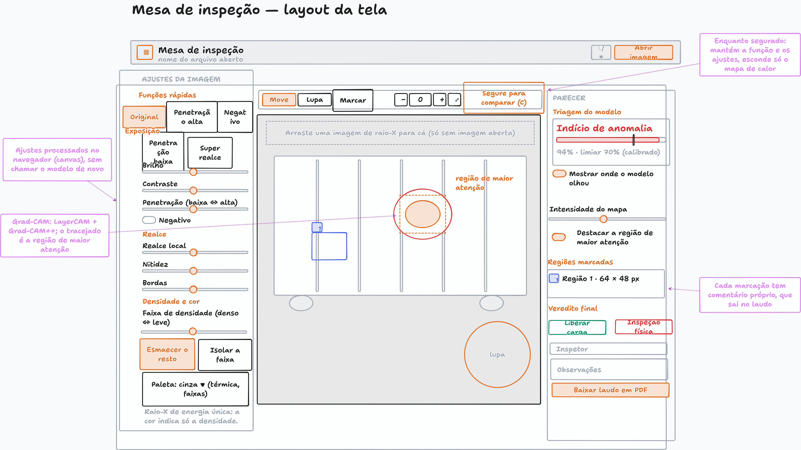
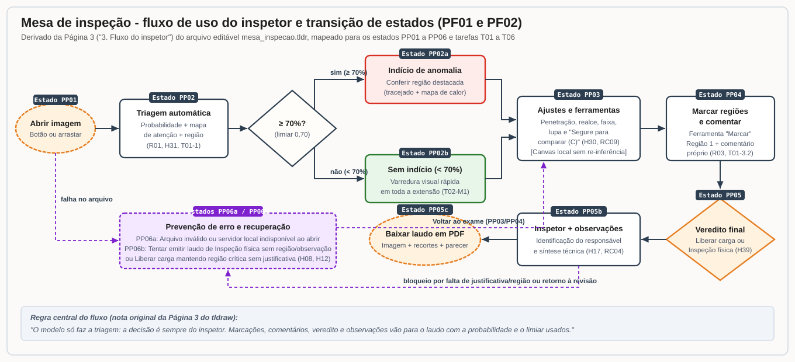
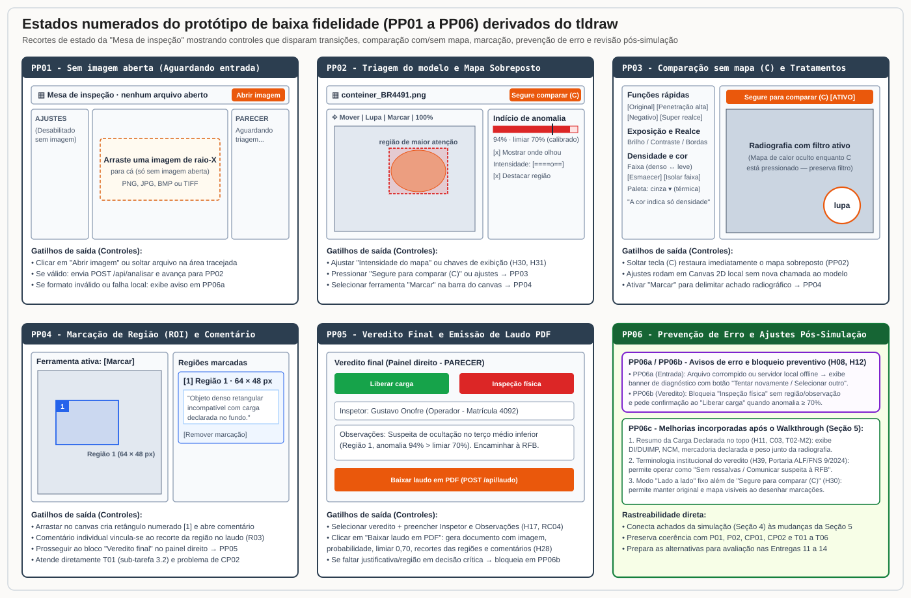

# Entrega 6 - Prototipação em papel

**Data:** 25/10/2026  
**Status:** 🟩 concluída  
**Responsabilidade:** 1 solução integrada por equipe  
**Autores:** Kawan Mark Geronimo Da Silva (22.222.010-5), Gabriel Albertini Pinheiro (22.122.094-8) e Alexandre Domiciano Pierri (22.125.061-6)

## Objetivo da atividade

Externalizar rapidamente ideias de interação em baixa fidelidade para explorar alternativas, validar entendimento do fluxo e identificar problemas antes de investir em alta fidelidade.

---

## 1. Escopo do protótipo

**Personas:**
- **P01 (Gustavo Onofre, operador da estação de imagem - primária):** conduz o exame radiográfico do contêiner, manipula os ajustes de imagem, avalia a região destacada pelo modelo e registra as marcações e o parecer técnico (`H01`, `H38`, `H39`).
- **P02 (Dr. Eduardo Resende, Auditor-Fiscal - primária na etapa de decisão/consumo do parecer):** utiliza o registro estruturado e o laudo gerado na estação (com recortes das regiões marcadas, comentários individualizados, probabilidade e limiar calibrado) para fundamentar de forma defensável seu ato formal no despacho aduaneiro (`CP02`, `R03`, `H06`, `H39`).
- **Fora do recorte de interface direta:** **P03 (Marcos Oliveira, agente de campo)** permanece como possível stakeholder até que `H42` seja investigada na Entrega 7, beneficiando-se indiretamente da localização espacial (`Região 1`) exportada no laudo sem exigir tela móvel própria.

**Cenários e tarefas cobertos:**
- **CP01 e tarefas T01 (HTA), T02 (GOMS) e T03 (CTT) de P01:** inspecionar a imagem de raio-X de um contêiner, aplicar tratamentos visuais de contraste/penetração/densidade, comparar a radiografia com a região apontada pelo modelo e registrar a conclusão fundamentada.
- **CP02 e tarefas T04 (HTA), T05 (GOMS) e T06 (CTT) de P02:** suprir a lacuna identificada na situação atual (em que o apontamento do escâner chegava sem coordenada espacial nem justificativa vinculada à imagem) por meio de marcações numeradas com comentário próprio e exportação de laudo em PDF (`R03`, `H28`, `RC04`, `RC07`).

**Objetivos principais do usuário no protótipo:**
- **AC02:** compreender onde e com que intensidade o modelo apontou indício de anomalia sobre a radiografia do contêiner, sem perder a visão da imagem original tratada (`R01`, `H30`, `H31`, `RC01`, `RC02`, `RC09`).
- **AC03:** delimitar regiões suspeitas diretamente no canvas, associar comentário técnico a cada região e emitir o veredito/laudo rastreável ao responsável (`R03`, `H17`, `H28`, `H38`, `RC04`, `RC07`).

> **Nota de alinhamento técnico com o TCC:** enquanto a formulação inicial da Entrega 1 descrevia a localização de anomalias apenas sob o termo genérico de mapa residual de reconstrução, a evolução experimental do TCC consolidou o pipeline com pré-processamento padronizado (`512 px`, imagem + filtro `Sobel` + `CLAHE`), classificador `EfficientNet-B1` treinado com anomalias sintéticas baseadas na Lei de Beer-Lambert e mapas de atenção combinados (`LayerCAM` nas `features[5]` + `Grad-CAM++` nas `features[6,7]`). Do ponto de vista de IHC, a capacidade entregue ao usuário permanece exatamente a prevista em `R01`, `R02` e `R03`: fornecer um indicador calibrado de triagem (`limiar 70%`) e um mapa visual que localiza a região de maior atenção sobre a radiografia.

## 1.1 Famílias de interface escolhidas

A tabela abaixo explicita quais famílias de interface do catálogo da disciplina foram incorporadas ao esboço da **Mesa de inspeção** e quais foram deliberadamente excluídas por não possuírem tarefa validada no recorte atual:

| Família de interface | Incluída no protótipo? | Justificativa baseada nas Entregas 1 a 5 e na Rastreabilidade |
|---|---|---|
| **Comparação de resultados e manipulação visual** | **Sim (núcleo central)** | Atende `A02`, `AC02`, `R01`, `RC01`, `RC09` e `RC10`. Ocupa o centro e a lateral esquerda da tela (`AJUSTES DA IMAGEM` e canvas com `Segure para comparar (C)`, `Lupa` e controle `Intensidade do mapa`), permitindo confrontar a radiografia tratada com o mapa de atenção sem poluição visual permanente. |
| **Detalhamento, explicabilidade e anotação espacial** | **Sim (painel direito e canvas)** | Atende `AC02`, `AC03`, `R01`, `R03`, `H31`, `RC02` e `RC04`. Inclui o cartão `Triagem do modelo` (`94% · limiar 70% calibrado`), as chaves `Mostrar onde o modelo olhou` e `Destacar a região de maior atenção`, e a ferramenta `Marcar` com lista de `Regiões marcadas` e comentários individuais. |
| **Relatório / resultados e registro de parecer** | **Sim (painel direito)** | Atende `A03`, `AC03`, `R03`, `H17`, `H28`, `H38`, `H39`, `RC04` e `RC07`. Consolida o `Veredito final`, a identificação do `Inspetor`, o campo `Observações` e a geração de `Baixar laudo em PDF` contendo imagem, recortes das regiões e comentários para encaminhamento formal (`CP01`, `CP02`). |
| **Entrada / seleção de dados com validação** | **Sim (mínima, na barra superior e dropzone)** | Atende `H26` no protótipo demonstrativo local: botão `Abrir imagem` e área tracejada `"Arraste uma imagem de raio-X para cá (só sem imagem aberta)"`, com validação de formato (`PNG`, `JPG`, `BMP`, `TIFF`). |
| **Acompanhamento de execução e estado local** | **Sim (estado transitório)** | Atende `H27` e `?05`: aviso de carregamento do modelo local ao iniciar a janela e feedback imediato durante o processamento da imagem em `POST /api/analisar`, enquanto os ajustes de imagem rodam instantaneamente no navegador (`Canvas 2D`) sem nova chamada ao modelo. |
| **Dashboard / fila priorizada e alertas em tempo real** | **Não** | Fora deste esboço: dependem de `H04`, `H25`, `H33` e `H41` (se o operador escolhe a ordem de exame em uma fila), que seguem como hipóteses abertas para investigação na Entrega 7. |
| **Histórico agregado com busca e filtros** | **Não** | Fora deste esboço: a investigação agregada de padrões (`A04`, `H02`, `?02`) pertence a outro perfil (Analista de Inteligência), e a consulta individual (`AC04`, `H29`) é secundária frente ao fluxo principal de inspeção da imagem. |
| **Configuração técnica de limiar, administração, login e CRUD** | **Não** | Fora do recorte de IHC (Entrega 1, seção 8; Entrega 2, seção 3.1; `?01` e `?03`). O limiar `70%` aparece apenas como referência calibrada de leitura no medidor, sem expor parâmetros matemáticos de treinamento ao operador (`H37`, `RC03`). |

---

## 2. Fluxos escolhidos

O protótipo em baixa fidelidade foi estruturado em torno de dois fluxos encadeados (`PF01` e `PF02`) que cobrem integralmente a jornada de exame e documentação da inspeção na **Mesa de inspeção**:

| Fluxo | Tarefa / objetivo coberto | Personas e artefatos de origem | Por que foi priorizado |
|---|---|---|---|
| **PF01** | **Carregar radiografia, interpretar triagem do modelo e inspecionar a imagem com filtros e comparação** (`A02`, `AC02`, `R01`) | `P01` \| `CP01` \| `T01` (sub-tarefas `1` e `2`) e `T02` (métodos `M1`, `M2` e `M4`) | É o coração da interação com a contribuição do TCC: permite verificar se há indício de anomalia (`≥ 70%`), localizar a região de maior atenção e inspecionar a estrutura física da carga com filtros radiográficos e remoção temporária do mapa de calor (`Segure para comparar (C)`). |
| **PF02** | **Demarcar regiões suspeitas, comentar achados, registrar veredito e exportar laudo em PDF** (`A03`, `AC03`, `R03`) | `P01` e `P02` \| `CP01`, `CP02` \| `T01` (sub-tarefa `3`), `T03`, `T04`, `T05` e `T06` | Transforma a percepção visual do inspetor em evidência documental rastreável: vincula cada retângulo marcado (`Região 1`) a um comentário próprio e gera o documento técnico que resolve a ruptura de comunicação entre o escâner e a decisão aduaneira (`CP02`). |

### 2.1 Rastreabilidade direta entre as tarefas da Entrega 5 e o esboço no tldraw

| Etapa nas tarefas modeladas (Entrega 5) | Como o esboço da Mesa de inspeção apoia a etapa | Elementos correspondentes no tldraw |
|---|---|---|
| **T01 (1.1) / T02:** Receber e posicionar a radiografia do contêiner na tela | Entrada direta por arraste na dropzone central ou pelo botão `Abrir imagem`, ajustando enquadramento (`⤢`, `100%`, `+`, `−`, `✥ Mover`). | Barra superior (`Abrir imagem`), dropzone tracejada e barra de ferramentas do canvas. |
| **T01 (2.1, 2.2) / T02 (M1):** Varredura visual e aplicação de filtros radiográficos (`[F]` ADE Coana nº 19/2014; `C01`, `C03`) | Painel esquerdo `AJUSTES DA IMAGEM` agrupado por objetivo visual: `Funções rápidas` (`Original`, `Penetração alta`, `Negativo`, `Penetração baixa`, `Super realce`), `Exposição` (`Brilho`, `Contraste`, `Penetração`), `Realce` (`Realce local`, `Nitidez`, `Bordas`) e `Densidade e cor` (`Faixa de densidade`, `Esmaecer o resto`, `Isolar a faixa`, `Paleta`). | Painel esquerdo completo, processado localmente em `Canvas 2D` sem recarregar o modelo. |
| **R01 / AC02 / H30 / H31:** Localizar rapidamente onde a imagem diverge do esperado e comparar sem perder os contornos reais | Cartão `Triagem do modelo` (`Indício de anomalia · 94% · limiar 70%`), chaves `Mostrar onde o modelo olhou` e `Destacar a região de maior atenção`, slider `Intensidade do mapa` e botão `Segure para comparar (C)`, que oculta só o mapa de calor preservando os ajustes ativos. | Painel direito (`Triagem do modelo`), canvas central (`região de maior atenção`) e barra do canvas (`Segure para comparar (C)` e `lupa`). |
| **T01 (3.2) / T03 / T04 / CP02:** Delimitar espacialmente a anomalia e fundamentar o apontamento/decisão | Ferramenta `Marcar` permite desenhar retângulos numerados (`[1] Região 1 · 64 × 48 px`) no canvas; cada marcação abre comentário próprio no painel `PARECER` e compõe o laudo em PDF junto com `Veredito final`, `Inspetor` e `Observações`. | Ferramenta `Marcar`, caixa azul `1` no canvas, seção `Regiões marcadas` e seção `Veredito final` (`Liberar carga`, `Inspeção física`, `Baixar laudo em PDF`). |

---

## 3. Telas e estados

Os esboços de baixa fidelidade foram elaborados pela equipe no **tldraw** (ferramenta de desenho livre em estilo de papel/quadro branco), o que permitiu desenhar rapidamente a estrutura da interface, anotar decisões de comportamento diretamente ao redor dos componentes (notas violetas no canvas) e mapear o fluxo de uso antes da construção de telas de alta fidelidade.

Para evitar qualquer colisão de identificadores com personas (`P01` a `P03`) ou com as futuras telas de alta fidelidade no Figma (`F01`, Entrega 11), os estados do protótipo de baixa fidelidade utilizam o prefixo **`PP`** (`PP01` a `PP06`), conforme registrado na [Matriz de rastreabilidade](../RASTREABILIDADE.md).

### 3.1 Esboço original em baixa fidelidade no tldraw (Layout completo da Mesa de inspeção)

A imagem abaixo apresenta o esboço original criado pela equipe no tldraw (`Página 1: 1. Layout da tela`), consolidando a organização espacial em três zonas: **Ajustes da imagem** (esquerda), **Canvas de inspeção radiográfica** (centro, com maior prioridade visual conforme `RC10`) e **Parecer / Triagem do modelo** (direita), acompanhado das anotações de comportamento em caixas violetas:

- **Imagem PNG do esboço original:** [`mesa_inspecao.png`](../assets/06_prototipos/mesa_inspecao.png)
- **Arquivo-fonte editável do tldraw (com as 3 páginas: `1. Layout da tela`, `2. Arquitetura` e `3. Fluxo do inspetor`):** [`mesa_inspecao.tldr`](../assets/06_prototipos/mesa_inspecao.tldr)

### 3.2 Diagrama do fluxo de uso e transição entre estados (`PF01` e `PF02`)

O diagrama abaixo reproduz o fluxo desenhado na `Página 3 (3. Fluxo do inspetor)` do arquivo [`mesa_inspecao.tldr`](../assets/06_prototipos/mesa_inspecao.tldr), explicitando o código de cada estado (`PP01` a `PP06`), o ponto de decisão pelo limiar calibrado (`≥ 70%`) e os caminhos de retorno e prevenção de erro:

### 3.3 Detalhamento visual dos estados numerados (`PP01` a `PP06`)

Como o esboço principal do tldraw condensa em uma única prancha elementos de diferentes momentos da interação (como o aviso `"Arraste uma imagem de raio-X para cá (só sem imagem aberta)"` e a imagem já carregada com marcações), o painel abaixo decompõe e numera explicitamente cada tela/estado (`PP01` a `PP06`) e seus respectivos controles de transição:

### 3.4 Tabela descritiva de telas, estados e controles de transição

| ID do Estado | Nome da tela / estado | O que exibe ao usuário | Controles que mudam o estado (gatilhos) | Rastreabilidade (`H`, `RC`, `T`, `CP`) |
|---|---|---|---|---|
| **PP01** | **Mesa sem imagem aberta (Estado inicial)** | Barra superior com `"nenhum arquivo aberto"`; centro com a caixa tracejada `"Arraste uma imagem de raio-X para cá (só sem imagem aberta)"`; painéis `AJUSTES DA IMAGEM` e `PARECER` aguardando carregamento. | - Botão `Abrir imagem` (topo direito) ou soltar arquivo (`PNG`, `JPG`, `BMP`, `TIFF`) na dropzone. - Se válido: aciona `POST /api/analisar` e avança para `PP02` (`PP02a` ou `PP02b`). - Se inválido/offline: desvia para `PP06a`. | `H26`, `H27`, `?05`, `T01` (`1.1`) |
| **PP02a** | **Triagem concluída: Com indício de anomalia (`≥ 70%`)** | Radiografia centralizada no canvas; cartão `Triagem do modelo` em destaque vermelho (`"Indício de anomalia · 94% · limiar 70% (calibrado)"`); mapa de calor (`LayerCAM + Grad-CAM++`) e caixa tracejada laranja `"região de maior atenção"` ativos sobre a imagem. | - Chave `Mostrar onde o modelo olhou` (liga/desliga camada). - Slider `Intensidade do mapa` (ajusta opacidade em `H30`). - Chave `Destacar a região de maior atenção` (exibe/oculta bbox tracejado). - Botão/atalho `Segure para comparar (C)` ou sliders de `AJUSTES DA IMAGEM` → leva a `PP03`. - Botão `Marcar` → leva a `PP04`. | `R01`, `R02`, `AC02`, `H30`, `H31`, `H34`, `H37`, `RC01`, `RC02`, `RC09`, `RC10`, `CP01` |
| **PP02b** | **Triagem concluída: Sem indício (`< 70%`)** | Radiografia centralizada; cartão `Triagem do modelo` em tom neutro/verde (`"Sem indício"` abaixo da marca vertical de `70%`); imagem exibida limpa para varredura rápida em toda a extensão do contêiner. | - Mesmos controles de tratamento visual do painel esquerdo (`PP03`), `Lupa`, `Marcar` (`PP04`) e seção `Veredito final` (`PP05`), pois a decisão final permanece sempre com o inspetor. | `R01`, `H12`, `T02` (`M1`), `CP01` |
| **PP03** | **Inspeção comparativa sem mapa (`Segure C`) e Ajustes de imagem** | Enquanto `Segure para comparar (C)` está pressionado, o canvas oculta temporariamente o mapa de calor mas **mantém a função rápida e os ajustes ativos** (`Penetração alta`, `Negativo`, `Super realce`, `Brilho`, `Contraste`, `Bordas`, `Faixa de densidade` com `Esmaecer o resto` ou `Isolar a faixa` e `Paleta`). Inclui lente circular `lupa` para ampliação local. | - Manter pressionado `Segure para comparar (C)` (transição momentânea `PP02 ↔ PP03`). - Botões de `Funções rápidas`, sliders de `Exposição`, `Realce`, `Densidade e cor` e seletor `Paleta` (executados em `Canvas 2D` no navegador sem chamar o modelo novamente). - Ferramentas `✥ Mover`, `Lupa`, zoom (`−`, `100%`, `+`, `⤢`) e `Marcar` (`PP04`). | `R01`, `H05`, `H09`, `H10`, `H30`, `RC01`, `RC09`, `C01`, `C03`, `T01` (`2.1`, `2.2`), `T02` (`M1`) |
| **PP04** | **Marcação espacial de regiões (`Marcar`) e comentários** | Ferramenta `Marcar` ativa na barra do canvas; retângulo azul numerado (`1`) desenhado sobre a anomalia; item `[1] Região 1 · 64 × 48 px` listado em `Regiões marcadas` no painel direito, com campo de comentário individualizado. | - Arrastar cursor no canvas com `Marcar` ativo (cria `Região N` e foca no campo de comentário correspondente). - Editar ou excluir comentário/região na lista `Regiões marcadas`. - Avançar para `Veredito final` (`PP05`). | `R03`, `AC03`, `H31`, `H38`, `RC04`, `C03`, `T01` (`3.2`), `CP02` |
| **PP05** | **Veredito final, identificação e emissão de laudo em PDF** | Bloco inferior do painel `PARECER` contendo os botões de decisão (`Liberar carga` em verde e `Inspeção física` em vermelho), campos `Inspetor` e `Observações`, e botão principal `Baixar laudo em PDF` (`POST /api/laudo`). | - Selecionar `Liberar carga` ou `Inspeção física` (`PP05`). - Preencher `Inspetor` e `Observações` (`PP05b`). - Acionar `Baixar laudo em PDF`: se válido, gera o PDF com imagem, recortes das regiões, comentários, probabilidade e limiar (`PP05c`) e abre diálogo `Salvar como`; se incompleto/inconsistente, aciona `PP06b`. | `R03`, `A03`, `AC03`, `H06`, `H17`, `H18`, `H28`, `H38`, `H39`, `RC04`, `RC07`, `T03`, `T04`, `T06`, `CP01`, `CP02` |
| **PP06a / PP06b** | **Estados de erro, bloqueio preventivo e retorno** | **PP06a (Erro de entrada/conexão):** aviso quando o arquivo aberto não é uma imagem radiográfica suportada ou quando o servidor local (`127.0.0.1`) ainda está carregando. **PP06b (Prevenção de erro na decisão):** aviso de bloqueio ao tentar emitir laudo de `Inspeção física` sem nenhuma região marcada ou sem `Observações`, ou confirmação explícita ao escolher `Liberar carga` quando o modelo apontou `Indício de anomalia ≥ 70%`. | - Em `PP06a`: botão `Selecionar outro arquivo` retorna a `PP01`. - Em `PP06b`: botão `Voltar ao exame e revisar` devolve o foco para `PP04` (marcação) ou `PP05b` (observações), impedindo emissão acidental de laudo incompleto. | `H08`, `H12`, `H19`, `H27`, `H38`, `RC04`, `RC07` |

---

## 4. Simulação / walkthrough

Para validar o esboço em baixa fidelidade da **Mesa de inspeção** antes da etapa de alta fidelidade, foi conduzida uma sessão de *walkthrough* formativo utilizando a prancha desenhada no tldraw ([`mesa_inspecao.png`](../assets/06_prototipos/mesa_inspecao.png)) e o fluxo de uso ([`prototipo_fluxo_01.svg`](../assets/06_prototipos/prototipo_fluxo_01.svg)).

**Protocolo da simulação formativa:**
- **Perfil do participante (iteração formativa):** colega de curso externo à elaboração das telas (conforme orientação do template para a Entrega 6, sem substituir os participantes finais da Entrega 14).
- **Cenário e tarefa apresentados ao participante:** *"Você está operando a Mesa de inspeção de raio-X (`P01`, `CP01`). Acabou de abrir a imagem de um contêiner declarado como bobinas plásticas e peças automotivas. O sistema exibiu o resultado na tela. Inspecione a imagem, verifique a região apontada, utilize os controles necessários para ter certeza do seu achado e conclua o registro para encaminhamento."*
- **Condução:** o participante percorreu os estados `PP01 → PP02a → PP03 → PP04 → PP05` pensando em voz alta (*think-aloud*), indicando onde clicaria, como interpretava cada controle do painel esquerdo (`AJUSTES DA IMAGEM`), da barra central (`Segure para comparar (C)`, `Lupa`, `Marcar`) e do painel direito (`PARECER`), e o que esperava acontecer em cada passo.

### 4.1 Registro das observações e evidências do walkthrough

| # | Observação durante a simulação | Tela / estado e ação realizada | Evidência coletada no walkthrough | Consequência para o design (alimenta a Seção 5) |
|---|---|---|---|---|
| **OBS-01** | **Ausência dos dados da carga declarada (manifesto) na tela obrigou o participante a perguntar o que havia no contêiner** | `PP02a` / `PP03` - ao tentar julgar se a mancha densa na `região de maior atenção` era normal ou suspeita | O participante apontou imediatamente para o retângulo tracejado laranja (`94%`), mas perguntou: *"Onde eu leio na tela o que esse contêiner declarou transportar para saber se essa densidade faz sentido?"* No esboço original, o topo mostrava apenas `nome do arquivo aberto`. | Confirmou na prática a relevância de `H11`, `C03` e do passo `1.2` de `T01` (`M2` de `T02`): incluir um cabeçalho/resumo compacto da **Carga declarada (DI/DUIMP, NCM, descrição da mercadoria e peso)** visível junto ao nome do arquivo. |
| **OBS-02** | **Boa aceitação do botão `Segure para comparar (C)`, mas dificuldade ao querer desenhar a marcação (`Marcar`) vendo os dois lados simultaneamente** | `PP03` e `PP04` - ao alternar entre `Segure para comparar (C)` e a ferramenta `Marcar` | O participante elogiou o comportamento de `Segure para comparar (C)` (*"muito bom esconder só o mapa de calor mantendo o filtro de penetração alta"*), porém notou que, ao soltar a tecla para desenhar o retângulo com o mouse na ferramenta `Marcar`, o mapa de calor voltava a cobrir a borda exata do objeto. | Para investigar `H30` de forma completa e apoiar a precisão do desenho em `PP04`, manter `Segure para comparar (C)` e acrescentar um botão de alternância de layout **`Vista: Sobreposta ⇄ Lado a lado`** na barra do canvas. |
| **OBS-03** | **Interpretação imediata do medidor com limiar (`94% · limiar 70%`), com pedido de clareza sobre o que o modelo detecta** | `PP02a` - leitura do cartão `Triagem do modelo` no painel `PARECER` | O traço vertical marcando o `limiar 70% (calibrado)` na barra de progresso permitiu entender instantaneamente por que `94%` gerou o alerta `Indício de anomalia` (`H31`, `RC11` redundância textual + visual). Contudo, o participante perguntou se `94%` significava *"94% de chance de ser droga/arma"*. | Reforçar junto ao medidor um subtítulo explicativo curto em linguagem do domínio (`RC03`, `H37`): *"Divergência visual frente ao padrão radiográfico esperado (não classifica o tipo de ilícito)"*. |
| **OBS-04** | **Ambiguidade institucional nos botões `Liberar carga` e `Inspeção física` para o perfil do operador do escâner (`H39`)** | `PP05` - ao escolher a ação no bloco `Veredito final` | Quando lembrado do contexto de `CP01` (em que o operador do recinto alfandegado aponta a suspeita para a Receita Federal decidir, conforme Portaria ALF/FNS nº 9/2024), o participante comentou que `"Liberar carga"` e `"Inspeção física"` parecem decisões finais da autoridade aduaneira (`P02`), e não o apontamento técnico do operador (`P01`). | Alinhar os rótulos do bloco `Veredito final` a `H39` e `RC07`: explicitar o par **`Sem ressalvas na imagem (Liberar triagem)`** e **`Apontar suspeita / Solicitar inspeção física`**, indicando que o laudo fundamenta a decisão formal no despacho. |
| **OBS-05** | **Dúvida sobre o momento em que o comentário de cada região marcada é editado** | `PP04` - após desenhar `[1] Região 1 · 64 × 48 px` com a ferramenta `Marcar` | Na prancha original, a nota violeta explicava que *"Cada marcação tem comentário próprio, que sai no laudo"*, mas na caixa `Regiões marcadas` aparecia apenas a linha `[1] Região 1 · 64 × 48 px`, sem exibir visualmente o campo de texto do comentário. | Exibir explicitamente uma caixa de texto de comentário logo abaixo de cada item `[1] Região 1` na lista `Regiões marcadas`, com foco automático assim que o retângulo termina de ser desenhado no canvas. |
| **OBS-06** | **Risco de clicar em `Liberar carga` ou `Baixar laudo em PDF` sem preencher `Inspetor` e `Observações` ou com anomalia alta ativa** | `PP05` - tentativa de finalizar rapidamente a tarefa | O participante clicou em `Inspeção física` e foi direto para `Baixar laudo em PDF` antes de preencher os campos `Inspetor` e `Observações`. | Tornar explícito o estado de prevenção de erro `PP06b` (`H08`, `H12`, `H19`, `RC04`): exigir identificação do `Inspetor` e justificativa/comentário antes de liberar a exportação do laudo de suspeita, e exibir confirmação caso selecione liberação com anomalia `≥ 70%`. |

---

## 5. Alterações após a simulação

A tabela a seguir consolida as alterações projetadas sobre o esboço original do tldraw a partir das evidências recolhidas no *walkthrough* da Seção 4 (representadas no estado revisado `PP06c` de [`estados_prototipo_pp01_pp06.svg`](../assets/06_prototipos/estados_prototipo_pp01_pp06.svg)), preparando a base para o modelo conceitual (Entrega 9), o MoLIC (Entrega 10) e o protótipo de alta fidelidade no Figma (Entrega 11):

| Antes (no esboço original do tldraw) | Problema identificado na simulação | Depois (alteração definida para a evolução do protótipo) | Justificativa e rastreabilidade (`H`, `RC`, `T`, `CP`) |
|---|---|---|---|
| Barra superior exibia apenas `Mesa de inspeção` e `nome do arquivo aberto`, sem dados do manifesto ou declaração. | O participante não conseguia verificar se a densidade e a geometria vistas no raio-X eram compatíveis com a mercadoria declarada (`OBS-01`). | Inclusão de uma faixa/resumo expansível de **Dados da Carga Declarada** (`Unidade de carga / Contêiner`, `DI/DUIMP`, `Mercadoria declarada / NCM` e `Peso bruto`) na barra superior ao abrir o caso. | Atende diretamente `H11`, `C03` (*manifest data comparison*), a sub-tarefa `1.2` do HTA `T01` e o método `M2` do GOMS `T02`, além de apoiar a conferência documental de `P02` em `T04`. |
| Comparação entre radiografia tratada e mapa de atenção dependia exclusivamente de manter pressionado `Segure para comparar (C)` ou de mover o slider `Intensidade do mapa`. | Ao soltar a tecla `C` para desenhar com o mouse na ferramenta `Marcar`, o mapa de calor voltava a cobrir os contornos finos do objeto (`OBS-02`). | Manutenção do atalho rápido `Segure para comparar (C)` (excelente para inspeção ágil) somada a um seletor de modo na barra do canvas: **`Sobreposto ⇄ Lado a lado`**. | Permite avaliar de maneira justa as duas alternativas da hipótese `H30` e atende `RC01` e `RC09` sem forçar esforço motor contínuo durante a marcação de regiões (`PP04`). |
| Cartão `Triagem do modelo` mostrava `"Indício de anomalia"` e `"94% · limiar 70% (calibrado)"` sem explicar a natureza do índice. | Dúvida se a porcentagem indicava certeza jurídica de contrabando ou grau de atipicidade visual na radiografia (`OBS-03`). | Adição de microtexto explicativo abaixo do medidor: *"Índice de atipicidade visual na região destacada (apoio à triagem; não substitui a verificação do inspetor)"*. | Segue `RC02`, `RC03` e `H37`, alinhado à regra central já anotada na Página 3 do `.tldr`: *"O modelo só faz a triagem: a decisão é sempre do inspetor"*. |
| Lista `Regiões marcadas` exibia apenas o título `[1] Região 1 · 64 × 48 px`, deixando o campo de comentário implícito na nota lateral. | O participante não viu onde digitar o comentário específico da `Região 1` após soltar o mouse no canvas (`OBS-05`). | Cada cartão `[N] Região N` dentro de `Regiões marcadas` passa a exibir um campo de texto próprio (`Comentário da região`) aberto automaticamente ao criar a marcação, mais botão de exclusão (`×`). | Materializa na interface a própria nota de projeto do tldraw (*"Cada marcação tem comentário próprio, que sai no laudo"*) e garante a evidência espacial exigida por `R03`, `RC04` e `CP02`. |
| Botões do bloco `Veredito final` rotulados apenas como `Liberar carga` e `Inspeção física`, sem validação visível de campos obrigatórios. | Ambiguidade frente à divisão de papéis entre operador do escâner e Auditor-Fiscal (`OBS-04`) e tentativa de baixar o PDF sem preencher `Inspetor` e `Observações` (`OBS-06`). | Rótulos ajustados para refletir o parecer técnico (`Sem ressalvas / Liberar` vs. `Apontar suspeita / Inspeção física`) e adição do bloqueio preventivo `PP06b` (exige `Inspetor`, ao menos uma região comentada ou justificativa em `Observações`, e confirmação ao liberar carga com alerta `≥ 70%`). | Respeita a hipótese `H39` (Portaria ALF/FNS nº 9/2024 e divisão COV/Edaim em `CP01` e `CP02`) e previne erros críticos de ambos os tipos (`H08`, `H12`, `H17`, `H19`, `RC04`, `RC07`). |

---

## Checklist

- [x] O protótipo cobre os fluxos prioritários das tarefas analisadas.
- [x] Em TCC sem interface original, as telas escolhidas decorrem das tarefas/objetivos e não de um template genérico (`login + dashboard + CRUD`).
- [x] As telas/estados estão numeradas e legíveis.
- [x] É possível entender como sair de um estado e chegar ao próximo.
- [x] Há estados de erro, vazio ou confirmação quando relevantes.
- [x] A simulação foi realizada e gerou observações concretas.
- [x] Mudanças após a simulação foram registradas com justificativa.
- [x] Rastreabilidade atualizada.
