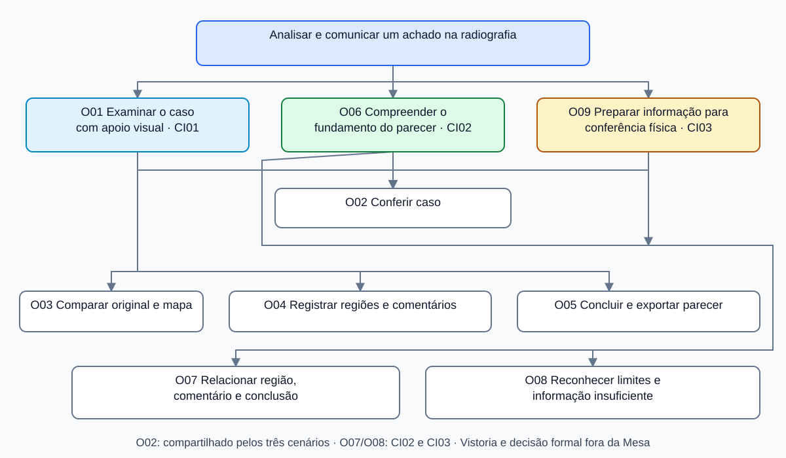

# Entrega 9 — Modelo conceitual e design centrado na comunicação

**Data:** 04/11/2026 
**Status:** 🟩 concluída 
**Responsabilidade:** soluções individuais e consolidação da equipe

## Objetivo e base do projeto

Definir como a Mesa de inspeção comunica o resultado do modelo e permite registrar um parecer. Os cenários abaixo partem de [CP01–CP03](04_cenarios_problema.md), das tarefas T01–T09, dos fluxos PF01/PF02 e das [metas MU01–MU06](08_engenharia_usabilidade.md).

São situações propostas para o protótipo, não sessões realizadas com profissionais. **Os trechos em negrito apresentam a interação acrescentada ou alterada em relação ao cenário de problema.** As condições de turno, fadiga e comunicação dos cenários originais continuam hipóteses. O sistema apoia a análise e produz um parecer; não autoriza desembaraço.

## 1. Soluções individuais

### CI01 — examinar a imagem e registrar uma suspeita

**Autor(a):** Kawan Mark Geronimo Da Silva — 22.222.010-5 
**Origem:** CP01; P01 Gustavo Onofre; T01–T03; PF01/PF02.

Durante o plantão, Gustavo recebe a imagem de um contêiner declarado como paletes de madeira. Uma região parece mais densa, mas a diferença é pequena. **Na Mesa de inspeção, ele abre o caso e confere sua identificação e a descrição disponível da carga. O sistema informa que a imagem está sendo analisada e, ao terminar, apresenta o resultado do modelo e a região de maior atenção.**

**Gustavo compara a radiografia com o mapa, alterna entre sobreposição e lado a lado e ajusta a imagem sem alterar o arquivo original. A legenda explica que o destaque indica relevância para a predição, sem identificar o tipo de ilícito.** Como a dúvida permanece, **ele marca a região, escreve o que observou e registra “Suspeita apontada”, com uma justificativa. Revisa o parecer e o exporta para encaminhamento ao responsável. Se faltar um campo obrigatório, o sistema indica o que corrigir e mantém o restante preenchido.** O parecer deixa registrada sua análise, sem afirmar que a suspeita foi confirmada.

| Alteração em relação a CP01 | Motivo | Base |
|---|---|---|
| Contexto da carga junto da radiografia | Apoiar a comparação com o que está declarado. | H11; ED02; OBS-01 da Entrega 6. |
| Comparação e explicação do mapa | Ajudar a examinar o destaque sem perder a imagem original. | R01; H30/H31; MU01/MU02. |
| Marcação comentada e parecer revisável | Preservar o achado e a justificativa. | R03; T03; MU03/MU05. |

### CI02 — compreender o parecer antes de decidir

**Autor(a):** Gabriel Albertini Pinheiro — 22.122.094-8 
**Origem:** CP02; P02 Eduardo Resende; T04–T06; PF02.

Eduardo recebe um caso cuja carga levantou suspeita na imagem do escâner. Precisa entender o motivo e confrontá-lo com os dados do despacho. **Na situação proposta, recebe o parecer exportado pela Mesa, identificado pelo caso, pelo responsável e pela data. A radiografia contém regiões numeradas, acompanhadas de recortes e comentários.**

**Ele relaciona o comentário à região indicada e verifica a descrição da carga. O documento separa o resultado do modelo da conclusão de Gustavo e informa que é um parecer de apoio. Se o conteúdo for insuficiente ou o caso não corresponder, Eduardo solicita esclarecimento pelo canal institucional, sem interpretar o número do modelo como autorização de liberação.** A decisão formal continua no sistema do despacho. **A exportação não significa envio automático ao Siscomex; o encaminhamento do documento é externo ao protótipo.**

| Alteração em relação a CP02 | Motivo | Base |
|---|---|---|
| Parecer com caso, autor, região e comentário | Propor uma forma de tornar a suspeita compreensível ao destinatário. | R03; T05/T06; H28/?08 ainda abertas. |
| Separação entre resultado e conclusão humana | Evitar atribuir à IA a decisão formal. | H39; MU02; ED01/ED03. |
| Conferência do documento e pedido de esclarecimento | Permitir reconhecer informação insuficiente ou caso incorreto. | MU03/MU05; RC04/RC07. |

### CI03 — preparar a informação para a conferência física

**Autor(a):** Alexandre Domiciano Pierri — 22.125.061-6 
**Origem:** CP03; P03 Marcos Oliveira como stakeholder; T07–T09 exploratórias; contribuição para PF02.

Marcos participa da conferência de um contêiner refrigerado retido após suspeita. No cenário de problema, a solicitação não informa onde a diferença de densidade foi observada. **Na proposta, o responsável pelo encaminhamento dispõe de um parecer com identificação do caso, imagem marcada e descrição da região suspeita. Antes de encaminhar, confere se os comentários correspondem às marcações e se o documento pertence à carga correta.**

**Marcos recebe essa informação pelo procedimento institucional, sem acessar uma aplicação móvel nova. A região na radiografia serve como referência visual; não é uma coordenada física exata nem define, sozinha, como a carga deve ser aberta.** A equipe conduz a verificação conforme seu procedimento. **O achado é registrado no fluxo do despacho; a Mesa não simula integração automática para receber esse desfecho.** O cenário propõe melhorar a informação encaminhada, sem afirmar redução medida do tempo de conferência.

| Alteração em relação a CP03 | Motivo | Base |
|---|---|---|
| Identificação, marcação e descrição no parecer | Propor informação que ajude a esclarecer a origem da suspeita. | H28/?08; R03; MU03. |
| Conferência do conteúdo antes do encaminhamento | Reduzir a chance de trocar caso ou região. | MU05; RC04. |
| Entrega externa do documento, sem tela para P03 | Respeitar o recorte e a ausência de evidência de uso direto. | H42; ED03. |

## 2. Design centrado na comunicação

**Convenção:** `U` é o usuário; `D` é o preposto do designer/sistema. As falas descrevem a intenção da interação, não um roteiro de entrevista. Em CI02/CI03, o parecer comunica por seu conteúdo; ações institucionais externas não são comandos da Mesa.

| Cenário / tópico > subtópico | Falas e signos | Intenção |
|---|---|---|
| CI01 — caso > identificação | U: “Quero examinar este caso.” D: “Esta é a imagem e esta é a carga informada.” **S01/S02** | Conferir o contexto antes de analisar. |
| CI01 — análise > andamento | D: “Analisando imagem”; ou “Não foi possível analisar. Tente novamente.” **S03** | Distinguir espera, resultado e falha. |
| CI01 — análise > resultado | U: “O que o modelo indicou?” D: “Este é o resultado e esta é a região relevante para a predição.” **S04/S05** | Explicar o apoio e seus limites. |
| CI01 — comparação > visualização | U: “Quero ver o original e comparar.” D: “Você pode ocultar o mapa ou ver lado a lado.” **S02/S05/S06** | Preservar a leitura da imagem. |
| CI01 — registro > achado | U: “Quero registrar esta região e o que observei.” D: “Região numerada, com comentário editável.” **S07/S08** | Vincular observação à marcação. |
| CI01 — registro > conclusão | U: “Quero concluir o parecer.” D: “Informe conclusão, justificativa e responsável.” **S09/S10/S11** | Distinguir julgamento humano e modelo. |
| CI01 — exportação > revisão/erro | D: “Revise o caso e as regiões”; “Preencha o responsável”; ou “Falha ao exportar; seus dados foram mantidos.” **S01/S07–S12** | Apoiar revisão e recuperação. |
| CI02 — consulta > fundamento | U: “Qual foi o motivo da suspeita?” D, no parecer: “Caso, responsável, região e comentário.” **S01/S07/S08/S11/S12** | Dar contexto ao destinatário. |
| CI02 — consulta > alcance | D, no parecer: “Resultado do modelo e parecer humano; sem autorização de desembaraço.” **S04/S09/S12** | Separar apoio e ato formal. |
| CI03 — encaminhamento > referência | U: “O documento identifica a carga e a região observada?” D, no parecer: “Imagem numerada e comentário correspondente.” **S01/S07/S08/S12** | Apoiar conferência do conteúdo antes da entrega externa. |

## 3. Mapas de objetivos

Os mapas individuais usam os mesmos identificadores do mapa consolidado. A consolidação reúne objetivos repetidos de registro e consulta, mantendo um único parecer para o caso.

| Autor / mapa individual | Objetivo principal e decomposição |
|---|---|
| Kawan — CI01 | **O01 Examinar o caso com apoio visual** → O02 Conferir caso; O03 Comparar original e mapa; O04 Registrar regiões e comentários; O05 Concluir e exportar parecer. |
| Gabriel — CI02 | **O06 Compreender o fundamento do parecer** → O02 Conferir caso; O07 Relacionar região, comentário e conclusão; O08 Reconhecer limites e informação insuficiente. |
| Alexandre — CI03 | **O09 Preparar a informação para conferência física** → O02 Conferir caso; O07 Relacionar região, comentário e conclusão; O08 Reconhecer limites e informação insuficiente. |

[Mapa em fonte Mermaid editável](../assets/09_modelo_conceitual/mapa_objetivos.mmd). O SVG também é editável. O09 cobre a preparação do documento na origem; a execução da vistoria permanece fora da interface.

### Dicionário de objetivos

| ID | Objetivo | Persona | Cenário | Prioridade |
|---|---|---|---|---|
| O01 | Examinar o caso com apoio visual | P01 | CI01 | alta |
| O02 | Conferir caso | P01/P02 | CI01–CI03 | alta |
| O03 | Comparar original e mapa | P01 | CI01 | alta |
| O04 | Registrar regiões e comentários | P01 | CI01 | alta |
| O05 | Concluir e exportar parecer | P01 | CI01 | alta |
| O06 | Compreender o fundamento do parecer | P02 | CI02 | alta |
| O07 | Relacionar região, comentário e conclusão | P01/P02 | CI01–CI03 | alta |
| O08 | Reconhecer limites e informação insuficiente | P01/P02 | CI01–CI03 | alta |
| O09 | Preparar a informação para conferência física | P01/P02; destinatário P03 | CI03 | média |

## 4. Esquema conceitual de signos

A tabela distingue dados do caso, saídas do modelo e entradas humanas. **Origem** indica de onde vem o valor, não prova que existe integração. No protótipo, usar casos fictícios e nome fictício do responsável.

| ID / grupo | Signo | Origem | Significado | Conteúdo | Restrição | Padrão | Prevenção | Recuperação |
|---|---|---|---|---|---|---|---|---|
| S01 / caso | Identificação e carga declarada | Dados do caso | Vincula imagem e parecer à unidade informada. | Identificador e descrição textual | Identificador obrigatório para exportar; descrição ausente deve ser indicada. | Sem caso aberto | Manter identificação visível e pedir revisão antes de exportar. | Corrigir o vínculo antes de prosseguir; avisar sobre descarte ao trocar o caso. |
| S02 / imagem | Radiografia original | Arquivo do caso | Evidência visual de referência. | Imagem | Formato compatível; preservar arquivo original. | Vazia | Rejeitar arquivo inválido com explicação. | Selecionar outro arquivo; restaurar visualização. |
| S03 / análise | Estado da análise | Sistema | Informa se há espera, resultado ou falha. | Estado textual | Não apresentar falha ou ausência como “sem indício”. | Aguardando imagem | Texto de estado e impedimento de usar resultado inexistente. | Tentar análise novamente. |
| S04 / modelo | Resultado do modelo | Modelo ou simulação declarada | Indício segundo a versão demonstrada; sem diagnóstico do tipo de ilícito. | Rótulo e indicador/limiar, quando disponíveis | Não representar canal aduaneiro nem probabilidade comprovada de contrabando. | Sem resultado | Legenda explica significado; separar da conclusão humana. | Rever explicação e retornar à imagem. |
| S05 / modelo | Mapa de atenção | Modelo ou simulação declarada | Regiões relevantes para a predição. | Camada visual | Não é contorno exato nem mapa residual. | Visível após análise válida | Identificar camada e preservar acesso ao original. | Ocultar/reexibir mapa. |
| S06 / visualização | Modo e ajustes | Usuário | Sobreposição/lado a lado, zoom e tratamentos da imagem. | Opções e valores | Não alterar original nem sugerir nova inferência após ajuste apenas visual. | Imagem enquadrada; ajustes neutros | Rótulos e modo ativo visível. | Restaurar ajustes; alternar modo. |
| S07 / achado | Região marcada | Usuário | Área numerada que o analista deseja registrar. | Retângulo e número | Dentro da imagem; ao menos uma para “Suspeita apontada”. | Nenhuma | Distinguir marca humana do mapa automático. | Editar ou excluir região. |
| S08 / achado | Comentário da região | Usuário | O que foi observado naquela área. | Texto | Obrigatório em cada região exportada; não aceitar apenas espaços. | Vazio | Campo junto da região e validação localizada. | Editar comentário sem perder marcação. |
| S09 / parecer | Conclusão da análise | Usuário | “Sem ressalvas na imagem” ou “Suspeita apontada”. | Escolha única | Não equivale a liberar/reter carga. | Não selecionada | Não preencher automaticamente pelo resultado da IA. | Alterar antes da exportação. |
| S10 / parecer | Justificativa | Usuário | Fundamenta a conclusão geral. | Texto | Obrigatória; confirmar revisão se a conclusão divergir do indício do modelo. | Vazia | Indicar omissão e permitir voltar à imagem. | Completar/editar preservando demais dados. |
| S11 / autoria | Responsável e data | Usuário; data pelo sistema | Identifica a autoria declarada do registro. | Texto e data/hora | Responsável obrigatório; sem autenticação institucional no protótipo. | Nome vazio; data na emissão | Rotular como autoria informada, não assinatura certificada. | Corrigir antes de exportar. |
| S12 / documento | Parecer de apoio | Gerado dos dados revisados | Reúne caso, imagem, regiões, comentários, conclusão, autoria e resultado do modelo. | PDF | Exportação local; sem protocolo de envio institucional. | Não emitido | Revisar conteúdo e validar S01/S07–S11. | Repetir exportação sem perder dados; emitir nova versão após correção. |

O parecer é o relatório justificado por AC03/R03. Não há objetivo demonstrado para dashboard, fila priorizada, histórico agregado, administração ou CRUD; esses padrões continuam fora do recorte. Dados do caso são contexto da análise, não um cadastro novo.

## Síntese para a Entrega 10

Os diagramas MoLIC deverão reutilizar **O01–O09 e S01–S12**, cobrindo abertura do caso, processamento, comparação, anotação, revisão e exportação. Devem incluir arquivo inválido, falha de análise, campo incompleto, conclusão divergente do modelo, troca de caso com dados não exportados e falha de exportação.

Cada integrante terá um foco: CI01, exame e registro; CI02, conferência do fundamento e leitura do parecer; CI03, preparação e revisão do conteúdo destinado à conferência física. Leitura do PDF e procedimentos externos devem ser identificados como limites da interação, sem inventar tela de decisão formal ou aplicativo de campo.

## Checklist

- [x] Três cenários de interação com alterações destacadas.
- [x] Autor e cenário de origem identificados em cada contribuição.
- [x] Tópicos, falas e signos ligados aos objetivos do usuário.
- [x] Mapas individuais e mapa consolidado apresentados.
- [x] Esquema de signos em tabela única, com origem e semântica.
- [x] Identificadores definidos para reutilização na Entrega 10.
- [x] Resultados técnicos traduzidos para a tarefa, com limites claros.
- [x] Relatório justificado por objetivo; demais padrões fora do recorte.
- [x] Cenários propostos diferenciados de pesquisa ou avaliação realizada.

## Referências

- Entregas [4](04_cenarios_problema.md), [5](05_analise_tarefas.md), [6](06_prototipacao_papel.md), [7](07_coleta_dados.md) e [8](08_engenharia_usabilidade.md); [rastreabilidade](../RASTREABILIDADE.md).
- BARBOSA, S. D. J.; SILVA, B. S. *Interação Humano-Computador*. Elsevier/Campus.
- DE SOUZA, C. S. *The Semiotic Engineering of Human-Computer Interaction*. MIT Press, 2005. Referências conceituais indicadas na [bibliografia da disciplina](../BIBLIOGRAFIA.md).
