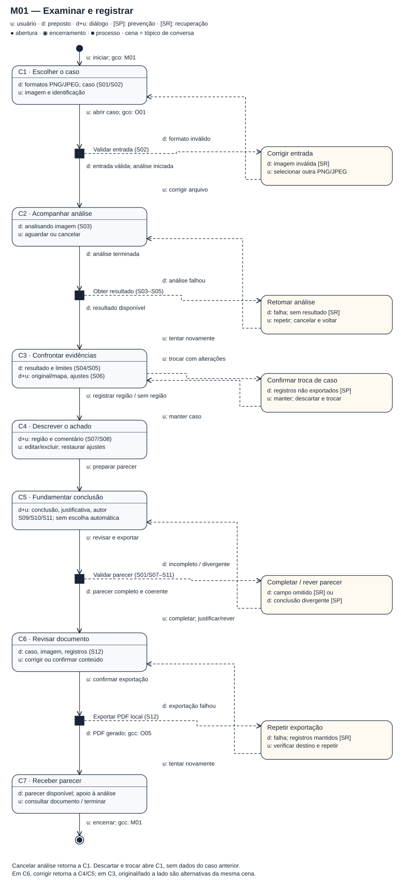
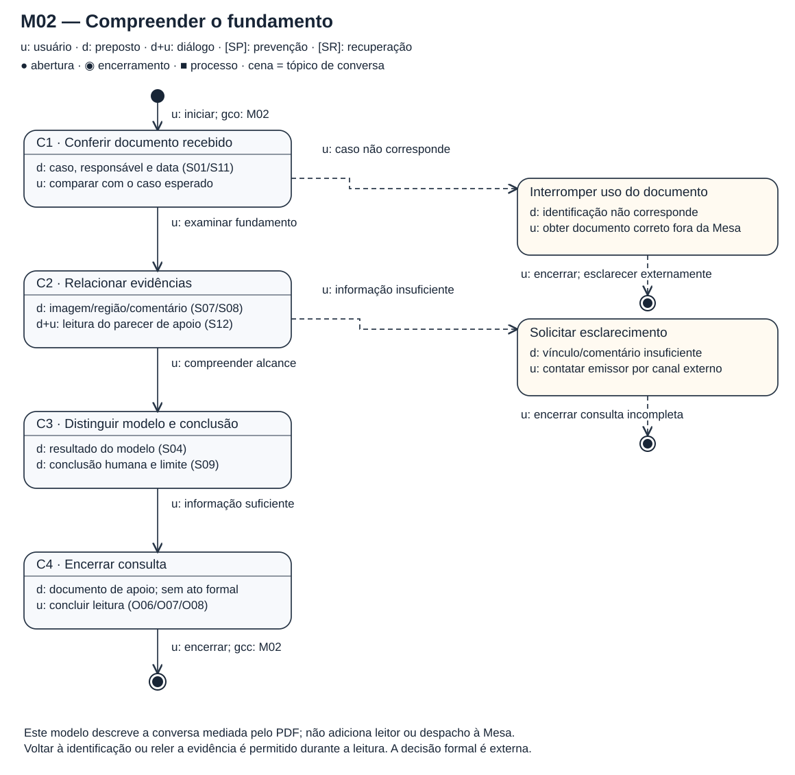
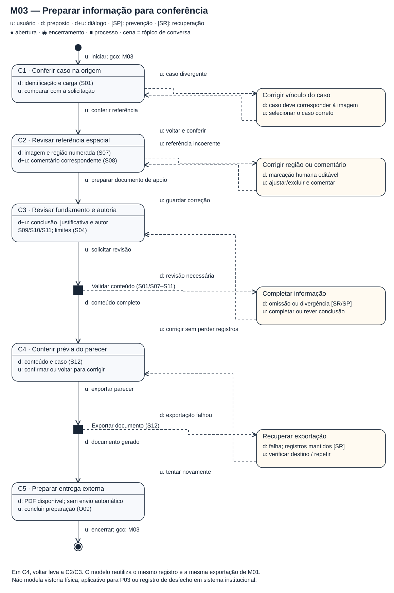

# Entrega 10 — MoLIC

**Data:** 11/11/2026 
**Status:** 🟩 concluída 
**Responsabilidade:** uma solução por integrante, consolidada na Mesa de inspeção.

Os modelos derivam de [CI01–CI03, O01–O09 e S01–S12](09_modelo_conceitual.md). Modelam a conversa necessária para usar o apoio visual do TCC, sem detalhar o algoritmo nem representar autorização de desembaraço.

**Notação da aula 10:** círculo preenchido = abertura; círculo duplo = encerramento; retângulo arredondado = cena, com tópico e diálogos; quadrado preenchido = processo do sistema. `u:` identifica fala do usuário; `d:`, do preposto; `d+u:`, diálogo sobre um signo. `[SP]` indica prevenção de ruptura e `[SR]`, recuperação. Setas tracejadas destacam caminhos de ruptura. `gco/gcc` marcam abertura/fechamento de conversa sobre uma meta. Não há menu ubíquo: o recorte trabalha um caso por vez.

## M01 — Examinar e registrar

**Responsável:** Kawan Mark Geronimo Da Silva — 22.222.010-5. 
**Origem:** CI01, P01, T01–T03; **objetivos:** O01–O05/O08; **signos:** S01–S12.

[Fonte SVG editável / ampliar](../assets/10_molic/molic_m01.svg).

**Caminho principal:** escolher imagem e conferir caso → acompanhar análise → confrontar original e mapa → registrar região comentada → informar conclusão, justificativa e responsável → revisar → exportar o parecer local. É possível concluir “Sem ressalvas na imagem” sem marcar região; “Suspeita apontada” exige ao menos uma região comentada.

| Alternativa/ruptura | Comunicação e recuperação |
|---|---|
| Arquivo inválido, em P1 | Informa formatos aceitos e retorna à escolha de imagem; arquivo corrompido exige nova cópia na origem. |
| Falha de análise, em P2 | Explica que não há resultado; permite repetir ou cancelar. Cancelar retorna a C1. |
| Comparação, em C3 | Ocultar mapa, lado a lado e restaurar ajustes preservam a radiografia original. |
| Troca com alterações, em C3 | Confirma descarte. Manter retorna a C3; descartar abre C1 com outro caso. |
| Dados incompletos/divergência, em P3 | Identifica o campo e preserva os demais dados; conclusão contrária ao modelo pede revisão e confirmação, sem obrigar concordância. |
| Correção ou falha de PDF, em C6/P4 | Voltar permite corrigir achado/conclusão; falha mantém registros e permite verificar destino e repetir. |

## M02 — Compreender o fundamento do parecer

**Responsável:** Gabriel Albertini Pinheiro — 22.122.094-8. 
**Origem:** CI02, P02, T04–T06 na parte de consulta; **objetivos:** O06/O02/O07/O08; **signos:** S01/S04/S07–S12.

[Fonte SVG editável / ampliar](../assets/10_molic/molic_m02.svg).

**Caminho principal:** conferir caso, autoria e data → relacionar imagem, região e comentário → distinguir resultado do modelo e conclusão humana → encerrar a consulta. Aqui o parecer é a mensagem do preposto; o modelo não cria uma tela de despacho. A navegação de leitura será a do leitor de PDF utilizado.

| Alternativa/ruptura | Comunicação e recuperação |
|---|---|
| Caso diferente, em C1 | A identificação permite reconhecer a divergência. Interromper o uso e solicitar o documento correto ao emissor, fora da Mesa. |
| Informação insuficiente, em C2 | Região/comentário e limites explícitos permitem reconhecer a lacuna; encerrar e pedir esclarecimento pelo canal externo. |
| Releitura | Voltar à identificação ou à evidência antes de concluir, sem alterar o documento. |

A decisão formal e a comunicação institucional ficam fora desta conversa. Um documento incompleto não é tratado como evidência suficiente por padrão.

## M03 — Preparar informação para conferência

**Responsável:** Alexandre Domiciano Pierri — 22.125.061-6. 
**Origem:** CI03, P01/P02; CP03 e T07–T09 apenas como contexto exploratório; **objetivos:** O09/O02/O07/O08; **signos:** S01/S04/S07–S12.

[Fonte SVG editável / ampliar](../assets/10_molic/molic_m03.svg).

**Caminho principal:** conferir o caso → revisar referência espacial e comentário → revisar conclusão e autoria → conferir prévia → exportar o documento para entrega externa. P03 permanece destinatário/stakeholder; a vistoria física não é executada na interface.

| Alternativa/ruptura | Comunicação e recuperação |
|---|---|
| Caso ou referência divergente, em C1/C2 | Retornar à conferência; ajustar/excluir marcação ou editar comentário antes de emitir. |
| Omissão ou conclusão divergente, em P1 | Completar os campos ou rever/confirmar a conclusão, preservando o registro. |
| Correção na prévia, em C4 | Voltar a C2/C3, conferir novamente e só então exportar. |
| Falha de exportação, em P2 | Informar falha e manter dados; repetir após conferir o destino local. |

## Consolidação e preparação das telas

| Objetivo | Modelo | Decisão de consolidação / estados previstos |
|---|---|---|
| O01/O03 — exame e comparação | M01 | F01 entrada; F02 processamento; F03 sobreposição; F04 original; F05 lado a lado. |
| O02 — conferir caso | M01/M02/M03 | Identificação persistente; F01 e F08/F12. Uma fonte de dados para o caso. |
| O04 — registrar | M01/M03 | F06 região/comentário; editar e excluir. |
| O05 — concluir/exportar | M01/M03 | F07 conclusão; F08 prévia; F09 sucesso. Mesma exportação nos dois modelos. |
| O06/O07 — compreender fundamento | M02/M03 | F08/F12: caso, imagem numerada, comentário e conclusão no parecer. F12 representa o PDF, não novo sistema. |
| O08 — reconhecer limites | Todos | Explicação junto ao resultado e no parecer; F10 erros; F11 confirmações. Pedido de esclarecimento externo. |
| O09 — preparar para conferência | M03 | Reutiliza F06–F09; sem aplicativo para campo ou envio institucional. |

F10 será documentado em variantes de entrada, análise, preenchimento e exportação; F11, em variantes de descarte e divergência. Os IDs são a referência para a Entrega 11. Dashboard, histórico, filtros, administração e permissões não têm tarefa no recorte e não foram acrescentados.

## Checklist de modelagem — M01, M02 e M03

- [x] Um modelo identificado por integrante, com abertura e encerramento.
- [x] Cenas representam tópicos; falas distinguem usuário e preposto.
- [x] Processos do sistema e seus resultados usam a notação da aula.
- [x] Caminhos principais, alternativas e rupturas têm recuperação ou saída explícita.
- [x] Objetivos e signos correspondem à Entrega 9; limites externos estão indicados.
- [x] Acessos ubíquos e funcionalidades sem justificativa foram evitados.
- [x] Diagramas possuem legenda, fonte editável e link para ampliação.
- [x] Cobertura consolidada e estados para o protótipo foram definidos.

**Referência:** aula 10, *MoLIC*, partes A (abertura/encerramento, cenas, processos e rupturas) e B (SP/SR e gco/gcc); *Estilos de Interface e Conversão MoLIC para protótipo de telas*, págs. 14–20. Cópias locais em `FEI_CC8122_IHC/10 - Tópico 10/`.
