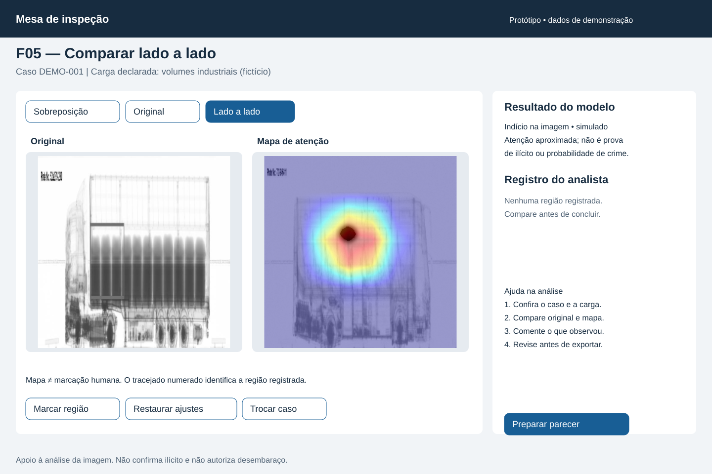
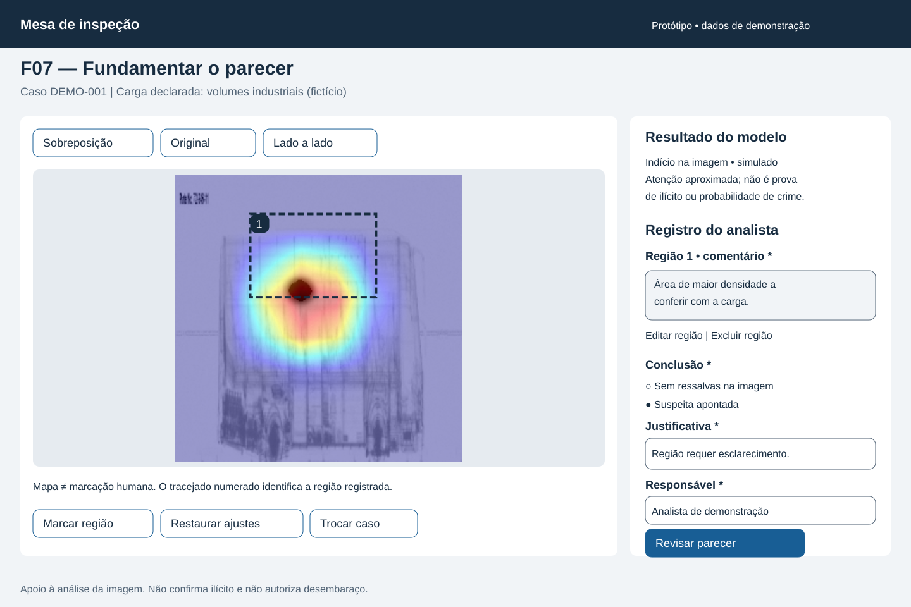
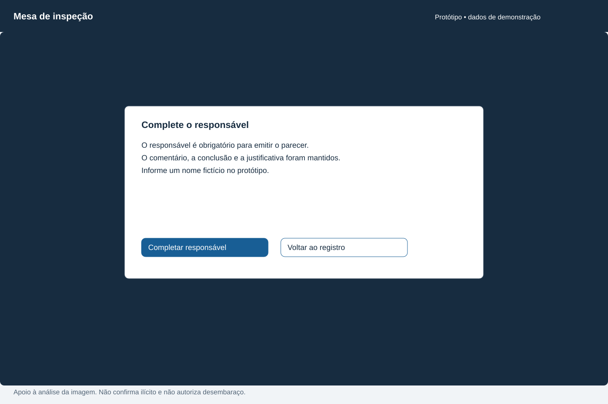

# Entrega 11 — Protótipo no Figma

**Data:** 11/11/2026 
**Status:** 🟨 pranchas e conexões preparadas; montagem/publicação no Figma pendentes por decisão da equipe. 
**Responsabilidade:** protótipo integrado — Kawan, Gabriel e Alexandre.

Materializar a [Entrega 10](10_molic.md) na Mesa de inspeção. Foram preparadas **16 pranchas SVG editáveis**, com os mesmos signos e fluxos. Elas não são screenshots do Figma nem um protótipo já navegável.

**Protótipo/arquivo Figma:** pendente. 
**Permissão em janela anônima:** ainda não verificada. A equipe solicitou deixar essa etapa pendente; nenhum link foi inventado.

## Cobertura MoLIC → telas

| MoLIC / objetivo | Fluxo previsto | Erro e recuperação | Responsável pelo fluxo |
|---|---|---|---|
| M01 / O01–O05/O08 | F01 → F02 → F03/F04/F05 → F06 → F07 → F08 → F09 | F10A–D; F11A–B | Kawan — 22.222.010-5 |
| M02 / O06/O02/O07/O08 | F09 → F12; ler caso, autoria, região, comentário e conclusão | Parecer orienta interromper uso e esclarecer divergência externamente | Gabriel — 22.122.094-8 |
| M03 / O09/O02/O07/O08 | F06 → F07 → F08 → F09; entrega externa | Voltar à edição; F10C/D; F11B | Alexandre — 22.125.061-6 |

## Catálogo de telas e estados

Cada link abre a fonte SVG editável. F10/F11 são famílias de estados, não telas extras de negócio.

| ID / prancha | Objetivo e signos | Origem |
|---|---|---|
| [F01 — entrada](../assets/11_figma/f01.svg) | Conferir caso, carga e imagem; S01/S02. Estado vazio e formatos aceitos. | M01/C1 |
| [F02 — processamento](../assets/11_figma/f02.svg) | Perceber espera e poder cancelar; S03. | M01/C2 |
| [F03 — sobreposição](../assets/11_figma/f03.svg) | Examinar mapa e limites; S04–S06. | M01/C3 |
| [F04 — original](../assets/11_figma/f04.svg) | Ocultar mapa e preservar contexto; S02/S06. | M01/C3 |
| [F05 — lado a lado](../assets/11_figma/f05.svg) | Comparar original/mapa sem manter tecla pressionada; S02/S05/S06. | M01/C3 |
| [F06 — região/comentário](../assets/11_figma/f06.svg) | Relacionar marcação humana e observação; S07/S08. | M01/C4; M03/C2 |
| [F07 — conclusão](../assets/11_figma/f07.svg) | Informar conclusão, justificativa e autoria; S09–S11. | M01/C5; M03/C3 |
| [F08 — revisão](../assets/11_figma/f08.svg) | Conferir documento e voltar para corrigir; S01/S07–S12. | M01/C6; M03/C4 |
| [F09 — sucesso](../assets/11_figma/f09.svg) | Receber confirmação da exportação local; S12. | M01/C7; M03/C5 |
| [F10A — entrada inválida](../assets/11_figma/f10a.svg) | Explicar formato/cópia e selecionar outro arquivo; S02. | M01/P1 |
| [F10B — falha de análise](../assets/11_figma/f10b.svg) | Distinguir falha e ausência de indício; repetir/cancelar; S03. | M01/P2 |
| [F10C — omissão](../assets/11_figma/f10c.svg) | Indicar responsável ausente e manter dados; S11. Mesma regra prevista para demais campos obrigatórios. | M01/P3; M03/P1 |
| [F10D — falha de exportação](../assets/11_figma/f10d.svg) | Explicar correção do destino e repetição sem perder dados; S12. | M01/P4; M03/P2 |
| [F11A — descarte](../assets/11_figma/f11a.svg) | Confirmar troca com registro não exportado; S01/S07–S11. | M01/C3 |
| [F11B — divergência](../assets/11_figma/f11b.svg) | Rever ou confirmar conclusão distinta do modelo; S04/S09/S10. | M01/P3; M03/P1 |
| [F12 — parecer](../assets/11_figma/f12.svg) | Relacionar caso, evidência e fundamento; indicar limites e esclarecimento externo; S01/S04/S07–S12. | M02/C1–C4 |

### Pranchas representativas

## Conexões a montar no Figma

| Ação | Destino / comportamento previsto |
|---|---|
| F01 abrir caso | Validar arquivo e identificação; F10A em falha; F02 em sucesso. |
| F02 aguardar / cancelar | Após 3 segundos, F03; cancelar retorna a F01. Variante de falha leva a F10B. |
| F03–F05 selecionar visualização | Alternar entre as três, mantendo região e ajustes. Restaurar retorna aos ajustes neutros. |
| Marcar/editar/excluir região | F06; seleção retangular limitada à imagem. Excluir devolve estado sem região; editar mantém comentário. |
| Preparar parecer | F07; não preencher conclusão automaticamente. |
| Revisar parecer | Sem campos exigidos, indicar omissão (F10C); conclusão divergente, F11B; válido, F08. Suspeita exige região comentada. |
| F08 voltar / exportar | Voltar a F06/F07 preservando dados; exportar leva a F09 ou F10D na variante de falha. |
| F10A/B/C/D recuperar | A→F01; B→F02 ou F01; C→F07 com foco no campo; D→F08 e repetir. |
| Trocar caso com alterações | F11A; manter retorna ao estado anterior; descartar limpa registro e abre F01. |
| F11B rever / confirmar | Rever volta a F07; confirmar mantém justificativa e segue a F08. |
| F09 consultar documento | F12 como representação de leitura. PDF final precisa preservar o conteúdo e permitir leitura ampliada no leitor. |

A importação dos SVGs não cria esses comportamentos. Ainda será necessário montar controles/variantes, ligações e entradas editáveis no Figma e percorrer os fluxos antes da inspeção final. F12 representa o documento de apoio, sem leitor próprio ou comando de despacho.

## Sistema visual e acessibilidade básica

| Elemento | Regra | Motivo |
|---|---|---|
| Tipografia | Arial; corpo 18 px, apoio 16 px, títulos 22/30 px. | Hierarquia e leitura no computador. |
| Cores | Texto `#172c40`, apoio `#526476`, ação `#185e95`; superfícies brancas/cinza claro. | Contraste e separação de controles. |
| Componentes | Botões com 44 px de altura; rótulos explícitos; campos obrigatórios com asterisco. | Alvos consistentes e reconhecimento. |
| Feedback | Estado textual, erro localizado e orientação de recuperação; confirmação de descarte/divergência. | Informação não depende só de cor. |
| Imagem | Mapa identificado; marca humana numerada e tracejada; original acessível por controle persistente. | Distinguir atenção automática e anotação. |

As combinações de texto das pranchas foram conferidas pelo cálculo de contraste (mínimo 4,5:1). Isso não comprova conformidade integral com WCAG. Foco, ordem de tabulação, acionamento por teclado, ampliação e nomes acessíveis precisam ser verificados no protótipo/implementação; o SVG estático não os valida. Radiografia exige descrição contextual e alternativa textual das regiões no parecer.

**Simulação:** identificação, carga, responsável e parecer são fictícios; os arquivos visuais são ilustrações já presentes no TCC, com [origem registrada](../assets/11_figma/README.md). Espera, resultado, falhas e exportação ainda são comportamentos previstos, sem integração ao modelo ou sistema institucional.

## Checklist

- [ ] Arquivo e protótipo publicados no Figma, acessíveis em janela anônima.
- [x] Pranchas representativas e fontes editáveis no repositório.
- [x] Cobertura dos três MoLICs especificada, incluindo erro/recuperação.
- [x] Terminologia e signos coerentes com a Entrega 9.
- [x] Regras de componentes e feedback consistentes.
- [ ] Fluxos críticos conectados e testados, sem links mortos.
- [ ] Entradas, validações, edição e preservação dos dados verificadas no protótipo navegável.
- [x] Vazio, processamento, erro, confirmação e sucesso preparados.
- [x] Relatório justificado por R03; sem dashboard, histórico ou administração sem tarefa.
- [x] Limites e elementos simulados explicitados.

**Referência:** aula 11, primeira versão da interface a partir do protótipo em papel; aula 10, *Conversão MoLIC para protótipo de telas*, págs. 14–20. A conclusão da entrega depende da montagem e publicação no Figma.
