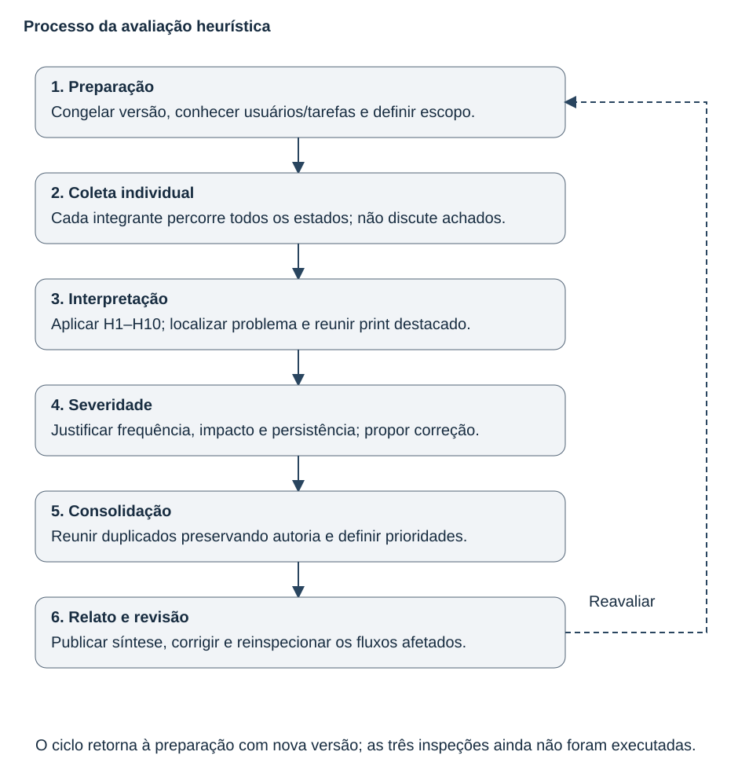

# Entrega 13 — Avaliação heurística

**Data:** 11/11/2026 
**Status:** 🟨 processo e fichas preparados; três inspeções individuais e consolidação pendentes. 
**Responsabilidade:** uma inspeção completa por integrante, seguida de síntese da equipe.

A inspeção avalia a interação da Mesa de inspeção, não o desempenho científico do modelo. Conforme a aula 13, cada pessoa primeiro examina a interface individualmente; depois a equipe consolida os problemas. Preparar fichas não equivale a executar essas inspeções.

## 1. Processo / fluxograma

[Fonte SVG editável](../assets/13_heuristica/fluxograma_inspecao.svg). A revisão devolve os fluxos afetados à inspeção, mantendo a versão de origem de cada achado.

## 2. Escopo e procedimento

| Item | Definição |
|---|---|
| Versão | Base visual: [pranchas da Entrega 11](11_figma.md). Inspeção final depende do Figma navegável; registrar URL/node, commit e data nas fichas. |
| Telas/estados | F01–F09, F10A/B/C/D, F11A/B e F12: 16 pranchas. Incluir leitura do documento, vazio, processamento, erro, retorno, confirmação e sucesso. |
| Fluxos | M01 exame/registro; M02 compreensão do parecer; M03 preparação para conferência. |
| Dispositivo | Computador com teclado/mouse; referência 1920 × 1080. Registrar configuração efetiva. |
| Fora do recorte | Dashboard, filtros, histórico, CRUD, permissões e decisão institucional não existem na solução. Não inventar testes para esses padrões. |

Cada integrante faz uma passagem de familiarização e outra verificando H1–H10 em **todos** os estados. Registra ação, localização e print destacado por problema; depois justifica severidade e recomenda correção. Não discutir achados antes de concluir as três fichas. Ausência de observação não pode ser preenchida como “sem violação”.

| Severidade | Significado |
|---:|---|
| 0 | Não é problema de usabilidade. |
| 1 | Cosmético; corrigir se houver tempo. |
| 2 | Menor, com baixa prioridade. |
| 3 | Maior; alta prioridade. |
| 4 | Impede disponibilização até a correção. |

A justificativa considera frequência provável, impacto sobre a tarefa e persistência, conforme págs. 11–14 da aula. Uma inspeção não demonstra a frequência real de erro de usuários.

## 3. Registros individuais

| Avaliador / responsável | Ficha com matriz H1–H10 e declaração de violações | Situação |
|---|---|---|
| A01 — Kawan Mark Geronimo Da Silva, 22.222.010-5 | [Inspeção A01](../instrumentos/13_heuristica/a01.md) | Não realizada. |
| A02 — Gabriel Albertini Pinheiro, 22.122.094-8 | [Inspeção A02](../instrumentos/13_heuristica/a02.md) | Não realizada. |
| A03 — Alexandre Domiciano Pierri, 22.125.061-6 | [Inspeção A03](../instrumentos/13_heuristica/a03.md) | Não realizada. |

Cada ficha inclui cobertura, registro de violações com evidência/severidade/recomendação e boas práticas para heurísticas não violadas. Não há achados atribuídos a integrantes sem que tenham inspecionado. O arquivo ilustrativo antigo `v01.svg` não foi utilizado como evidência.

## 4. Uso das heurísticas — exercício didático

Os slides de fechamento da aula 14 pedem **dez exemplos**, um para cada heurística. A tabela abaixo mostra decisões presentes nas pranchas. Não é resultado das inspeções e não significa que cada heurística esteja integralmente atendida.

| Heurística de Nielsen | Exemplo no projeto | Evidência e propósito |
|---|---|---|
| H1 — Visibilidade do estado | “Analisando imagem” separado de sucesso e falha. | [F02](../assets/11_figma/f02.svg), [F10B](../assets/11_figma/f10b.svg): evitar interpretar falta de resultado como normalidade. |
| H2 — Correspondência com o mundo real | Caso, carga declarada, região e parecer, sem código técnico como mensagem principal. | [F08](../assets/11_figma/f08.svg): comunicar o fundamento da observação. Vocabulário ainda requer validação com o perfil. |
| H3 — Controle e liberdade | Cancelar análise, voltar para corrigir e manter caso diante de descarte. | [F02](../assets/11_figma/f02.svg), [F11A](../assets/11_figma/f11a.svg): saída explícita. |
| H4 — Consistência e padrões | Mesmos rótulos para original, sobreposição e lado a lado; posição persistente. | [F03](../assets/11_figma/f03.svg), [F05](../assets/11_figma/f05.svg): reconhecer ações equivalentes. |
| H5 — Prevenção de erros | Responsável obrigatório e confirmação de conclusão divergente. | [F10C](../assets/11_figma/f10c.svg), [F11B](../assets/11_figma/f11b.svg): conferir antes da emissão. |
| H6 — Reconhecimento em vez de memorização | Caso, marcação numerada e comentário aparecem juntos na revisão. | [F08](../assets/11_figma/f08.svg): relacionar evidência sem depender da lembrança. |
| H7 — Flexibilidade e eficiência | Alternativas original/sobreposição/lado a lado e restauração dos ajustes. | [F05](../assets/11_figma/f05.svg): adequar a comparação; eficiência ainda será medida. |
| H8 — Estética e minimalismo | Radiografia ocupa o painel principal; registro e resultado agrupados à direita. | [F06](../assets/11_figma/f06.svg): foco na tarefa, sem indicadores ou cadastros sem objetivo. |
| H9 — Reconhecimento e recuperação de erros | Mensagem explica falha de exportação, preservação dos registros e verificação do destino. | [F10D](../assets/11_figma/f10d.svg): orientar a próxima ação. |
| H10 — Ajuda e documentação | Passos curtos junto à análise e limites do mapa no painel do resultado. | [F03](../assets/11_figma/f03.svg): ajuda contextual; não depende de manual externo. |

## 5. Consolidação e plano de melhoria

Após as três inspeções, agrupar problemas pela mesma causa/tela, preservando todos os IDs e avaliadores. Resolver diferenças de severidade com justificativa, sem calcular uma média automática. Só então preencher:

| ID consolidado | IDs individuais / avaliadores | Heurística / tela | Problema e evidência | Severidade final / motivo | Prioridade / responsável / situação |
|---|---|---|---|---|---|

**Síntese atual:** ainda não há contagem de problemas por heurística ou severidade, nem conclusão de que inexistam problemas. A tabela vazia indica coleta pendente. Depois da coleta, registrar totais, padrões recorrentes e os bloqueios encontrados. Severidade 4 deve ser corrigida e verificada antes dos testes; problemas 3 que comprometam UT01–UT03 também bloqueiam a respectiva tarefa. Demais ajustes seguem impacto/recorrência. Cada correção precisa citar achado, versão e tela na rastreabilidade.

## Checklist

- [x] Escopo, processo iterativo, procedimento individual e escala definidos.
- [x] Ficha completa com H1–H10 preparada para cada integrante.
- [x] Estados de erro, processamento, relatório e retorno incluídos no escopo.
- [x] Exercício didático separado das violações, com dez exemplos do projeto.
- [x] Critérios de evidência, severidade, recomendação e consolidação definidos.
- [ ] Cada integrante executou sua inspeção completa na versão navegável.
- [ ] Matrizes preenchidas com resultados e boas práticas observadas.
- [ ] Violações reais registradas com print destacado, contexto e justificativa.
- [ ] Duplicados consolidados; totais e correções prioritárias definidos.

**Referências:** aula 13, *Avaliação de Usabilidade por Inspeções*, págs. 8–16; aula 14, *Teste de Usabilidade com Observação do Usuário*, pág. 16; [plano DECIDE](12_planejamento_avaliacao.md). Para concluir, a equipe precisa realizar as três inspeções; revisão automatizada das pranchas não as substitui.
