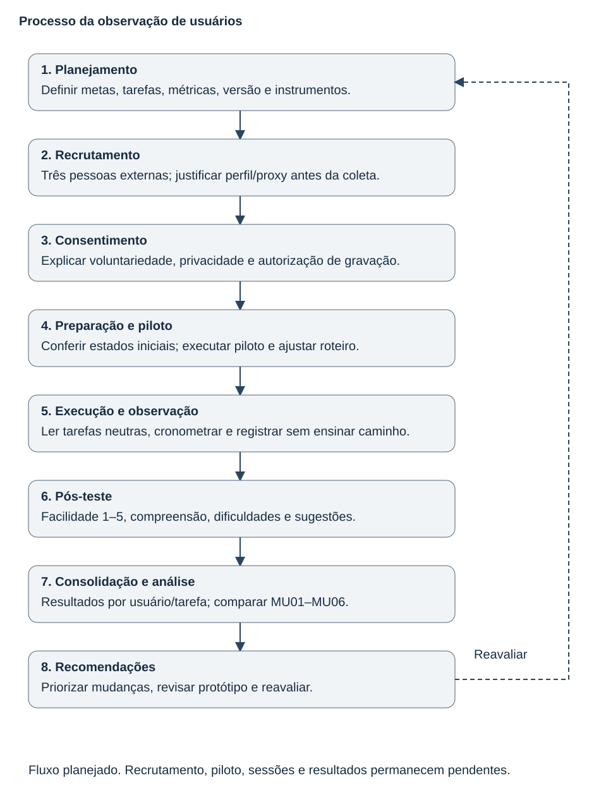

# Entrega 14 — Observação de usuários

**Data:** 11/11/2026 
**Status:** 🟨 preparação concluída; piloto, três sessões e relatório de resultados pendentes. 
**Responsáveis:** Kawan Mark Geronimo Da Silva, Gabriel Albertini Pinheiro e Alexandre Domiciano Pierri.

Aplicar o [plano DECIDE](12_planejamento_avaliacao.md) à Mesa de inspeção. A aula exige observar uso real e registrar a interação; a pesquisa documental da Entrega 7 não substitui essa etapa. Não há participantes, gravações ou métricas coletados nesta versão.

## A. Fluxograma do processo

[Fonte SVG editável](../assets/14_testes/fluxograma_avaliacao.svg).

## B. Preparação e execução

### 1. Objetivos e versão

Verificar comparação (MU01), entendimento dos limites da IA (MU02), parecer completo (MU03), tempo de registro (MU04), recuperação (MU05) e facilidade (MU06). O teste avalia a interação, não a validade científica do modelo.

**Versão a avaliar:** protótipo navegável derivado de F01–F12, ainda pendente de montagem no Figma. Antes do piloto, registrar URL/node, commit, data e dispositivo. As pranchas estáticas não permitem medir a execução das tarefas e não serão apresentadas como teste concluído.

### 2. Participantes e recrutamento

São necessários **três participantes externos**, pois a equipe tem três integrantes. As linhas abaixo são vagas planejadas, não pessoas já recrutadas.

| Vaga | Perfil a recrutar / justificativa exigida | Responsável |
|---|---|---|
| U01 | Profissional ligado à inspeção/análise de imagens; ou proxy com experiência pertinente registrada. | Kawan |
| U02 | Profissional que lê relatórios para tomar decisões; ou proxy com essa experiência registrada. | Gabriel |
| U03 | Profissional ligado à preparação/conferência de evidências; ou proxy com experiência pertinente registrada. | Alexandre |

Na ausência de acesso ao público ideal, a alternativa é recrutar adultos externos com experiência em análise de imagens/dados ou leitura de relatórios. Antes das sessões, justificar a relação de cada proxy com as tarefas e validar sua adequação com o professor. Não basta ser colega disponível; integrantes e autores das telas não entram na amostra final. Os resultados com proxies tratam apenas de compreensão e interação no cenário simulado, sem validar rotina aduaneira ou decisões de especialistas.

### 3. Consentimento e privacidade

Usar o [termo preparado](../instrumentos/12_avaliacao/consentimento.md) antes da sessão. Gravação prevista de tela e áudio, sem webcam, somente mediante autorização específica. Se houver recusa à gravação, respeitar a escolha e registrar a limitação da evidência; não produzir vídeo sem consentimento.

Guardar consentimentos e registros brutos em pasta privada da equipe, acessível ao professor quando necessário. Publicar apenas resumos anônimos U01–U03. O vídeo acadêmico terá link restrito ao professor, nunca dados pessoais expostos no Git. Descartar os registros brutos em até 90 dias após a sessão. Usar caso/carga fictícios e responsável fictício no protótipo; fechar notificações e outras janelas.

### 4. Piloto

**Situação:** não realizado. Um integrante pode atuar como participante apenas no piloto. Validar instruções, duração, estados iniciais, resets, variantes de falha, cronômetro e gravação. Registrar data, versão, defeitos encontrados e mudanças antes de iniciar a coleta final; mudanças posteriores exigem identificar quais participantes usaram cada versão.

### 5. Tarefas

| ID | Instrução resumida — ler a versão integral no roteiro | Sucesso / medidas | Ligação |
|---|---|---|---|
| UT01 | Examinar a área indicada, comparar com a imagem sem destaque e explicar o alcance do resultado. | Comparação concluída sem ajuda; distingue indício de prova e de autorização. Tempo, erros, ajudas e facilidade. | T01/T02; O02/O03/O08; M01; F03–F05. |
| UT02 | Registrar a região/observação e preparar parecer para outra pessoa com conclusão e autoria fictícia. | Caso correto, região comentada, conclusão, justificativa e responsável; mediana ≤ 180 s sem ajuda. | T03; consulta de T05/T06; O04–O07/O09; M01/M03; F06–F09/F12. |
| UT03 | Resolver a falta do responsável e eventual falha, preservando o registro ao emitir o parecer. | Bloqueia emissão incompleta; recupera omissão e falha de exportação sem perder dados. | O05/O08; M01/M03; F07/F10C/D/F08/F09. |

Limite de 5 minutos por tarefa. Estados iniciais são independentes: caso pronto em UT01/UT02; registro sem responsável e primeira exportação válida com falha simulada em UT03. Não depender do sucesso anterior para aplicar a próxima tarefa. O [roteiro](../instrumentos/12_avaliacao/roteiro.md) traz instruções neutras e condições iguais para todos.

### 6. Protocolo do moderador

1. Receber a pessoa, explicar que o produto está sendo avaliado e obter consentimento.
2. Registrar perfil mínimo e condição profissional/proxy; permitir exploração inicial padronizada.
3. Preparar estado inicial, ler a instrução e iniciar o cronômetro.
4. Observar sem ensinar o caminho; separar pedidos de ajuda e intervenções. Não exigir fala contínua durante a medição.
5. Registrar sucesso, erros, ajudas e tempo. Encerrar em desistência ou limite, sem penalizar a pessoa.
6. Perguntar facilidade de 1 a 5 e motivo; aplicar pergunta de compreensão após UT01.
7. Fazer pós-teste, agradecer, salvar registros anonimizados e verificar autorizações antes de compartilhar evidências.

**Materiais:** [perfil/pós-teste](../instrumentos/12_avaliacao/questionarios.md), [planilha de observação](../instrumentos/12_avaliacao/observacoes.csv) e fichas [U01](../instrumentos/14_observacao/u01.md), [U02](../instrumentos/14_observacao/u02.md), [U03](../instrumentos/14_observacao/u03.md).

### 7. Sessão remota e vídeo pedidos na aula

Se a aplicação for remota, testar conexão, compartilhamento, zoom e áudio antes; mostrar apenas a janela do protótipo, silenciar notificações e combinar como interromper. Guardar interrupções técnicas separadamente do desempenho. O vídeo deve ilustrar instrução, uso e resultados, com IDs anônimos e acesso autorizado ao professor.

A aula também solicita assistir à palestra de Felipe Melo no Moodle. A cópia local contém a indicação e links de vídeos, mas não sua transcrição; não foi possível recuperar o conteúdo desses vídeos nesta preparação. As recomendações acima vêm dos slides de planejamento/observação, não foram atribuídas ao palestrante. **Pendente:** assistir à palestra e complementar as recomendações específicas antes da sessão remota.

**Link do vídeo do teste:** ainda não existe; depende da aplicação e das autorizações.

## C. Resultados por participante

As fichas individuais estão preparadas para registrar UT01–UT03, incluindo grau de sucesso, erros e tipos, ajudas, tempo, facilidade e evidência. **Nenhuma foi aplicada.** Campo vazio significa dado não coletado, não valor zero, falha ou satisfação neutra. Não há gravação ou resposta pós-teste a relatar.

## D. Consolidação por tarefa

| Tarefa / meta | Sucesso | Tempo típico | Erros / ajudas | Facilidade | Meta atendida? |
|---|---|---|---|---|---|
| UT01 / MU01–MU02 | Não coletado | Não coletado | Não coletado | Não coletada | Não avaliada |
| UT02 / MU03–MU04 | Não coletado | Não coletado | Não coletado | Não coletada | Não avaliada |
| UT03 / MU05 | Não coletado | Não coletado | Não coletado | Não coletada | Não avaliada |

MU06 considera a mediana de facilidade de UT01/UT02. Apresentar contagens `n/3`, mediana, falhas e limitações conforme o plano. Não calcular médias ou taxas antes da coleta.

## E. Achados e recomendações

Preencher somente com observações registradas; relacionar quantidade de ocorrências, comportamento/fala, impacto e artefato a revisar.

| ID | Achado / tarefa | Evidência quantitativa e qualitativa | Impacto | Recomendação / artefato |
|---|---|---|---|---|

Não há AU registrado. Recomendações dependem de evidência; as decisões prévias de design não serão apresentadas como descobertas de usuários.

## F. Comparação com a heurística

| Problema | ID da heurística | Evidência dos usuários | Aprendizado / decisão |
|---|---|---|---|

Comparação pendente das duas coletas. Preservar problemas exclusivos de cada método, sem inferir que uma ausência de relato prova que não há problema.

## G. Conclusão e pendências reais

Ainda não é possível afirmar quais metas foram atingidas, quais problemas foram recorrentes, o que surpreendeu a equipe ou quais mudanças têm prioridade empírica. O relatório final deverá responder esses pontos com os registros individuais e comparar inspeção/observação.

Para concluir: montar o Figma; realizar as três inspeções; recrutar e justificar os participantes; obter consentimentos; executar piloto e sessões; produzir vídeo autorizado; consolidar métricas, achados e revisões. Participantes proxy, amostra pequena, contexto simulado e ausência de integração limitam qualquer conclusão à versão e às condições testadas.

## Checklist

- [x] Fluxograma, preparação, tarefas e protocolo documentados.
- [x] Três vagas externas e responsabilidades definidas.
- [x] Alternativa de proxies e suas limitações explicitadas previamente.
- [x] Avaliação de interação separada da avaliação técnica do TCC.
- [x] Instrumentos, critérios, anonimização e autorização de gravação preparados.
- [ ] Protótipo navegável e inspeções concluídos antes da aplicação.
- [ ] Três participantes externos recrutados, adequados e consentidos.
- [ ] Piloto realizado e alterações registradas.
- [ ] Sessões observadas sem ensino do caminho, com métricas por pessoa/tarefa.
- [ ] Palestra conferida e vídeo autorizado do teste disponível ao professor.
- [ ] Consolidação, comparação com heurística e conclusão sustentadas por dados.
- [ ] Achados geraram recomendações e atualização da rastreabilidade.

**Referências:** aula 14, *Teste de Usabilidade com Observação do Usuário*, págs. 4–16; *Plano de Avaliação de Usabilidade com Observação*, págs. 2–6; modelo de consentimento 01; atividade remota no conteúdo do tópico. Cópias locais em `FEI_CC8122_IHC/14 - Tópico 14/`.
